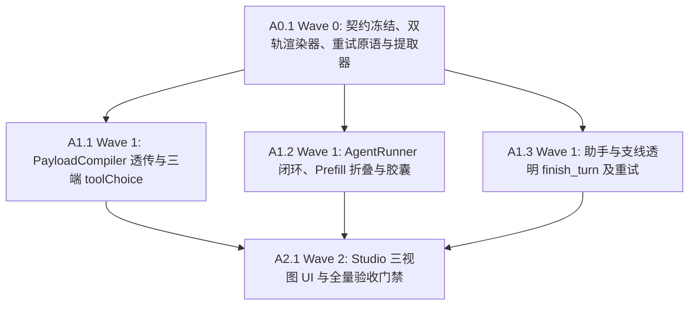

# ST-Agentic 抗路由降智、强约束工具闭环与自定义 JSON 消息架构计划

> 本文档定义 `ST-Agentic` 针对**上游动态降级路由（如静默切往 `3.1-flash-lite` 等弱模型）与动态提示词注入干扰导致的多轮工具链半途罢工、空转死循环、初始闲聊误判与单拍断流/空包问题**的完整工程防御架构与 Swarm 并行实施任务板。所有设计严格遵守 [AGENTS.md](../AGENTS.md)、[ARCHITECTURE.md](./ARCHITECTURE.md) 定义的四大系统不变量及公开标准 API 规范（绝不采用伪造内部系统头或绕过平台校验的越界手段）。

---

## §1 背景痛点、核心设计决策与四大架构红线对齐

### 1.1 四大故障根因剖析

核查当前代码基线，多轮 Agent 与辅助助手在面对上游静默动态路由与提示词注入干扰时存在四处结构性缺口：

1. **缺少初始工具调用上下文，首轮易误判为普通闲聊且 `PromptBlock` 缺 EJS 支持**：
   - `PromptBlock`（[settings.ts](../src/core/types/settings.ts#L82-L90)）目前仅支持 `'system' | 'user' | 'assistant'` 纯文本角色，无法直接在预设前缀中构造包含真实 `assistant(tool_calls) -> tool` 调用示范的上下文，导致部分路由探测策略把首轮对话判定为普通聊天并切往弱模型；
   - `ContextAssembler`（[context-assembler.ts](../src/core/context/context-assembler.ts#L488-L505)）、`AssistantRunner`（[assistant-runner.ts](../src/core/assistant/assistant-runner.ts#L2743-L2757)）与 `SideGenService`（[sidegen-service.ts](../src/core/sidegen/sidegen-service.ts#L977-L991)）目前仅对积木执行同步的 `substituteMacros`，尚未接入异步 `HostBridge.evaluateOptionalEjs`（仅 `LoreReadEvaluator` 与 `@@evaluate_ejs` 触发器接入了 EJS）。
2. **`PayloadCompiler` 未暴露受控工具选择，弱模型在 `AUTO` 出口下半途纯文本罢工**：
   - [payload-compiler.ts](../src/core/llm/payload-compiler.ts#L772-L782) 与 [payload-compiler.ts](../src/core/llm/payload-compiler.ts#L1445-L1483) 仅向 OpenAI / Anthropic / Gemini 传递了 `tools` 列表，未编译 `tool_choice` / `toolConfig`（等同默认 `AUTO`）；
   - 当某一拍不幸切到 `3.1-flash-lite` 或被注入噪音干扰时，模型阻力最小的路径是不调工具直接输出纯文本结束（`STOP`），表现为任务做一半停下拒绝继续。
3. **单拍流式回滚自动重试未在三大 Runner 间拉齐，脏帧易污染上下文**：
   - `FetchLLMTransport.stream`（[fetch-transport.ts](../src/core/llm/fetch-transport.ts#L525-L539)）仅在尚未发出任何可观测 chunk 前（`!hasYieldedObservableChunk`）重试 HTTP 429/5xx，一旦流中途断流、返回空包或违背约束吐纯文本便无法重试；
   - `AssistantRunner`（[assistant-runner.ts](../src/core/assistant/assistant-runner.ts#L1858-L2010)）已有完善的 `autoRetryConfig` 单拍缓冲回滚重试机制，但主线 `AgentRunner`（[agent-runner.ts](../src/core/agents/agent-runner.ts#L1350-L1396)）与 `SideGenService` 尚未统一接入；
   - `AgentRunner` 在空输出重催路径（[agent-runner.ts](../src/core/agents/agent-runner.ts#L1422-L1440)）直接将异常 `emptyAssistantMsg` 推入 `turnMessages` 再追加提示词，一旦触发拒绝/摆烂输出就会污染后续轮次，引发连锁自回归停工（Trajectory Poisoning）。
4. **上游厂商扩展字段无法透传，且多轮 Prefill 残留易引发 HTTP 400**：
   - 自定义预设常需携带特定上游支持的消息扩展字段（例如 Kimi `"partial": true`、DeepSeek `"prefix": true` 等）；
   - 这些扩展标记在传统合并后处理（`merge` / `semi` / `strict`）中极易被同角色合并逻辑吞并，且若将末尾预填 `assistant` 消息带入第 2 轮工具结果回传请求中间，上游会直接报错 `400`。

### 1.2 六项已确认核心设计决策

1. **`/output.md` 保持专职绑定主聊天楼层，由双形态 `finish_turn` 统一全局闭环**：
   - 绝不将 `/output.md` 改造为通用临时缓冲，完整保留 `OutputMount`（[fs-mounts.ts](../src/core/vfs/fs-mounts.ts#L1283-L1440)）直连宿主 `chat[messageId].swipes[swipeId]` 的单一真相源、流式预览与 `[↻ 恢复]` 断点续写；
   - 新增内置终结工具 `finish_turn`，按运行场景切换双形态 Schema：
     - **主回合文件模式（`isMainOutputMode === true`）**：`finish_turn({ step_brief })`（无正文参数，不重复吐字）；
     - **返回值 / 会话输出模式（`@@agent`、`before_turn`、无目标路径触发器、`AssistantRunner`、`SideGenService`）**：`finish_turn({ step_brief, response })`（前置极简规划槽 + 直接携带回复正文）；
     - **副作用型目标路径触发器（配置了 `targetPaths` 且非汇报型）**：`finish_turn({ step_brief, status? })`。
2. **全程受控函数调用解码（`mode: "ANY"` / `tool_choice: "required"`）+ 尾部 `allowedToolNames` 动态门禁**：
   - 开启强约束工具闭环（`strictToolLoop`）后，从首拍到收尾全程禁绝纯文本自由结束分支；
   - 主回合 `/output.md` 为空时，通过请求尾部 `toolChoice.allowedToolNames`（Gemini `allowedFunctionNames`）动态屏蔽 `finish_turn`，直到 `/output.md` 写入非空内容后才放行交卷；**顶层 `request.tools` 列表整个会话期间保持严格冻结不变**；
   - 附带重复只读死循环熔断与自动缩圈、以及每轮工具返回尾部客观状态回执（`_turn_state`）。
3. **助手工作台与支线会话 `finish_turn` 对 UI 100% 透明解包为正文**：
   - 在 `AssistantRunner` 与 `SideGenService` 中，`finish_turn` 仅作底层受控解码载体：绝不渲染为气泡工具卡片（不入 `toolCallRecords`、不走 `evaluateToolPolicy`、不触发审批弹窗）；
   - 首项工具确认为 `finish_turn` 时流式实时解码其 `response` 参数增量直接渲染 GFM Markdown 正文；完结入库时还原为标准 `{ role: 'assistant', content: response, reasoningContent }`，100% 兼容编辑、撤回、重生成与压缩轨迹对齐；
   - 同拍混调 `[业务工具, finish_turn]` 时触发防抢跑保护，屏蔽抢跑正文并要求下一拍再正式调用 `finish_turn` 回复。
4. **预设提示词支持 `role: "custom"` 完全自定义 JSON 消息 + 未知字段原样透传**：
   - 支持单条消息对象 `{...}` 或消息数组 `[{...}, ...]`（一条积木即可配置完整的 `user -> assistant(tool_calls) -> tool` 初始工具调用示范）；
   - 兼容 OpenAI 格式与 `CanonicalMessage` 格式，自动跨端编译至 OpenAI / Anthropic / Gemini；
   - **除核心归一化字段外的全部未知属性全量存入 `extraFields` 原样透传**，在消息克隆与同角色合并阶段禁止合并带 `extraFields` 的消息。
5. **双轨 EJS（`ST-Prompt-Template`）与酒馆宏安全求值**：
   - 同时支持**轨道 A（静态合法 JSON + 字符串内嵌宏/EJS）**与**轨道 B（外层 `<% ... %>` 动态控制流生成 JSON）**，且空输出或 `[]` 静默跳过该积木；
   - 顺手为普通 `system` / `user` / `assistant` 提示词积木补齐异步 `evaluateOptionalEjs` 求值支持（遵守 Layer 0 冻结期仅求值一次、Layer 2 每轮实时求值）。
6. **统一适配单拍回滚自动重试体系与多轮 Prefill 自动消费折叠**：
   - 将单拍可重试异常判定下沉为共享原语，覆盖 `EMPTY_RESPONSE`、`TOOL_CHOICE_VIOLATION`、`MALFORMED_TOOL_CALL` 与流中途断开，三大 Runner 统一执行“**流式缓冲回滚 + 零上下文污染 + Jitter 退避自动重试**”；
   - 当请求末尾存在带 `partial: true` 或 `prefix: true` 的预填 `assistant` 消息时，在收到续写或工具调用后自动消费折叠，清除瞬态预填标记防止第 2 轮 HTTP `400`。

### 1.3 与 `AGENTS.md` 四大红线对齐核验

| 红线原则 | 本方案落实机制 |
| :--- | :--- |
| **1. 严格宿主防腐边界** | `prompt-block-renderer.ts`、`PayloadCompiler`、单拍重试原语与闭环状态机全部位于 `src/core/**` 纯逻辑层，严禁直接引用 `@st/*`、`window`、`document` 或 jQuery；EJS 求值严格通过既有 `HostBridge.evaluateOptionalEjs` 边界执行。 |
| **2. Append-Only KV Cache 不变性** | `finish_turn` 在会话初始化阶段即固定编译进 Layer 0 `tools`，会话期间绝不增删顶层 `tools`；`placement: 'prefix'` 的 `custom` 与 EJS 积木仅在构建冻结 Layer 0 时求值一次，缺失 `tool_call_id` 按 `call_${safeBlockId}_${msgIdx}_${tcIdx}` 确定性生成；`extraFields` 通过 `canonicalClone` / `canonicalStringify` 稳定键序序列化；动态门禁仅改变请求尾部 `toolChoice`。 |
| **3. 零原生替代与 Shadow DOM 隔离 UI** | 不替换 `#chat .mes` DOM；胶囊状态 `自动重试 (1/2)...` 封装在 `<agentic-capsule>` Shadow DOM 内；Studio 的 `custom` 角色编辑器、模板按钮与强约束闭环配置均位于 `<dialog id="agentic-app">` ShadowRoot 内，符合 `< 768px` 移动端单栈导航、`>= 40×40px` 触控热区、表单 `>= 16px` 及全键盘阻断规范（不引入 Monaco）。 |
| **4. Causal Branch 因果分支安全** | 所有运行期闭环状态、`Read-Set`、预填折叠操作、`/output.md` 写入及中断检查点均严格绑定 `(messageId, swipeId)` 坐标与 `AbortSignal`。 |

---

## §2 核心接口与数据结构契约（Contracts & Types）

### 2.1 消息与未知字段透传契约（[messages.ts](../src/core/types/messages.ts)）

在 `CanonicalToolCall` 与 `CanonicalMessage`（[messages.ts](../src/core/types/messages.ts#L87-L102)）上扩展可选 `extraFields`，统一承载不可枚举危险键过滤后的自定义扩展字段：

```typescript
export interface CanonicalToolCall {
    id: string;
    name: string;
    arguments: string;
    thoughtSignature?: string;
    /** 未知扩展字段原样保留（已过滤 __proto__ / constructor / prototype） */
    extraFields?: Record<string, unknown>;
}

export interface CanonicalMessage {
    role: CanonicalRole;
    content: string | CanonicalContentPart[];
    name?: string;
    reasoningContent?: string;
    toolCalls?: CanonicalToolCall[];
    toolCallId?: string;
    toolName?: string;
    /** 未知顶层字段原样保留（如 Kimi partial: true、DeepSeek prefix: true 等） */
    extraFields?: Record<string, unknown>;
}
```

### 2.2 提示词积木、连接策略与智能体配置（[settings.ts](../src/core/types/settings.ts) & [normalize.ts](../src/core/config/normalize.ts)）

```typescript
export type PromptBlockRole = 'system' | 'user' | 'assistant' | 'custom';

export interface PromptBlock {
    id: string;
    name: string;
    role: PromptBlockRole;
    placement: 'prefix' | 'tail';
    content: string;
    enabled: boolean;
    triggers?: PromptTriggerType[];
}

export type StrictToolLoopOverride = 'inherit' | 'on' | 'off';

export interface ApiConnection {
    // ... 既有字段保持不变
    /** 开启强约束工具闭环（强制工具解码 + finish_turn 门禁 + 重复只读熔断，默认 false） */
    strictToolLoop?: boolean;
    /** 单拍自动重试最大次数（覆盖流中途断流/空响应/约束违例/损坏工具 JSON，默认 2，0 为关闭） */
    roundMaxRetries?: number;
}

export interface AgentProfile {
    // ... 既有字段保持不变
    /** 智能体级强约束闭环覆盖：'inherit'（默认跟随当前连接） | 'on' | 'off' */
    strictToolLoop?: StrictToolLoopOverride;
}
```

- 归一化约束（[defaults.ts](../src/core/config/defaults.ts) & [normalize.ts](../src/core/config/normalize.ts)）：
  - `VALID_BLOCK_ROLES` 扩展为 `['system', 'user', 'assistant', 'custom']`；
  - `createDefaultConnection` 默认 `strictToolLoop: false`、`roundMaxRetries: 2`；`normalizeConnection` 将 `roundMaxRetries` 限制在 `[0, 10]` 整数范围；
  - `normalizeAgentProfile` 校验 `strictToolLoop` 仅接受 `'inherit' | 'on' | 'off'`（缺省为 `'inherit'`）；
  - `export-import.ts` 导入/导出通过 `normalizeConnection` / `normalizePreset` 自动兼容旧版 JSON 配置。

### 2.3 跨厂商受控工具选择契约（[llm-transport.ts](../src/core/bridge/llm-transport.ts)）

```typescript
export type LLMToolChoiceMode = 'auto' | 'required' | 'none';

export interface LLMToolChoice {
    mode: LLMToolChoiceMode;
    /**
     * 可选：本轮允许调用的工具名白名单（编译器自动与 request.tools 取交集）。
     * 严禁修改顶层 request.tools 列表本身，仅映射至后端解码配置。
     */
    allowedToolNames?: readonly string[];
}

export interface LLMRequest {
    connectionId: string;
    connection?: ApiConnection;
    messages: CanonicalMessage[];
    tools: CanonicalToolSchema[];
    cacheBreakpoints?: number[];
    toolChoice?: LLMToolChoice;
    stream?: boolean;
    signal?: AbortSignal;
}
```

### 2.4 运行态事件与单拍可重试错误契约（[trace.ts](../src/core/types/trace.ts)、[errors.ts](../src/core/llm/errors.ts)、[retry.ts](../src/core/llm/retry.ts)）

1. **`src/core/types/trace.ts`**：
   - `GenerationEventKind` 新增 `'turn_retrying'`；
   - `GenerationEventPayload` 新增可选字段：
     ```typescript
     retryAttempt?: number;
     retryMaxAttempts?: number;
     retryDelayMs?: number;
     retryReason?: string;
     ```
2. **`src/core/llm/errors.ts` & `src/core/llm/retry.ts`**：
   - 标准化单拍可重试错误码常量 `ROUND_RETRY_ERROR_CODES`：
     - `'EMPTY_RESPONSE'`：模型返回空内容且无任何工具调用（非 `length` 截断）；
     - `'TOOL_CHOICE_VIOLATION'`：`request.toolChoice?.mode === 'required'` 时模型违背约束返回 `toolCalls.length === 0`（非 `length` 截断）；
     - `'MALFORMED_TOOL_CALL'`：工具调用参数无法解析为合法 JSON 对象（如降级弱模型吐出截断或语法损坏的 JSON）；
   - 将 [assistant-runner.ts](../src/core/assistant/assistant-runner.ts#L170-L206) 的网络断流匹配逻辑下沉导出为共享函数：
     - `isRetryableRoundError(error: unknown): boolean`：识别 `AbortError` / `ContextOverflow`（均返回 `false`）、`LLMTransportError.retryable`、HTTP `408/429/5xx` 以及瞬时流中断消息模式；
     - `computeRoundRetryDelayMs(params: { error?: unknown; attempt: number; initialDelayMs?: number; maxDelayMs?: number; backoffFactor?: number; jitterRatio?: number }): number`（默认 `jitterRatio: 0.25`，避免固定间隔踩在同一上游降级时间窗上）。

---

## §3 核心模块详细设计

### 3.1 自定义 JSON 消息与双轨 EJS 渲染器（新增 `src/core/context/prompt-block-renderer.ts`）

抽离统一的异步积木渲染模块，供 `ContextAssembler`、`AssistantRunner` 与 `SideGenService` 共用：

1. **普通角色积木（`'system' | 'user' | 'assistant'`）**：
   - 依次执行 `substituteMacros(block.content, macroOverrides)` 与可选 `await hostBridge?.evaluateOptionalEjs?.(text, vars)`；
   - `trim()` 后非空则返回 `[{ role: block.role, content }]`，否则返回 `[]`。
2. **`role === 'custom'` 双轨求值管线**：
   - **轨道 A（外层已是合法 JSON — 优先尝试，免疫设定里的引号/换行炸裂）**：
     1. 原始文本 `JSON.parse(raw)` 成功（支持单对象 `{...}` 或消息数组 `[{...}]`，空数组 `[]` 直接返回 `[]`）；
     2. 递归遍历 JSON 树中的所有字符串叶节点：依次执行 `substituteMacros` 与可选 `await evaluateOptionalEjs`；
     3. 若某条消息 `tool_calls[].arguments` 为字符串且本身可 `JSON.parse` 为对象，同样对其内部字符串叶节点求值后再用 `canonicalStringify` 回写（对象态 `arguments` 直接在步骤 2 中完成叶节点求值后再转字符串）。
   - **轨道 B（外层含 `<%` 动态模板 — 控制流拼装 JSON）**：
     1. 当 `raw` 无法直接 `JSON.parse` 且包含 `<%` 时，向传给 `evaluateOptionalEjs` 的派生环境对象注入安全序列化辅助函数 `json: (val: unknown) => JSON.stringify(val)`（`<%- json(char) %>` 即可安全插值），先执行 `await evaluateOptionalEjs(raw, envVars)`；
     2. 若求值输出 `trim()` 为空，直接返回 `[]`（支持 `<% if (...) { %>...<% } %>` 条件跳过整条积木）；
     3. 对求值输出执行 `JSON.parse`，再对其中的字符串叶节点执行 `substituteMacros`。
   - **同步回退降级（供 `ContextAssembler.assemble()` 同步入口使用）**：
     - 当尚未预渲染且需同步组装时，支持对静态合法 JSON（轨道 A）执行同步 `substituteMacros`；若检测到必须异步 EJS 的动态外层模板，优先由 `assembleWithHost()` 或调用方通过 `prerenderPromptBlocks()` 异步预处理后再传入 `ContextAssembleInput.preRenderedBlocks`。
3. **消息结构归一化与 `extraFields` 未知字段保真**：
   - **角色归一化**：支持 `'system' | 'user' | 'assistant' | 'tool'`（兼容误写 `'model'` -> `'assistant'`；禁止再嵌套 `'custom'`）。
   - **多媒体/文本内容兼容**：`content` 支持字符串、`CanonicalContentPart[]`、或普通对象（`role === 'tool'` 时自动 `canonicalStringify`）。
   - **`tool_calls` / `toolCalls` 兼容与确定性 ID**：
     - 兼容 OpenAI 嵌套 `{ id?, type?: 'function', function: { name, arguments }, ...rest }` 与扁平简写 `{ id?, name, arguments, ...rest }`；
     - `arguments` 为对象时自动调用 `canonicalStringify`；缺省 `id` 按 `call_${safeBlockId}_${msgIdx}_${tcIdx}` **确定性生成**（禁止随机 UUID / 时间戳）；
     - `thoughtSignature` 兼容 `thoughtSignature`、`signature`、`extra_content.google.thoughtSignature`；
     - 除标准字段外的所有其余字段（过滤 `__proto__` / `constructor` / `prototype`）存入 `CanonicalToolCall.extraFields`。
   - **`role: 'tool'` 自动配对补全**：
     - 兼容 `toolCallId` / `tool_call_id` 与 `toolName` / `tool_name` / `name`；
     - 若省略 `tool_call_id` 或 `name`，向前回溯同积木内（或前导消息中）紧邻前一条 `assistant.toolCalls` 中尚未消费配对的调用项自动补齐 `toolCallId` 与 `toolName`，防止 Gemini `functionResponse` 缺 `name` 或 Anthropic `tool_result` 缺 `tool_use_id` 报错。
   - **消息顶层未知字段透传**：
     - 除上述已知标准属性与别名（`role`, `content`, `name`, `reasoningContent`, `reasoning_content`, `toolCalls`, `tool_calls`, `toolCallId`, `tool_call_id`, `toolName`, `tool_name`, `thoughtSignature`）外，其余所有顶层字段（例如 `"partial": true`、`"prefix": true`、厂商缓存/路由扩展键等）全量存入 `CanonicalMessage.extraFields`。
4. **静态校验辅助导出 `validateCustomPromptBlock(rawContent: string)`**：
   - 供 Studio 编辑器保存校验：
     - 外层非 `<%` 模板时，严格执行 `JSON.parse` + 消息格式校验 + `tool_calls` 与 `tool` 配对完整性警告；
     - 含 `<%` 且外层非合法 JSON 时，校验 `<%` 与 `%>` 配对平衡，返回 `{ valid: true, mode: 'ejs_template', warnings }`。
5. **Layer 0 vs Layer 2 缓存安全接入（[context-assembler.ts](../src/core/context/context-assembler.ts)）**：
   - `ContextAssembleInput` 新增可选 `preRenderedBlocks?: ReadonlyMap<string, CanonicalMessage[]>`；
   - `assembleWithHost` 在编译 Layer 0 前仅当未命中 `trajectoryStore.getFrozenPrefix(agent.id)`（或 `forceRecompilePrefix`）时异步渲染 `prefix` 积木；每轮均异步渲染匹配触发器的 `tail` 积木并写入 `preRenderedBlocks`；
   - `compileStaticPrefix`（[context-assembler.ts](../src/core/context/context-assembler.ts#L488-L505)）与 `buildLayer2Messages`（[context-assembler.ts](../src/core/context/context-assembler.ts#L900-L916)）遇到一条积木展开为多条消息时按序全量推入 `layer0Messages` / `layer2Messages`。

### 3.2 跨协议载荷编译器升级（[payload-compiler.ts](../src/core/llm/payload-compiler.ts)）

1. **`extraFields` 全链路保真与防合并保护**：
   - `cloneMessage`（[payload-compiler.ts](../src/core/llm/payload-compiler.ts#L88-L100)）：深拷贝保留 `msg.extraFields` 与每个 `tc.extraFields`；
   - `squashConsecutiveRoles`（[payload-compiler.ts](../src/core/llm/payload-compiler.ts#L166-L171)）：若 `prev.extraFields` 或 `curr.extraFields` 非空，强制 `canMergeWithPrev = false`，避免 `merge` / `semi` / `strict` 模式吞并 `"partial": true` 等消息标记；
   - 三端编译器输出展开：
     - **OpenAI (`compileOpenAIPayload`)**：先按既有逻辑构造 `out`，再展开安全拷贝的 `msg.extraFields`（禁止覆盖原型污染键）；每个 `tool_calls` 项同样展开 `tc.extraFields`；
     - **Anthropic (`compileAnthropicPayload`)**：遇到 `extraFields` 非空的消息禁止并入 `prev.content`，独立成条，并展开顶层 `extraFields` 到消息对象或 `tool_use` 块；
     - **Gemini (`compileGeminiPayload`)**：遇到 `extraFields` 非空的消息禁止并入 `prev.parts`，独立成条，并将 `msg.extraFields` / `tc.extraFields` 合入目标 `content` / `functionCall` 对象。
2. **`request.toolChoice` 三端精确编译**：
   - 仅当 `request.tools.length > 0 && request.toolChoice` 时启用编译（在 `includeBody` 合并之前执行，用户仍可通过 `includeBody` 高级覆盖）：
   - 先过滤白名单：`validAllowed = allowedToolNames ∩ Set(request.tools.map(t => t.name))`（去重保持顺序）；
   - **Gemini**：
     - `mode === 'none'` -> `body.toolConfig = { functionCallingConfig: { mode: 'NONE' } }`
     - `mode === 'auto'` -> `body.toolConfig = { functionCallingConfig: { mode: 'AUTO' } }`（**严格约束：`AUTO`/`NONE` 下绝不传 `allowedFunctionNames`，否则 Gemini 返回 HTTP 400**）
     - `mode === 'required'` -> `body.toolConfig = { functionCallingConfig: { mode: 'ANY', ...(validAllowed.length > 0 ? { allowedFunctionNames: validAllowed } : {}) } }`
   - **OpenAI**：
     - `mode === 'none' | 'auto'` -> `body.tool_choice = mode`
     - `mode === 'required'` -> `validAllowed.length === 1 ? { type: 'function', function: { name: validAllowed[0] } } : 'required'`
   - **Anthropic**：
     - `mode === 'none'` -> `body.tool_choice = { type: 'none' }`
     - `mode === 'auto'` -> `body.tool_choice = { type: 'auto' }`
     - `mode === 'required'` -> `validAllowed.length === 1 ? { type: 'tool', name: validAllowed[0] } : { type: 'any' }`

### 3.3 流式 `finish_turn` 提取器扩展（[output-stream-extractor.ts](../src/core/agents/output-stream-extractor.ts)）

1. 保持现有 `IncrementalOutputStreamExtractor` 对 `/output.md`（`write_file` / `append_file`）的解析与中断抢救逻辑完全不变；
2. 抽取可复用的增量 JSON 字符串字段解码状态机（共享解码转义字符 `\n`/`\t`/`\"`/`\\` 与 UTF-16 `\uXXXX` 代理对），新增导出类 `FinishTurnStreamExtractor`：
   - 仅当流中**首个工具调用槽位（`index === 0`）**的工具名确认为 `'finish_turn'`（且尚未出现同拍其他工具槽位 `index > 0`）时，增量解码参数中的 `response` 字段与 `step_brief` 字段；
   - 每次 `response` 出现新解码文本时触发 `onResponseDelta(delta)`，若出现 `index > 0` 并行工具调用则立即标记为混合工具拍（`suppressed = true`）停止推送，防止抢跑草稿上屏；
   - 提供 `resetRound()`、`getDecodedResponse()`、`getDecodedStepBrief()` 与 `isSuppressed()` 方法，供 `AssistantRunner`、`SideGenService` 与返回值型 `AgentRunner` 直接复用。

### 3.4 主线 `AgentRunner` 全工具闭环、动态门禁与 Prefill 折叠（[agent-runner.ts](../src/core/agents/agent-runner.ts)）

1. **闭环开关判定 `resolveStrictToolLoop(agent, connection)`**：
   - `agent.strictToolLoop === 'on'` -> `true`；`'off'` -> `false`；`'inherit' | undefined` -> `Boolean(connection.strictToolLoop)`。
2. **双形态内置 `finish_turn` 工具注册（回合首轮固定注入 Layer 0 `tools`）**：
   - 当 `strictToolLoop === true` 时注册 `finish_turn`（即使该 Agent 原先 `enabledTools` 为空，也挂载此终结工具形成受控单发闭环）：
     - **形态 A（主回合 `isMainOutputMode === true`）**：参数 `{ step_brief: z.string().min(1) }`，附加 `propertyOrdering: ['step_brief']`；
     - **形态 B（副作用路径触发器：非主回合且存在明确目标写入路径、无纯文本汇报需求）**：参数 `{ step_brief: z.string().min(1), status?: z.string() }`；
     - **形态 C（返回值型：`@@agent` 子智能体、`before_turn` 简报、通用无目标路径触发器）**：参数 `{ step_brief: z.string().min(1), response: z.string().min(1) }`，附加 `propertyOrdering: ['step_brief', 'response']`。
   - 顶层 `description` 保持简短单行（如 `'Complete the current turn and submit the final result.'`），避免长声明拖慢后端投机解码。
3. **动态 `toolChoice.allowedToolNames` 门禁与重复只读死循环缩圈**：
   - 正常轮次发包 `toolChoice = { mode: 'required', allowedToolNames: currentAllowed }`：
     - **主回合空文件门禁**：`isMainOutputMode` 下若当前 `/output.md.trim().length === 0`，从 `currentAllowed` 中剔除 `'finish_turn'`（OpenAI 兼容多工具路径若仍收到 `finish_turn`，直接返回 `{ ok: false, error: '/output.md is still empty. Call write_file("/output.md", ...) first.' }` 继续闭环，绝不提前结束）；一旦 `/output.md` 非空则放行 `'finish_turn'`；
     - **副作用目标门禁**：存在显式 `targetPaths` 且本轮尚未产生工具写操作前，首拍可屏蔽 `'finish_turn'`；
     - **重复只读熔断**：追踪本轮 `${toolName}:${canonicalArgs}` 调用次数。针对只读工具（`READ_ONLY_TOOL_NAMES`），同一签名重复调用 >= 2 次时在工具返回值附带警告并将该只读工具移出本轮 `blockedReadTools`；若出现连续两拍**全部调用都是已重复的只读查询**，下一拍将 `currentAllowed` 自动缩圈至仅保留写入工具与 `finish_turn`，强迫降级模型结束原地打转；
     - **尾部状态回执**：`strictToolLoop` 下每条工具结果末尾附带极简客观状态回执（如 `_turn_state: { round: "2/8", output_ready: true }`），紧贴近因注意力焦点。
   - 收到有效的 `finish_turn` 调用且满足结束条件时：
     - 形态 A：读取 `/output.md` 作为 `finalContent` 直接走完结提交流程；
     - 形态 C：提取 `args.response` 作为 `finalContent`，并将一条干净文本消息（不含 `finish_turn` 工具链污染持久历史，或按标准单轮完成态提交）写入 `TrajectoryStore` 与返回结果。
4. **多轮 Prefill（`partial: true` / `prefix: true`）自动消费折叠**：
   - 在每拍拿到非异常 `turnOutput` 后（写回 `turnMessages` 前），检查当前发出请求的最后一条消息（`turnMessages` 尾部，或首拍 `Layer 2` 尾部）是否满足 `msg.role === 'assistant' && !msg.toolCalls?.length && (msg.extraFields?.partial === true || msg.extraFields?.prefix === true)`：
     - 若是，将该末尾预填消息从 `turnMessages` / `completedTurnMessages` 中弹出；
     - 将其文本前缀内容拼接到本拍模型返还的 `turnOutput.content` 头部，构成完整的新 `assistant` 消息（不带 `partial` / `prefix` 标记）；
     - 保证在携带工具调用进入第 2 轮发包时，历史中间绝不残留会触发上游 `400` 的 `partial: true` / `prefix: true` 标记。

### 3.5 统一单拍回滚自动重试与胶囊反馈（`AgentRunner` / `AssistantRunner` / `SideGenService` / `StreamRenderer`）

1. **`AgentRunner` 单拍自动重试环**：
   - 在 [agent-runner.ts](../src/core/agents/agent-runner.ts#L1350-L1396) 内层 `while (true)` 中，读取 `maxRoundRetries = connection.roundMaxRetries ?? 2`；
   - 单拍收到 `turnOutput` 后、提交进 `turnMessages` 之前执行响应门检：
     - 若 `!isLengthFinishReason(turnOutput.finishReason)` 且：
       1. `turnOutput.toolCalls.length === 0 && !turnOutput.content.trim()` -> 抛出 `LLMTransportError(..., { retryable: true, code: 'EMPTY_RESPONSE' })`；
       2. `llmRequest.toolChoice?.mode === 'required' && turnOutput.toolCalls.length === 0` -> 抛出 `LLMTransportError(..., { retryable: true, code: 'TOOL_CHOICE_VIOLATION' })`；
       3. `strictToolLoop && turnOutput.toolCalls.some(tc => !isValidJsonObjectString(tc.arguments))` -> 抛出 `LLMTransportError(..., { retryable: true, code: 'MALFORMED_TOOL_CALL' })`；
     - 未开 `strictToolLoop` 但处于 `isMainOutputMode` 且 `/output.md` 为空时，如返回纯文本拒答/空转，首次仍可回滚重试一次干净请求再决定是否走 `EMPTY_OUTPUT_CHECK_PROMPT` 或中断抢救，优先保护 `turnMessages` 零污染。
   - 捕获 `isRetryableRoundError(error)` 且 `roundRetriesUsed < maxRoundRetries` 时：
     1. 递增 `roundRetriesUsed`，计算带抖动延迟 `computeRoundRetryDelayMs({ error, attempt: roundRetriesUsed, initialDelayMs: 1200, maxDelayMs: 10_000, jitterRatio: 0.25 })`；
     2. 调用 `extractor?.resetRound(committedOutput)` 并触发 `input.onOutputPreview?.(committedOutput)`，将主楼层 DOM 预览抹回本拍已提交基线；
     3. 通过 `this.traceLogger.emit({ kind: 'turn_retrying', retryAttempt: roundRetriesUsed, retryMaxAttempts: maxRoundRetries, retryDelayMs, retryReason })` 广播事件；
     4. 执行 `await delayWithAbort(delayMs, signal)` 后 `continue` 重发干净原请求（仅当重试耗尽仍失败时才落入 `salvageAndInterrupt` 生成 `InterruptedTurnCheckpoint`）。
2. **`StreamRenderer` & `<agentic-capsule>` 状态感知（[stream-renderer.ts](../src/host/stream-renderer.ts)、[AgenticCapsuleElement.ts](../src/ui/capsule/AgenticCapsuleElement.ts)）**：
   - 在 `StreamRenderer`（或事件绑定层）处理 `'turn_retrying'` 事件：临时将胶囊摘要更新为 `网络/模型异常，自动重试 (1/2)...` 并将屏幕文本回滚到最新干净预览；下一拍数据到达后自动恢复正常流式显示。
3. **`AssistantRunner` & `SideGenService` 对齐**：
   - `AssistantRunner` 复用其现有的 `autoRetryConfig`（上限取 `Math.max` 或优先采用 `connection.roundMaxRetries`，并在流前/中同步检验 `TOOL_CHOICE_VIOLATION` 与 `MALFORMED_TOOL_CALL`）；
   - `SideGenService` 的 `runOnce` 与 `sendToSession` 补齐同款 `roundRetriesUsed` + `FinishTurnStreamExtractor` 缓冲回滚重试循环。

### 3.6 助手工作台与支线会话 `finish_turn` 透明正文解包规范（`AssistantRunner` & `SideGenService`）

针对助手工作台（`AssistantRunner`）及线外支线（`SideGenService`），`finish_turn` **在用户视野中完全隐身，100% 呈现为普通流式 Markdown 对话气泡**：

1. **工具登记与策略旁路**：
   - 在解析 `activeTools` 之后、当连接/预设启用 `strictToolLoop` 时，静态挂载内部 `finish_turn` Schema（`{ step_brief, response }`，带 `propertyOrdering: ['step_brief', 'response']`）并设置首拍与各拍 `toolChoice: { mode: 'required', allowedToolNames: [...] }`；
   - `finish_turn` **不注册进业务审批策略或权限警告列表**，在工具执行阶段作为内置控制工具特殊识别，绝不写入 `assistantMessage.toolCalls`（`toolCallRecords`）。
2. **流式参数实时转正文上屏**：
   - 挂载 `FinishTurnStreamExtractor` 接收 `onToolCallDelta`；
   - 当本拍首项工具为 `finish_turn` 且未触发并行混调时，将提取出的 `response` 增量直接送入 `contentBuffer`、`options.onDelta` 与 `syncAssistantBubble()`（气泡实时以 GFM Markdown 渲染正文）；若本拍模型无原生 `reasoningContent` 而解码出 `step_brief`，可将 `step_brief` 写入折叠思考区 `thinkBuffer`（绝不混入正文）。
3. **落盘解包与轨迹对齐（100% 兼容编辑/撤回/重生成）**：
   - 当整拍仅调用 `finish_turn` 且提取出有效 `response`（若流式未拼全则同步回填 `args.response`）：
     - 直接以标准文本助手消息 `{ role: 'assistant', content: finalResponse, reasoningContent }` 写入 `TrajectoryStore`（调用 `appendTrajectoryTurn`）与 `AssistantSession.messages`，**不在 `TrajectoryStore` 中保留冗余的 `finish_turn` tool_call/tool_result 伪对话**；
     - 完美契合 [session-store.ts](../src/core/assistant/session-store.ts#L356-L384) 的 `reconcileTurnMessages`（后续用户在工作台编辑该回复、撤回、重新生成或切换非强约束连接时零摩擦衔接）。
4. **同拍混调 `[业务工具, finish_turn]` 防抢跑保护**：
   - 若模型在同一拍里既调用了普通工具（如 `read_file`、`wi_read_enabled` 或需人工审批的写工具），又顺带抢跑调用了 `finish_turn`：
     - 流式阶段由于 `FinishTurnStreamExtractor` 检测到多工具调用（或非首位 `finish_turn`），自动抑制抢跑 `response` 不上屏（若流初首项曾是 `finish_turn` 但随后出现第二个工具，立即回滚 `contentBuffer` 至 `roundStartContentBuffer`）；
     - 循环照常执行业务工具（包括遇到高风险操作时正常创建 `PendingApproval` 并挂起等待用户点击确认）；
     - 遇到同拍中的 `finish_turn` 时不展示任何 UI 卡片、不终结回合，仅在 `inFlightMessages` 对应 `toolCallId` 位置回填静默回执 `{"ok":false,"deferred":true,"message":"Other tools ran in this round. Review their outputs (or approval result) first, then call finish_turn in the next round."}`，推进下一拍重新汇总回复。

### 3.7 Studio 三视图交互与校验护栏（`PromptsView.tsx`, `AgentsView.tsx`, `ConnectionsView.tsx`）

1. **`PromptsView.tsx` & `AgentsView.tsx` 积木编辑器**：
   - `消息角色 (Role)` 下拉框新增 `{ value: 'custom', label: 'custom (自定义 JSON 消息)' }`，列表徽章同步支持 `custom`；
   - 选中 `custom` 时：`CodeEditor` 的 `languageHint` 自动切换为 `'json'`，显示快捷插入工具栏：
     - **「插入初始工具上下文模板」**：生成 `[user, assistant(tool_calls: read_file), tool]` 标准闭环示例；
     - **「插入 Assistant Prefill 模板」**：生成 `{"role": "assistant", "content": "...", "partial": true}` 示例；
   - 点击保存调用 `validateCustomPromptBlock(draftContent)`：
     - 静态 JSON 语法/结构非法时就地标红拦截保存；
     - 含 `<% ... %>` 动态模板且外层非纯 JSON 时，校验标签平衡并在下方显示温和提示「检测到外层 EJS 控制流，将在上下文组装时求值后解析为 JSON 消息」；
     - 若检测到 `prefix` 区域中某条 `custom` / `user` / `assistant` 积木后方仍存在 `role === 'system'` 积木，展示非阻塞提示条提醒 Gemini/Claude 仅将前导连续 `system` 放入顶层系统指令。
2. **`ConnectionsView.tsx` & `AgentsView.tsx` 闭环策略配置**：
   - `ConnectionsView` 请求策略区新增 `ToggleSwitch`「强约束工具闭环（防路由降智与半途罢工）」与 `roundMaxRetries` 数字框（`0~10`，说明设为 0 关闭单拍自动重试）；
   - `AgentsView` 新增 `SelectInput`「强约束工具闭环」覆盖选项（`inherit` 跟随连接 / `on` 强制开启 / `off` 强制关闭）。

---

## §4 Swarm 多 Agent 并行实施排期、独占写路径与门禁

严格遵循 [TASKS.md](./TASKS.md) 的「先契约后扇出 + 严格路径独占锁 + 单波次合入门禁」协作规范，划分为 **3 个波次共 5 个原子任务**（Wave 1 三轨路径完全不相交，可直接同时扇出并行执行）：

### 4.1 任务总览矩阵

| 任务 ID | 任务名称 | 波次 | 轨道 | 前置依赖 | 独占写路径（Owned Paths） |
| :--- | :--- | :---: | :---: | :--- | :--- |
| **A0.1** | 契约冻结、双轨 EJS 渲染器、单拍重试原语与流式解包器 | Wave 0 | Serial | 无 | `src/core/types/messages.ts`, `src/core/types/settings.ts`, `src/core/types/trace.ts`, `src/core/bridge/llm-transport.ts`, `src/core/config/**`, `src/core/llm/errors.ts`, `src/core/llm/retry.ts`, `src/core/context/prompt-block-renderer.ts`, `src/core/context/context-assembler.ts`, `src/core/context/index.ts`, `src/core/agents/output-stream-extractor.ts`, `src/core/agents/index.ts`, `tests/unit/context/prompt-block-renderer.test.ts`, `tests/unit/llm/round-retry.test.ts`, `tests/unit/agents/finish-stream-extractor.test.ts` |
| **A1.1** | `PayloadCompiler` 未知字段透传与三端 `toolChoice` 编译 | Wave 1 | Track A | A0.1 | `src/core/llm/payload-compiler.ts`, `tests/unit/llm/payload-compiler-tool-choice.test.ts` |
| **A1.2** | 主线 `AgentRunner` 全工具闭环、Prefill 折叠、单拍重试与胶囊状态 | Wave 1 | Track B | A0.1 | `src/core/agents/agent-runner.ts`, `src/host/stream-renderer.ts`, `src/ui/capsule/AgenticCapsuleElement.ts`, `tests/unit/agents/strict-tool-loop.test.ts` |
| **A1.3** | 助手 `AssistantRunner` 与支线 `SideGenService` 透明 `finish_turn` 与重试对齐 | Wave 1 | Track C | A0.1 | `src/core/assistant/assistant-runner.ts`, `src/core/sidegen/sidegen-service.ts`, `tests/unit/assistant/strict-finish-turn.test.ts`, `tests/unit/sidegen/strict-finish-turn.test.ts` |
| **A2.1** | Studio 三视图 UI、Mock 服务与全量验收门禁 | Wave 2 | Integration | A1.1, A1.2, A1.3 | `src/ui/studio/PromptsView.tsx`, `src/ui/studio/AgentsView.tsx`, `src/ui/studio/ConnectionsView.tsx`, `src/ui/store/mock-services.ts`, `tests/browser/ui/custom-prompts-strict-loop.test.tsx` |

### 4.2 依赖拓扑图（DAG）



### 4.3 分波次任务卡明细（可直接作为 Swarm Worker Brief 派发）

#### A0.1 — 契约冻结、双轨 EJS 渲染器、单拍重试原语与流式解包器（Wave 0 · 串行先导）
- **前置依赖**：无
- **独占写路径**：
  - `src/core/types/messages.ts`, `src/core/types/settings.ts`, `src/core/types/trace.ts`, `src/core/bridge/llm-transport.ts`
  - `src/core/config/**`（`defaults.ts`, `normalize.ts`, `export-import.ts`, `prompt-triggers.ts`, `index.ts`）
  - `src/core/llm/errors.ts`, `src/core/llm/retry.ts`
  - `src/core/context/prompt-block-renderer.ts`, `src/core/context/context-assembler.ts`, `src/core/context/index.ts`
  - `src/core/agents/output-stream-extractor.ts`, `src/core/agents/index.ts`
  - `tests/unit/context/prompt-block-renderer.test.ts`, `tests/unit/llm/round-retry.test.ts`, `tests/unit/agents/finish-stream-extractor.test.ts`
- **实施细目**：
  1. 按 §2.1–§2.4 更新冻结 `CanonicalToolCall.extraFields`、`CanonicalMessage.extraFields`、`PromptBlockRole`（含 `'custom'`）、`ApiConnection.strictToolLoop`/`roundMaxRetries`、`AgentProfile.strictToolLoop`、`LLMRequest.toolChoice` 与 `GenerationEventKind` (`'turn_retrying'`) 契约。
  2. 更新 `src/core/config/normalize.ts`、`defaults.ts`、`export-import.ts` 归一化新字段，并校验旧数据向后兼容。
  3. 在 `src/core/llm/errors.ts` 与 `src/core/llm/retry.ts` 下沉并导出 `ROUND_RETRY_ERROR_CODES`、`isRetryableRoundError` 与 `computeRoundRetryDelayMs`（默认 `jitterRatio: 0.25`）。
  4. 新增 `src/core/context/prompt-block-renderer.ts` 并在 `src/core/context/index.ts` 导出：实现普通积木宏+EJS求值、`role === 'custom'` 双轨 EJS+宏求值、确定性 `tool_call_id` 生成、前导 `tool_calls -> tool` 自动配对、`extraFields` 收集与 `validateCustomPromptBlock`。
  5. 扩展 `ContextAssembler`（[context-assembler.ts](../src/core/context/context-assembler.ts)）：`ContextAssembleInput` 支持 `preRenderedBlocks`；`assembleWithHost` 仅在 Layer 0 未冻结时异步预渲染 `prefix` 积木并每轮实时渲染 `tail` 积木；`compileStaticPrefix` 与 `buildLayer2Messages` 支持单个 `PromptBlock` 展开为多条消息。
  6. 扩展 [output-stream-extractor.ts](../src/core/agents/output-stream-extractor.ts) 新增 `FinishTurnStreamExtractor` 并在 `src/core/agents/index.ts` 导出：实时解码 `index === 0` `finish_turn` 的 `response` 与 `step_brief`，并在检测到多工具混调时立即抑制。
  7. 编写单元测试：覆盖双轨 EJS（含设定含引号/换行、`<% if %>` 空输出跳过、未知字段 `extraFields` 保真与确定性 ID）、`isRetryableRoundError` 判定、`FinishTurnStreamExtractor` 转义流式解码与混调抑制。
- **验收门禁**：
  ```powershell
  npm.cmd run typecheck
  npm.cmd run lint
  npx.cmd vitest run tests/unit/context/prompt-block-renderer.test.ts tests/unit/llm/round-retry.test.ts tests/unit/agents/finish-stream-extractor.test.ts
  ```

---

#### A1.1 — `PayloadCompiler` 未知字段透传与三端 `toolChoice` 编译（Wave 1 · Track A）
- **前置依赖**：A0.1
- **独占写路径**：
  - `src/core/llm/payload-compiler.ts`
  - `tests/unit/llm/payload-compiler-tool-choice.test.ts`
- **实施细目**：
  1. 更新 `cloneMessage` 与 `squashConsecutiveRoles`，确保 `msg.extraFields` 与 `tc.extraFields` 完整拷贝，且存在 `extraFields` 的消息在 `merge`/`semi`/`strict` 下绝不与相邻同角色消息合并。
  2. 更新 `compileOpenAIPayload`、`compileAnthropicPayload`、`compileGeminiPayload`：遇到 `extraFields` 禁止并入前一条 `parts`/`content` 块，并在输出消息及 `tool_call` 对象展开 `extraFields`（过滤原型污染键），确保 Kimi `"partial": true` 等扩展字段 100% 原样送达。
  3. 按 §3.2 实现 `request.toolChoice` 三端编译（取 `allowedToolNames ∩ request.tools` 交集，Gemini 严格仅在 `mode === 'ANY'` 时附带 `allowedFunctionNames`，并保留 `includeBody` 覆盖优先级）。
  4. 编写单元测试验证 OpenAI/Anthropic/Gemini 三端 `toolChoice` 编译、`AUTO`/`NONE` 不泄露 `allowedFunctionNames`、`extraFields` 原样透传与防合并行为。
- **验收门禁**：
  ```powershell
  npm.cmd run typecheck
  npm.cmd run lint
  npx.cmd vitest run tests/unit/llm/
  ```

---

#### A1.2 — 主线 `AgentRunner` 全工具闭环、Prefill 折叠、单拍重试与胶囊状态（Wave 1 · Track B）
- **前置依赖**：A0.1
- **独占写路径**：
  - `src/core/agents/agent-runner.ts`
  - `src/host/stream-renderer.ts`
  - `src/ui/capsule/AgenticCapsuleElement.ts`
  - `tests/unit/agents/strict-tool-loop.test.ts`
- **实施细目**：
  1. 在 `AgentRunner` 实现 `resolveStrictToolLoop(agent, connection)` 并在首轮工具表编译中静态注册双形态 `finish_turn`（`isMainOutputMode` 仅含 `step_brief`；副作用目标路径触发器用 `step_brief + status?`；其余用 `step_brief + response`）。
  2. 实现主循环动态 `toolChoice` 门禁：`/output.md` 为空时从 `allowedToolNames` 剔除 `finish_turn`（多工具回退时在工具执行层拦截空文件 `finish_turn`）；追踪只读重复签名表并在重复只读死循环时缩圈；在 `strictToolLoop` 下给工具结果尾部附加 `_turn_state` 简短回执。
  3. 实现多轮 Prefill（`partial: true` / `prefix: true`）自动消费折叠：弹出末尾预填 `assistant` 占位并将其前缀文本并入当拍新生成的 `assistant.content`，清除瞬态标记避免第 2 轮 HTTP `400`。
  4. 接入统一单拍自动重试循环（`roundRetriesUsed < (connection.roundMaxRetries ?? 2)`）：校验 `EMPTY_RESPONSE` / `TOOL_CHOICE_VIOLATION` / `MALFORMED_TOOL_CALL`，回滚 `extractor.resetRound` 与 `onOutputPreview`，广播 `turn_retrying` 事件并经 `delayWithAbort` 退避重发，绝不把脏帧写入 `turnMessages`；同步升级 `StreamRenderer` 与 `AgenticCapsuleElement` 呈现 `自动重试 (k/N)...` 提示。
  5. 编写单元测试覆盖 `/output.md` 未写禁交卷、重复只读熔断缩圈、`partial: true` 多轮折叠防 400、单拍重试脏帧回滚零污染、返回值子智能体 `finish_turn` 提取与 Layer 0 前缀冻结不变性。
- **验收门禁**：
  ```powershell
  npm.cmd run typecheck
  npm.cmd run lint
  npx.cmd vitest run tests/unit/agents/
  ```

---

#### A1.3 — 助手 `AssistantRunner` 与支线 `SideGenService` 透明 `finish_turn` 与重试对齐（Wave 1 · Track C）
- **前置依赖**：A0.1
- **独占写路径**：
  - `src/core/assistant/assistant-runner.ts`
  - `src/core/sidegen/sidegen-service.ts`
  - `tests/unit/assistant/strict-finish-turn.test.ts`
  - `tests/unit/sidegen/strict-finish-turn.test.ts`
- **实施细目**：
  1. 为 `AssistantRunner.resolvePresetPromptMessages` 与 `SideGenService.resolvePresetPromptMessages` 接入 `renderPromptBlocks()`，支持 `role: 'custom'`（展开多条含 `extraFields` / `toolCalls` 消息）及普通/自定义积木的异步 `evaluateOptionalEjs` 求值。
  2. 按 §3.6 在 `AssistantRunner` 接入 `strictToolLoop` 与透明 `finish_turn({ step_brief, response })`：
     - 挂载 `FinishTurnStreamExtractor` 实时解包 `response` 流式推送至气泡正文，`step_brief`（无原生思考时）归入折叠 `thinkBuffer`；
     - 绝不将 `finish_turn` 计入 `toolCallRecords`、不触发策略或审批卡；
     - 完结入库解包为纯 `assistant` 文本消息以兼容 `reconcileTurnMessages`；
     - 实现同拍混调 `[业务工具, finish_turn]` 防抢跑保护（保留业务工具执行与 `ApprovalGate` 审批挂起，静默回填 `deferred` 工具响应要求下一拍正式收尾）；
     - 补齐 `TOOL_CHOICE_VIOLATION`、`MALFORMED_TOOL_CALL` 校验接入已有 `autoRetry` 缓冲回滚循环，并消费折叠尾部 `partial: true` / `prefix: true` 预填。
  3. 在 `SideGenService` 的 `runOnce` 与 `sendToSession` 同步接入 `strictToolLoop`、`FinishTurnStreamExtractor` 透明解包、`isRetryableRoundError` 单拍回滚重试与 Prefill 折叠。
  4. 编写 `AssistantRunner` 与 `SideGenService` 专项单元测试覆盖上述全部场景（含同拍混调审批挂起恢复与 `finish_turn` 气泡零工具卡验证）。
- **验收门禁**：
  ```powershell
  npm.cmd run typecheck
  npm.cmd run lint
  npx.cmd vitest run tests/unit/assistant/ tests/unit/sidegen/
  ```

---

#### A2.1 — Studio 三视图 UI、Mock 服务与全量验收门禁（Wave 2 · 集成）
- **前置依赖**：A1.1, A1.2, A1.3
- **独占写路径**：
  - `src/ui/studio/PromptsView.tsx`
  - `src/ui/studio/AgentsView.tsx`
  - `src/ui/studio/ConnectionsView.tsx`
  - `src/ui/store/mock-services.ts`
  - `tests/browser/ui/custom-prompts-strict-loop.test.tsx`
- **实施细目**：
  1. 在 `PromptsView.tsx` 与 `AgentsView.tsx` 积木编辑器新增 `custom (自定义 JSON 消息)` 角色选项、`json` 模式自动切换、两个一键示例模板插入按钮（初始工具上下文 / Assistant Prefill）、`validateCustomPromptBlock` 保存校验与 `prefix` 中非前导 `system` 顺序提醒；更新列表徽章展示 `custom`。
  2. 在 `ConnectionsView.tsx` 请求策略区新增「强约束工具闭环」`ToggleSwitch` 与 `roundMaxRetries` 数字输入；在 `AgentsView.tsx` 新增 `strictToolLoop` 三态覆盖下拉选择；同步更新 `mock-services.ts` 默认字段。
  3. 编写浏览器组件测试 `tests/browser/ui/custom-prompts-strict-loop.test.tsx`，验证桌面与 `< 768px` 移动视口下 `custom` 角色编辑校验、模板插入、保存及闭环开关交互（确保 `<dialog>` Shadow DOM 隔离、触控热区与键盘事件阻断）。
  4. 运行全仓库最终验收门禁：
     ```powershell
     npm.cmd run typecheck
     npm.cmd run lint
     npm.cmd test
     npm.cmd run test:browser
     npm.cmd run build
     ```

---

## §5 关键防坑清单

1. **Gemini `allowedFunctionNames` 仅在 `mode === 'ANY'` 下合法且必须为顶层子集**：
   - Gemini 官方接口在 `mode === 'AUTO'` 或 `'NONE'` 时如果附带非空 `allowedFunctionNames` 会直接返回 HTTP `400`；白名单内任何名称若未出现在顶层 `tools[0].functionDeclarations` 同样会报错。编译器必须严格先做 `allowedToolNames ∩ request.tools` 过滤且仅在 `mode === 'ANY'` 下写入。
2. **`custom` 积木缺省 `tool_call_id` 严禁使用随机值**：
   - 使用 `crypto.randomUUID()` 或 `Date.now()` 会让每一次 `compileStaticPrefix` 产出不同的字节前缀，彻底毁掉缓存正常的渠道的前缀命中率。必须基于 `block.id` 与位置下标确定性生成（如 `call_${safeBlockId}_${msgIdx}_${tcIdx}`）。
3. **Kimi `partial: true` / DeepSeek `prefix: true` 多轮循环第 2 轮前必须消费折叠**：
   - 预填标记仅允许出现在整个 `messages` 数组的最末一条 `assistant` 消息上。一旦首拍返回了 `tool_calls` 并要追加 `tool_result` 发起第 2 轮请求，若旧预填标记还留在中间消息里会立即触发 `400`。必须在 `turnMessages` 追加该拍结果前弹出预填占位并把前缀文本合并进该拍新产生的 `assistant.content`。
4. **助手工作台同拍混调 `[业务工具, finish_turn]` 时严禁抢跑结束或旁路审批**：
   - 模型在弱模型降级状态下偶尔会同时吐出“查文件/修改文件 + `finish_turn`”。若把 `finish_turn` 当成“已交卷”会导致前序工具白跑或绕过 `ApprovalGate` 人工审批。必须先正常走完业务工具与审批流程，再把抢跑的 `finish_turn` 转为 `deferred` 工具回执压入下一拍重述。
5. **`AssistantSessionStore.reconcileTurnMessages` 要求入库回合末尾为纯文本 `assistant` 消息**：
   - 若将 `finish_turn` 的 `toolCalls` 与 `tool` 消息照搬存进 `TrajectoryStore` 而 UI 气泡只存纯文本，用户一旦触发编辑或重生成，[session-store.ts](../src/core/assistant/session-store.ts#L356-L384) 的 `canPreserveTail` 检查（`!(lastExisting.toolCalls && lastExisting.toolCalls.length > 0)`）就会失效重建整轮历史。入库前解包还原为纯 `assistant` 文本消息即可彻底规避此问题。
6. **单拍自动重试回滚时必须同步还原流式 UI 预览，绝不写入 `turnMessages`**：
   - 无论是 `AgentRunner` 的 `<agentic-capsule>` / `.mes_text` 预览还是 `AssistantRunner` 的聊天气泡，只要单拍发生 `TOOL_CHOICE_VIOLATION`、`MALFORMED_TOOL_CALL`、`EMPTY_RESPONSE` 或流中断，必须先调用 `extractor.resetRound(committedOutput)` / `roundStartContentBuffer` 彻底抹除当拍残影，再延时重发，严禁把残缺或拒答消息留进上下文历史。
