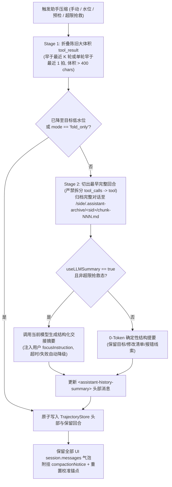
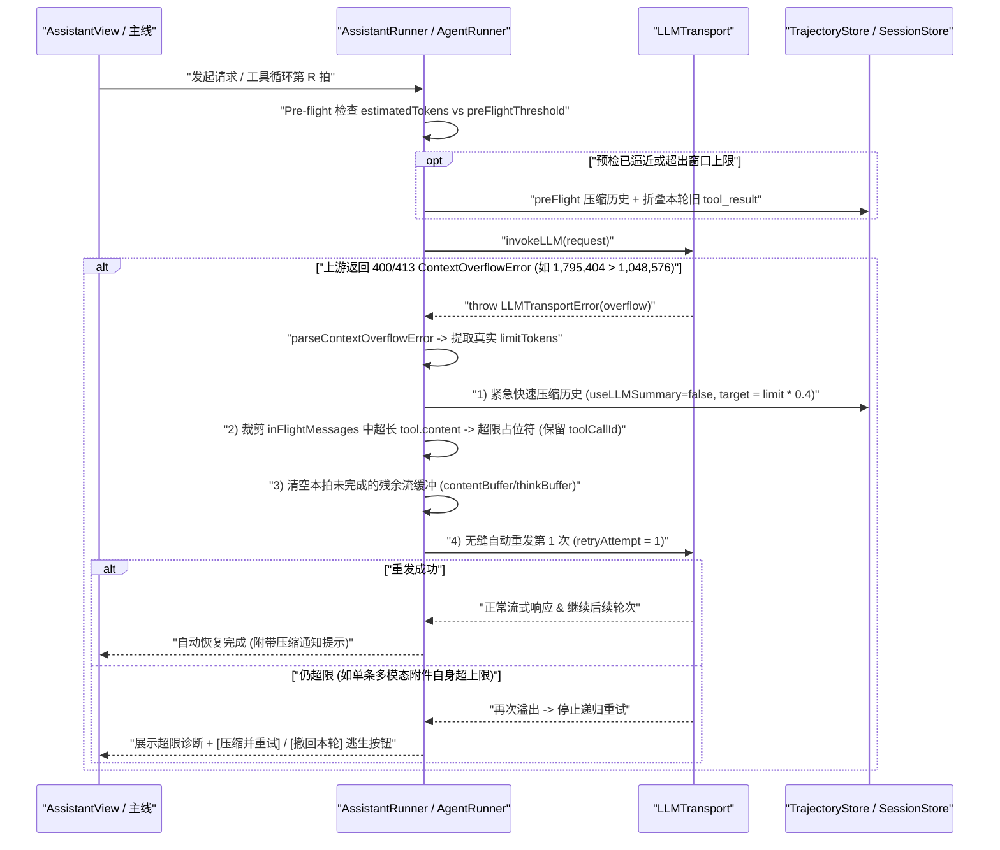

# ST-Agentic 上下文防爆闸门、压缩与超限自愈架构计划

> 本文档定义 `ST-Agentic` 针对**工具输出暴涨、长对话上下文膨胀、跨模型窗口切换死锁以及 API Token 超限自愈**的完整防御与压缩架构方案，覆盖核心契约、生命周期状态机、助手顶栏交互规范、波次实施排期与验收门禁。所有设计严格遵守 `AGENTS.md`、[ARCHITECTURE.md](./ARCHITECTURE.md) 与 [OFF_MAINLINE_PLAN.md](./OFF_MAINLINE_PLAN.md) 定义的四大系统不变量。

---

## §1 背景、事故根因与四大架构红线对齐

### 1.1 真实事故复盘与四处结构性缺口

结合近期线外助手工作台真实故障（会话从 `583 tok` / `867 tok` 在一轮工具调用后瞬间飙升至 `1,795,404` / `1,826,763 tokens` 并触发 Gemini `exceeds the maximum number of tokens allowed (1048576)` 报错且会话彻底卡死），核查代码基线确认存在以下四处结构性缺口：

1. **高危管理与查询工具无差别倾倒宿主大对象**
   - `st_settings_read`（[tools-admin.ts](../src/core/assistant/tools-admin.ts#L993-L1010) → [st-admin-bridge.ts](../src/host/st-admin-bridge.ts#L673-L695)）在读取 `extension_settings`、`power_user` 或 `all` 时，会将酒馆内全部已安装扩展的持久化状态（JS 脚本库、正则配置、向量索引缓存、主题 Base64 图片等）完整深拷贝并序列化为巨型 JSON 塞入 `inFlightMessages`。
   - 同类高危倾倒工具还包括：
     - `st_preset_list`（[st-admin-bridge.ts](../src/host/st-admin-bridge.ts#L588-L618)）：返回所有预设列表时附带每一个预设的完整 `data` 提示词体；
     - `card_admin_list_all`（[st-admin-bridge.ts](../src/host/st-admin-bridge.ts#L267-L287)）：返回全库角色卡时附带每张卡的完整 `description`；
     - `wi_read_enabled`（[tools-chat.ts](../src/core/assistant/tools-chat.ts#L744-L794)）：未传过滤条件时默认 `includeContent: true, limit: 200`，可将数本大世界书正文一次性倾倒进上下文。
2. **工具执行出口缺乏单次体积硬闸门与溢出转存**
   - 助手侧 `finalizeReadToolResult`（[tools-chat.ts](../src/core/assistant/tools-chat.ts#L114-L141)）与主线侧 `ToolRegistry.executeToolCall`（[registry.ts](../src/core/tools/registry.ts#L293-L369)）对单次 `tool_result` 返回均未设置字节/Token 上限；无论是超大 `read_file`、大批量 `agentic_read_traces`，还是用户自定义 JS `defineTool`，都可能单发击穿上下文上限。
3. **助手上下文压缩残缺，且工作台缺乏实时 Token 计数器与确认入口**
   - 现有 `AssistantSessionStore.compactIfNeeded`（[session-store.ts](../src/core/assistant/session-store.ts#L827-L921)）依赖 `summarizeAssistantTurns`（[session-store.ts](../src/core/assistant/session-store.ts#L352-L380)）机械截取每轮前 48/56 字符且总长超过 1200 字直接砍掉头部，既没有调用 LLM 生成结构化交接摘要，也没有优先折叠陈旧大体积 `tool_result`（Action B），且在 `turns.length <= 1` 时直接跳过；
   - `AssistantView`（[AssistantView.tsx](../src/ui/assistant/AssistantView.tsx#L1242-L1270)）顶栏右侧（`＋` 新建与 `↩` 撤销按钮旁）没有会话级累计 Token 计数器，用户无法感知当前窗口水位，也没有手动触发压缩的交互入口；`src/index.ts` 中的 `getWatermarkStatuses`（[index.ts](../src/index.ts#L803-L829)）亦未覆盖 `assistant:*` 会话。
4. **发包前未联动 `ApiConnection.contextSize` 预检，触发上游超限错误后无自愈回路**
   - `ApiConnection.contextSize`（[settings.ts](../src/core/types/settings.ts#L18)）目前仅作为连接配置字段存在，未接入 `AssistantRunner`（[assistant-runner.ts](../src/core/assistant/assistant-runner.ts#L987-L1049)）和主线 `AgentRunner`（[agent-runner.ts](../src/core/agents/agent-runner.ts#L931-L1050)）的轮次内发包前预算校验；
   - 一旦请求触及上游 API 的上下文窗口限制（HTTP 400 / 413），Runner 直接中断并写入 `[Error] ... 已中止`，既不会在轮次内自动压缩历史与裁剪撑爆的工具返回，也没有自愈重试或一键恢复机制。

### 1.2 已确认核心设计决策

1. **极简 GUI Token 计数器 + 点击确认压缩（不引入重型 Slash Command 系统）**：
   - 保持 [AssistantView.tsx](../src/ui/assistant/AssistantView.tsx#L44-L53) 约定的极简底部输入区规范，不建设 Slash 命令注册表、参数解析 AST 与光标自动补全浮层 UI。
   - 在**助手工作台顶栏右侧（`＋` 新建按钮左侧）新增实时会话 Token 计数器胶囊**（如 `867 tok` / `42.6k`），平时作为上下文水位仪表盘，按占用比例呈现正常/预警/危险态；点击后弹出 `ShadowModal` 询问是否进行上下文压缩，展示当前体积、可折叠旧工具数、可选「保留重点」输入框，以及「仅折叠旧工具输出 / 确认压缩上下文」操作。
2. **四层纵深防御体系**：
   - **第 1 层（源头分级下钻）**：`st_settings_read`、`st_preset_list`、`card_admin_list_all`、`wi_read_enabled` 改为默认目录摘要 / 元数据列表，支持按 `keyPath`、预设名、卡 ID 或书名下钻读取细节。
   - **第 2 层（工具出口 `32 KB` 硬闸门 + 瞬态内存溢出池）**：在助手与主线工具统一出口处对超大 `tool_result` 执行结构化裁剪与摘要预览，完整原文转存至进程内 LRU 瞬态溢出池（挂载虚拟只读路径 `/tmp/tool-spill/<id>`），支持后续通过 `read_file(start_line, end_line)` 或 `grep_search` 分段查阅，**绝不污染 `chat_metadata` 存档**。
   - **第 3 层（发包前窗口预检 + 三级无损递进压缩）**：接入 `ApiConnection.contextSize`，发包前校验总预估 Token；压缩遵循**先折旧只读工具输出 → 再原文归档 + LLM 结构化交接摘要 → 保留尾部活跃回合**的三级策略。
   - **第 4 层（触发 Token 上限错误时自动压缩抢救并无缝重试）**：识别 Gemini / OpenAI / Anthropic / DeepSeek / OpenRouter 上下文超限错误后，在同一轮次内自动执行**紧急零耗时快速压缩（禁用 LLM 摘要防递归超限）+ 原地替换 `inFlightMessages` 中超大 `tool` 消息体**，并无缝重发 1 次请求。
3. **UI 历史消息与 LLM 上下文轨迹严格解耦**：
   - 执行任何压缩（手动点击、自动水位或超限抢救）时，**仅重写 `TrajectoryStore`（`assistant:<sessionId>`）发往模型的上下文消息数组**；
   - `AssistantSession.messages` 中的历史气泡、工具折叠卡片、审批卡与 `UndoRecord` 写前快照 **100% 完整保留**，仅在对应位置呈现轻量可展开的压缩分隔提示条（展示压缩前后 Token 变化与交接摘要）。
4. **主线与助手共享核心防爆及自愈原语**：
   - 超限错误解析器（`src/core/llm/errors.ts`）、窗口预算与工具出口闸门（`src/core/context/context-budget.ts`）下沉至共享内核，使主线 `AgentRunner` 与线外 `AssistantRunner` 遵循统一保护标准。

### 1.3 与 `AGENTS.md` 四大红线对齐核验

| 红线原则 | 本方案落实机制 |
| :--- | :--- |
| **1. 严格宿主防腐边界** | `src/core/context/context-budget.ts` 与 `src/core/llm/errors.ts` 位于纯逻辑层，严禁引用 `@st/*`、`window`、`document`、jQuery；`st_settings_read` 等参数扩展通过 `HostAdminBridge`（`src/core/bridge/host-admin-bridge.ts`）契约传递，宿主要素裁剪逻辑限定在 `src/host/st-admin-bridge.ts`。 |
| **2. Append-Only KV Cache 不变性** | 工具出口截断与分级摘要全部发生在工具结果首次写入 `messages` 之前，一经入列即逐字节冻结；常规增长期严禁每轮滑动截断或动态回改前序消息，仅在到达高水位 / 手动确认 / 超限抢救这一拍执行原子压缩重组，保障随后多轮 100% 命中前缀缓存。 |
| **3. 零原生替代与 Shadow DOM 隔离 UI** | 不触碰 `#chat .mes` DOM；顶栏 Token 计数器胶囊、压缩确认 `ShadowModal`（含可选「保留重点」输入框 `font-size >= 16px` 及键盘 `stopPropagation` 护栏）、聊天流压缩分隔提示条全部位于 `<dialog id="agentic-app">` 的 `ShadowRoot` 内，移动端 `< 768px` 满足 `>= 40×40px` 触控热区与单行标题省略约束。 |
| **4. 因果分支与存档安全** | 瞬态溢出池 `TransientToolSpillStore` 严格驻留内存 LRU（单条上限 `2 MB`，总池上限 `16 MB`），随会话删除或聊天切换清理，严禁将 MB 级溢出工具正文写入 `chat_metadata` 导致酒馆存档膨胀；助手局部历史摘要归档绑定会话 ID。 |

---

## §2 核心接口与数据结构契约（Contracts & Types）

### 2.1 多厂商上下文超限错误解析契约（`src/core/llm/errors.ts`）

在 `LLMTransportError` 与错误工具函数中新增结构化超限识别器，统一捕获主流推理网关的上下文长度异常，并明确传输层 `defaultShouldRetry` 不应在原载荷未裁剪前盲目重试：

```typescript
export interface ContextOverflowInfo {
    isOverflow: true;
    providerHint?: 'gemini' | 'openai' | 'anthropic' | 'generic';
    /** 上游返回声明的上下文最大允许 token 上限（若错误文本可解析出） */
    limitTokens?: number;
    /** 上游实际统计到的输入 token 数（若错误文本可解析出） */
    actualTokens?: number;
    rawMessage: string;
}

/**
 * 识别各厂商与代理网关返回的上下文 Token 超限错误，并尽量提取 (limitTokens, actualTokens)：
 * - Gemini: "The input token count exceeds the maximum number of tokens allowed (1048576); input token count: 1795404"
 * - OpenAI / DeepSeek / OpenRouter / vLLM:
 *   "context_length_exceeded" / "This model's maximum context length is 128000 tokens. However, your messages resulted in 145000 tokens."
 * - Anthropic: "prompt is too long: 215000 tokens > 200000 maximum"
 */
export function parseContextOverflowError(error: unknown): ContextOverflowInfo | null;

export function isContextOverflowError(error: unknown): boolean;
```

- **传输层协同**：在 `src/core/llm/retry.ts` 的 `defaultShouldRetry(error)` 中增加保护：若 `isContextOverflowError(error)` 为 `true`，即使代理将其包装为 HTTP 400/413/500，传输层**必须返回 `false`**，避免无意义退避重发一模一样的超限载荷，把控制权立即交还上层 Runner 执行“压缩 + 裁剪后重试”。

### 2.2 窗口预算与工具出口闸门原语（`src/core/context/context-budget.ts`）

```typescript
export const DEFAULT_MAX_TOOL_RESULT_BYTES = 32 * 1024;
export const DEFAULT_SPILL_MAX_ENTRY_BYTES = 2 * 1024 * 1024;
export const DEFAULT_SPILL_POOL_MAX_BYTES = 16 * 1024 * 1024;

export interface EffectiveContextBudget {
    /** 连接声明的总窗口大小（来自 ApiConnection.contextSize 或按模型名兜底） */
    contextLimit: number;
    /** 预留输出空间（clamp(connection.maxTokens, 1024, floor(contextLimit * 0.25))） */
    reservedOutputTokens: number;
    /** 实际可用安全输入上限（contextLimit - reservedOutputTokens - safetyMargin） */
    safeInputBudget: number;
    /** 触发发包前预检强制压缩的阈值（floor(safeInputBudget * 0.88)） */
    preFlightThreshold: number;
    /** 联动后的自动高/低水位线（绝不超过 safeInputBudget） */
    autoHighWatermark: number;
    autoLowWatermark: number;
}

export function resolveEffectiveContextBudget(
    connection: Pick<ApiConnection, 'contextSize' | 'maxTokens' | 'model'>,
    options?: {
        configuredWatermark?: { high: number; low: number };
        providerLimitOverride?: number;
    },
): EffectiveContextBudget;

export interface SpillEntry {
    /** 虚拟只读检索路径，如 "/tmp/tool-spill/call_abc123.txt" */
    path: string;
    toolName: string;
    content: string;
    byteLength: number;
    lineCount: number;
    createdAt: number;
}

/**
 * 纯内存 LRU 瞬态溢出池：保存被出口闸门截断的完整脱敏工具输出，
 * 供 read_file / grep_search 分段检索，不落盘 chat_metadata。
 */
export class TransientToolSpillStore {
    put(params: {
        toolCallId: string;
        toolName: string;
        content: string;
        scopeId?: string;
    }): SpillEntry;
    get(path: string): SpillEntry | null;
    readSlice(path: string, startLine?: number, endLine?: number): string | null;
    grep(path: string, query: string, opts?: { caseSensitive?: boolean; regex?: boolean; limit?: number }): VfsSearchHit[];
    clearScope(scopeId: string): void;
    clearAll(): void;
}

export interface ToolOutputGateOptions {
    toolName: string;
    toolCallId: string;
    /** 单次工具结果最大 UTF-8 字节预算（默认 32 KB） */
    maxBytes?: number;
    /** 可选原始结构化数据（用于 JSON 生成顶层键大小清单） */
    rawData?: unknown;
    spillStore?: TransientToolSpillStore;
    scopeId?: string;
}

export interface ToolOutputGateResult {
    output: string;
    truncated: boolean;
    originalBytes: number;
    finalBytes: number;
    spillPath?: string;
}

export function applyToolOutputGate(
    rawOutput: string,
    options: ToolOutputGateOptions,
): ToolOutputGateResult;
```

- **结构化裁剪策略**：
  1. 若 `utf8ByteLength(rawOutput) <= maxBytes`：原样透传（零开销、零改动）。
  2. 若超出预算且输入为 JSON 对象（或传入 `rawData`）：生成**JSON 键体积清单（Key Manifest）**——按字节大小降序展示顶层键（含数据类型、数组长度/子键数、估算字节与前 100 字符预览）+ 溢出提示；若可转存至 `spillStore`，附上 `/tmp/tool-spill/<toolCallId>.json` 行号与路径指引。
  3. 若超出预算且为纯文本/Markdown：保留**前 120 行 + 省略声明（含总字节数与总行数）+ 末尾 30 行** + `/tmp/tool-spill/<toolCallId>.txt` 分页读取指引（`read_file` 指定 `start_line` / `end_line` 或 `grep_search`）。
  4. 所有写入 `spillStore` 的内容必须是**已经过 `redactString` / `redactWithReport` 脱敏**的文本，杜绝明文密钥通过 `/tmp/tool-spill/*` 旁路泄露。

### 2.3 `HostAdminBridge` 与高危工具分级读取契约（`src/core/bridge/host-admin-bridge.ts`）

为避免高危工具在桥接层就构造出几 MB 的对象并阻塞主线程，对现有 `HostAdminBridge` 签名做向后兼容扩展：

```typescript
export interface ReadHostSettingsOptions {
    /** 支持点路径/斜杠路径下钻读取，如 "TavernHelper.scripts" 或 "power_user.theme" */
    keyPath?: string;
    /** true 时强制仅返回键名/类型/字节数/预览清单，不返回全量深层内容 */
    summaryOnly?: boolean;
}

export interface ListPresetsOptions {
    apiType?: string;
    /** 默认 false：列表接口只返回 { name, apiType, active }；仅明确需要时才加载 data */
    includeData?: boolean;
    /** 仅过滤指定名称的预设，常与 includeData: true 搭配使用 */
    name?: string;
}

export interface HostAdminBridge {
    // ... 既有成员保持签名兼容
    listPresets(apiTypeOrOptions?: string | ListPresetsOptions): Promise<HostPresetInfo[]>;
    readHostSettings(
        scope: HostSettingsScope,
        options?: ReadHostSettingsOptions,
    ): Promise<Record<string, unknown>>;
}
```

- **四类高危助手工具改造细则**：
  1. `st_settings_read`（[tools-admin.ts](../src/core/assistant/tools-admin.ts#L306-L312) & `#L993-L1010`）：
     - Schema 新增 `keyPath?: string` 与 `summaryOnly?: boolean`。
     - 当 `scope` 为 `"all"` / `"extension_settings"` / `"power_user"` 且**未指定 `keyPath`**（或 `summaryOnly: true`，或序列化结果超过 `16 KB`）时，返回**分层清单**（`manifest: Array<{ key, type, bytes, itemCount?, preview }>`），引导模型改传具体扩展 `scope`（如 `"ST-Agentic"`）或 `keyPath` 下钻读取。
  2. `st_preset_list`（[tools-admin.ts](../src/core/assistant/tools-admin.ts#L319-L321) & `#L1078-L1094`）：
     - 默认传 `{ apiType, includeData: false }`，只返回预设元信息 `{ name, apiType, active }`；支持可选 `name` 参数单读特定预设。
     - `st_preset_patch` 内部对比 Diff 时传 `{ apiType, includeData: true, name: args.name }`，仅抓取目标单一预设，避免拖出全量预设列表。
  3. `card_admin_list_all`（[tools-admin.ts](../src/core/assistant/tools-admin.ts#L614-L630) & [st-admin-bridge.ts](../src/host/st-admin-bridge.ts#L267-L287)）：
     - 列表返回 `descriptionPreview`（限制前 `120` 字符 + 原始字符数统计），需要读单卡全字段时走 `card_admin_read(chid)`。
  4. `wi_read_enabled`（[tools-chat.ts](../src/core/assistant/tools-chat.ts#L354-L360) & `#L744-L794`）：
     - 若未传 `bookName` 且未传 `query`，或者匹配条目预计总正文超过 `24 KB` 时，自动切换为目录摘要（保留 `world, uid, comment, keys, keysecondary, constant, disable, order, contentLength`），提示模型按 `bookName` / `query` 或 `read_file("/lorebooks/...")` 精读。

### 2.4 助手会话状态、压缩选项与 UI 桥接契约（`src/core/types/off-mainline.ts` & `src/ui/store/app-store.ts`）

```typescript
// src/core/types/off-mainline.ts 新增契约

export type AssistantTokenLevel = 'normal' | 'warning' | 'danger';

export interface AssistantSessionTokenStatus {
    sessionId: string;
    /** 当前会话发往模型的预估输入 Token（优先基于最近一次真实 usage.inputTokens 校准增量） */
    currentTokens: number;
    /** 当前连接的有效上下文上限 */
    contextLimit: number;
    /** 自动高/低水位阈值 */
    highWatermark: number;
    lowWatermark: number;
    /** 占用比例与分级状态（<70% normal, 70%-90% warning, >=90% danger） */
    usagePercent: number;
    level: AssistantTokenLevel;
    /** 活跃轨迹中的回合数与总消息数 */
    activeTurnCount: number;
    activeMessageCount: number;
    /** 可直接折叠的陈旧大体积 (>400 chars) 只读 tool_result 数量 */
    foldableToolResultCount: number;
    /** 已完成的压缩次数 / 归档块数 */
    compactedCount: number;
    /** 最近一次交接摘要正文预览 */
    summaryPreview?: string;
    /** 当前是否正在执行压缩 */
    isCompacting?: boolean;
}

export interface AssistantCompactOptions {
    /** 用户可选填写的"保留重点"提示词 */
    focusInstruction?: string;
    /**
     * - auto: 优先折叠旧工具输出，不足再归档早期回合并摘要
     * - fold_only: 仅折叠陈旧大体积 tool_result，不归档/摘要对话回合
     * - full: 强制折叠旧工具输出并将早期回合浓缩为结构化交接摘要
     */
    mode?: 'auto' | 'fold_only' | 'full';
    /** 是否调用 LLM 生成交接摘要；超限紧急抢救态强制传 false */
    useLLMSummary?: boolean;
    /** 目标压回水位（默认为连接自适应低水位） */
    targetLowTokens?: number;
    signal?: AbortSignal;
}

export interface AssistantCompactReport {
    compacted: boolean;
    reason?: 'below_threshold' | 'nothing_to_compact' | 'manual' | 'auto_watermark' | 'preflight' | 'overflow_recovery';
    tokensBefore: number;
    tokensAfter: number;
    foldedToolResults: number;
    archivedTurns: number;
    archivedChunkPath?: string;
    summaryMode: 'llm' | 'deterministic' | 'fold_only' | 'none';
    summaryText?: string;
    timestamp: number;
}

export interface AssistantCompactionNotice {
    tokensBefore: number;
    tokensAfter: number;
    foldedToolResults: number;
    archivedTurns: number;
    summaryMode: 'llm' | 'deterministic' | 'fold_only';
    summaryText?: string;
    focusInstruction?: string;
    archivedChunkPath?: string;
    timestamp: number;
}
```

- 在 `AssistantMessage` 中新增可选字段 `compactionNotice?: AssistantCompactionNotice;`（以及可选 `errorCode?: 'context_overflow' | 'generic'` 供气泡错误逃生按钮判定）。
- 在 `AssistantRuntimeBridge`（[app-store.ts](../src/ui/store/app-store.ts#L62-L145)）扩展以下可选方法：
  ```typescript
  getSessionTokenStatus?(sessionId: string): Promise<AssistantSessionTokenStatus | null> | AssistantSessionTokenStatus | null;
  compactSession?(sessionId: string, options?: AssistantCompactOptions): Promise<AssistantCompactReport>;
  ```

---

## §3 核心算法与生命周期状态机

### 3.1 校准式实时 Token 计数算法（Calibrated Session Token Counter）

传统纯字符估算遇到非英文/高密度符号 JSON 或多模态图片/音频/PDF 附件时误差较大（如截图所示，实际 1.79M 而本地按附件长度估算偏低）。顶栏计数器与预检采用**API 实测锚点校准模型**：

1. **记录校准锚点**：每次会话 `invokeLLM` 成功获得真实 `usage.inputTokens > 0` 时，在内存态保存该线程的校准快照 `{ anchorActualInputTokens, anchorEstimatedTokens, anchorTrajectoryLen, updatedAt }`。
2. **动态推算当前真实水位**：
   $$\text{currentTokens} = \max\Big(\text{estimatedTotal},\ \text{anchorActualInputTokens} + (\text{estimatedTotal} - \text{anchorEstimatedTokens})\Big)$$
   - 若发生 `compact`、编辑消息、撤回或清空会话，立即重置锚点并切回 `estimateRequestTokens([...layer0, ...layer1], tools)`。
   - 正常多轮聊天期间，既保持第 1 轮之后的**实测精准度**，又能**实时反映用户输入或压缩后的下降值**。
3. **分级阈值映射**：
   - `contextLimit = resolveEffectiveContextBudget(connection).safeInputBudget`
   - `usagePercent = clamp(0, 100, Math.round((currentTokens / contextLimit) * 100))`
   - `level`: `< 70%` → `normal`；`70% ~ 89%` → `warning`；`>= 90%` 或已超出 `highWatermark` → `danger`。

### 3.2 助手三级无损递进压缩（Three-Stage Compaction）



1. **Stage 1（陈旧工具输出原地折叠）**：
   - 收集折叠对象：所有早于最近 `keepRecentTurns`（默认 `2`，当 `turns.length === 1` 紧急减重时折叠同一轮内早于最近 `1` 次工具往返拍次）且字符数 `> 400` 的工具返回（不限于 `read_file`，覆盖 `st_settings_read`、`wi_read_enabled`、`card_read_active`、`agentic_read_traces` 等全部只读返回）。
   - 替换为紧凑占位符：
     `[已折叠助手只读输出: <toolName> (<summaryLabel>, 原长约 <N> 字)；如需细节可按精确过滤条件重读]`
   - 保留 `toolCallId`、`toolName` 与消息结构完整性，100% 满足 OpenAI / Anthropic / Gemini 的 `tool_calls -> tool` 配对校验。
2. **Stage 2（完整原文归档 + 结构化交接摘要）**：
   - 若 Stage 1 后仍高于 `targetLowTokens`（且 `mode !== 'fold_only'`），从 `Layer 1` 头部切出最早的连续完整回合（由 `groupLayer1Turns` 保证绝不在 `tool_calls -> tool` 中间切断），至少保留最新 `1` 个完整回合（或处于 `full` 强压模式且多轮时保留最新 `1` 轮）。
   - **原文持久化归档**：通过 VFS 或独立只读轨迹归档文件写入 `/side/.assistant-archive/<sessionId>/chunk-NNN.md`（也可直接在工具层提供 `read_file` 查阅）。
   - **LLM 结构化交接摘要 Prompt 模板**（当 `useLLMSummary !== false` 且非超限抢救态）：
     - 约束输出结构（`1. 用户核心目标与当前进度` / `2. 已修改或读取的关键文件与对象` / `3. 已确认的约束与踩坑经验` / `4. 待继续步骤`）；
     - 若用户提供了 `focusInstruction`，在摘要提示词显式置顶标注必须保留的重点内容；
     - 摘要调用单独使用 `tools: []`、低 `temperature: 0.2`、硬超时（如 `25s`）且输入块自身若偏大则自动分批截断；任意网络/超时异常立即无缝降级至确定性结构提要（`buildDeterministicSummary`），确保**压缩动作永远不会因为摘要失败而卡死**。
3. **Stage 3（界面不删消息，绑定分隔通知）**：
   - 调用 `trajectoryStore.applyCompaction(...)` 更新发给模型的 `Layer 1`；
   - 绝不删除 `session.messages` 历史气泡，在最新已存档前最后一条消息（或追加一条系统通知元标记）记录 `compactionNotice`，界面渲染轻量折叠提示条。

### 3.3 触发 Token 上限错误时的自动抢救与无缝重试状态机



**关键防死锁与协议不变量**：
1. **单拍最多自愈重试 1 次（防无限计费循环）**：记录 `overflowRecoveryAttempted` 标记（每轮最多 1 次或仅在明显释放了大量 Token 后允许），彻底杜绝死循环重试。
2. **抢救态严禁调用 LLM 摘要**：遇到 `ContextOverflowError` 时，上下文窗口已经爆了或模型已超限，此时调用 `compact` **强制 `useLLMSummary: false`**，纯本地 0ms 执行 `Stage 1 工具折叠 + 确定性结构摘要`，毫秒级将 `Layer 1` 降回安全水位。
3. **只替换 `content`，绝不删 `tool` 节点**：清理 `inFlightMessages` 时，对体积最大的 `role === 'tool'` 消息原地修改其 `content` 为紧凑超限提示（例如：`[输出因触发模型上下文上限 (${limitTokens} tokens) 已被自动裁剪；原输出约 ${origTokens} tokens。请改用指定 keyPath / bookName / start_line-end_line 分段精确查询]`），完整保留 `toolCallId` 和 `assistant.toolCalls` 的一一对应关系，防止第二次请求因 `tool_call_id mismatch` 再次报错 400。
4. **若主因是本轮残余未发出的流 / 大体积附件**：若连 `Layer 1` 已压到最小、本轮也无巨型 `tool_result`（例如用户直接拖入超长文本或超大音频/视频附件），第 2 次明确向用户暴露可操作错误码 `errorCode: 'context_overflow'`，在气泡内呈现「撤回本轮附件消息」与「强制压缩历史后重试」按钮。

---

## §4 助手工作台 UI 交互与响应式规范

### 4.1 顶栏右侧 Token 计数器胶囊设计（[AssistantView.tsx](../src/ui/assistant/AssistantView.tsx#L1242-L1270)）

1. **放置位置**：位于 `ag-ast-topbar-right` 容器内部、`＋` 新建按钮的**左侧**（即 `[☰ 会话 (3)] [新助手会话]  ....  [📊 867 tok] [＋] [↩ 1]`），与截图红圈位置 1:1 对齐。
2. **视觉分级与信息密度**：
   - 默认文案：紧凑胶囊显示格式化数值，如 `867 tok`、`24.8k`、`182k`；桌面宽屏 hover/title 展示详细占比 `当前上下文约 24,800 / 1,048,576 tok (2%) · 点击管理/压缩上下文`。
   - 分级配色（复用 `styles.ts` 现有语义 CSS 变量，同时适配 Dark/Light/Auto）：
     - `normal`（`< 70%`）：中性边框 + 次要前景色；
     - `warning`（`70% ~ 89%`）：`var(--warning)` 边框与淡底色，提示接近高水位；
     - `danger`（`>= 90%` 或超出 `highWatermark`）：`var(--error)` 高亮胶囊；
     - `isCompacting`：胶囊展示微弱旋转/脉冲状态 `压缩中...` 并禁用重复点击。
   - **移动端 `< 768px` 合规**：满足 `min-height: 40px`、`min-width: 40px` 触控热区，`flex-shrink: 0`；当顶栏空间紧凑时仅显示紧凑数值 `24.8k`，左侧 `.ag-ast-title` 自动 `text-overflow: ellipsis` 截断，绝不挤破布局或触发横向滚动条。

### 4.2 点击计数器弹出的压缩确认弹窗（`ShadowModal`）

点击顶栏 Token 计数器胶囊后，在 `ShadowRoot` 内打开 `ShadowModal`（复用 [CommonControls.tsx](../src/ui/components/CommonControls.tsx)）：

- **标题**：`压缩当前会话上下文`
- **状态摘要区**：
  - 当前体积 / 窗口上限与占用进度条（如 `62,840 / 128,000 tok (49%)`）
  - 可压缩统计：`当前活跃 12 轮 · 包含 8 条可折叠旧工具输出 · 已归档 0 块`
  - 明确安心提示：`仅精简发给模型的轨迹上下文，界面聊天记录、审批卡与写前撤销记录将完整保留。`
  - 若已有上次交接摘要，提供可折叠查看框展示现有交接摘要预览。
- **可选保留重点输入框**：
  - 单行/双行 `<textarea>`（`font-size >= 16px` 防止 iOS 自动缩放，`onKeyDown` / `onKeyUp` 严格 `stopPropagation()` 防止穿透触发酒馆快捷键）；
  - Placeholder：`可选：输入需要重点保留的规则、文件或上下文目标（例如：保留世界书路由改造细节）`。
- **底部操作按钮组**：
  - `取消`（`variant="secondary"`）
  - `仅折叠旧工具`（当 `foldableToolResultCount > 0` 时启用，0 Token 立即完成减重）
  - `确认压缩`（`variant="primary"`，调用 `compactSession(sessionId, { mode: 'full', focusInstruction })`）

### 4.3 聊天流内压缩分隔提示条与错误逃生动作（[MessageBubble.tsx](../src/ui/assistant/MessageBubble.tsx)）

1. **压缩分隔提示条**：
   - 当消息挂载 `message.compactionNotice` 时，在气泡下方渲染一条居中窄幅胶囊条：
     `── 已压缩上下文：62.8k → 5.4k tok（归档 10 轮 · 折叠 6 条工具输出）· 查看交接摘要 ▾ ──`
   - 点击「查看交接摘要」原地展开交接摘要文本，便于用户随时核对压缩质量。
2. **超限错误气泡快捷逃生**：
   - 当消息因不可自动恢复的超限（例如单条附件远超模型窗口）而 `interrupted === true && errorCode === 'context_overflow'` 时，气泡底部额外提供快捷操作按钮：
     - **「压缩历史后重试」**
     - **「撤回本轮消息」**
   - 同时接入 [CacheStorageView.tsx](../src/ui/session/CacheStorageView.tsx)（或 `getWatermarkStatuses`）可选只读遥测联动，保持控制台视角一致。

---

## §5 波次实施排期、独占写路径与验收门禁

严格遵循 [TASKS.md](./TASKS.md) 规定的「先契约后扇出 + 目录独占锁 + 门禁合并」流程，拆分如下 3 个波次共 5 个原子任务：

### 5.1 任务总览矩阵

| 任务 ID | 任务名称 | 波次 | 轨道 | 前置依赖 | 独占写路径（Owned Paths） |
| :--- | :--- | :---: | :---: | :--- | :--- |
| **C0.1** | 共享契约、超限错误解析器与出口闸门原语 | Wave 0 | Serial | 无 | `src/core/types/off-mainline.ts`, `src/core/bridge/host-admin-bridge.ts`, `src/core/llm/errors.ts`, `src/core/llm/retry.ts`, `src/core/context/context-budget.ts`, `src/core/context/index.ts`, `tests/unit/llm/context-overflow.test.ts`, `tests/unit/context/context-budget.test.ts` |
| **C1.1** | ST 宿主管理桥瘦身、高危工具分级下钻与助手出口闸门 | Wave 1 | Track A | C0.1 | `src/host/st-admin-bridge.ts`, `src/core/assistant/tools-admin.ts`, `src/core/assistant/tools-chat.ts`, `tests/unit/assistant/tools-budget.test.ts` |
| **C1.2** | 助手三级压缩、校准计数器与超限自动自愈重试 | Wave 1 | Track B | C0.1 | `src/core/assistant/session-store.ts`, `src/core/assistant/assistant-runner.ts`, `tests/unit/assistant/compaction-recovery.test.ts` |
| **C1.3** | 主线 `ToolRegistry` 出口闸门与 `AgentRunner` 超限自愈 | Wave 1 | Track C | C0.1 | `src/core/tools/registry.ts`, `src/core/agents/agent-runner.ts`, `tests/unit/agents/context-overflow-recovery.test.ts` |
| **C2.1** | 顶栏 Token 计数器、压缩确认弹窗、分隔条 UI 与接线测试 | Wave 2 | Integration | C1.1, C1.2, C1.3 | `src/ui/store/app-store.ts`, `src/ui/store/mock-services.ts`, `src/ui/assistant/AssistantView.tsx`, `src/ui/assistant/MessageBubble.tsx`, `src/ui/shell/styles.ts`, `src/index.ts`, `tests/browser/ui/assistant-compact.test.tsx` |

### 5.2 各任务实施细目与验收门禁

#### C0.1 — 共享契约、超限错误解析器与出口闸门原语（Wave 0 串行）
- **实施细目**：
  1. 在 `src/core/types/off-mainline.ts` 冻结 `AssistantSessionTokenStatus`、`AssistantCompactOptions`、`AssistantCompactReport`、`AssistantCompactionNotice` 与 `AssistantMessage.compactionNotice` / `errorCode` 契约。
  2. 在 `src/core/bridge/host-admin-bridge.ts` 扩展 `ReadHostSettingsOptions`、`ListPresetsOptions` 兼容签名。
  3. 在 `src/core/llm/errors.ts` 实现 `parseContextOverflowError` / `isContextOverflowError`，并在 `src/core/llm/retry.ts` 阻止传输层原地重试超限报错。
  4. 新增 `src/core/context/context-budget.ts` 并经 `src/core/context/index.ts` 导出：实现 `resolveEffectiveContextBudget`、`TransientToolSpillStore` 与 `applyToolOutputGate`（JSON Key Manifest 清单生成 + 长文本头尾截断 + 内存 LRU 溢出控制）。
- **验收门禁**：`npm.cmd run typecheck`、`npm.cmd run lint`、`npx.cmd vitest run tests/unit/llm/context-overflow.test.ts tests/unit/context/context-budget.test.ts`。

#### C1.1 — ST 宿主管理桥瘦身、高危工具分级下钻与助手出口闸门（Wave 1 并行）
- **实施细目**：
  1. `src/host/st-admin-bridge.ts`：实现 `readHostSettings(scope, options)` 按 `keyPath` 下钻与 `summaryOnly` 清单生成；实现 `listPresets({ apiType, includeData, name })` 默认剥离 `data`；`listAllCharacters` 截断 `description` 为 120 字摘要。
  2. `src/core/assistant/tools-admin.ts`：给 `st_settings_read` 添加 `keyPath` / `summaryOnly`；给 `st_preset_list` 添加按 `name` 查询，默认 `includeData: false`；`st_preset_patch` 传 `{ includeData: true, name }`。
  3. `src/core/assistant/tools-chat.ts`：在 `finalizeReadToolResult` 与 `finalizeMutationToolResult` 接入 `applyToolOutputGate`（上限 `32 KB`，写入作用域绑定 `TransientToolSpillStore`）；扩展 `read_file` / `grep_search` 支持直接命中 `/tmp/tool-spill/*` 溢出文件；改造 `wi_read_enabled` 对大结果自动退化为条目目录清单。
- **验收门禁**：`npm.cmd run typecheck`、`npm.cmd run lint`、`npx.cmd vitest run tests/unit/assistant/tools-budget.test.ts`。

#### C1.2 — 助手三级压缩、校准计数器与超限自动自愈重试（Wave 1 并行）
- **实施细目**：
  1. `src/core/assistant/session-store.ts`：
     - 升级 `compactIfNeeded` → `compactSession(sessionId, options)`：支持 Stage 1 旧大体积 `tool_result` 原地折叠（含单轮紧急折叠早于最后 1 拍的旧工具）、Stage 2 完整回合切分归档与交接摘要构建（注入 `focusInstruction`，附带 `summarizeWithLLM` 回调与确定性降级）。
     - 实现 API 实测锚点校准逻辑与 `getSessionTokenStatus(sessionId, budget)`。
     - 修复 `syncTrajectoryToMessages` 在存在折叠 `tool_result` 与 `<assistant-history-summary>` 时，用户编辑/撤回/重生成消息的索引对齐与锚点重置。
  2. `src/core/assistant/assistant-runner.ts`：
     - 注入 `TransientToolSpillStore` 并随 `deleteSession` 清理。
     - 每次 `invokeLLM` 前执行基于 `resolveEffectiveContextBudget` 的 Pre-flight 预检，必要时自动压缩 `Layer 1` 或折叠本轮早期工具输出。
     - 捕获 `parseContextOverflowError` 时，在单拍内强制 `useLLMSummary: false` 压历史 + 原地裁剪 `inFlightMessages` 超长 `tool` 消息正文，清零流缓冲并无缝重发 1 次；若二次仍超限，标记 `errorCode: 'context_overflow'`。
     - 对外暴露 `getSessionTokenStatus` 与 `compactSession` 方法。
- **验收门禁**：`npm.cmd run typecheck`、`npm.cmd run lint`、`npx.cmd vitest run tests/unit/assistant/compaction-recovery.test.ts`。

#### C1.3 — 主线 `ToolRegistry` 出口闸门与 `AgentRunner` 超限自愈（Wave 1 并行）
- **实施细目**：
  1. `src/core/tools/registry.ts`：为 `executeToolCall` 接入可选 `applyToolOutputGate` 与 `TransientToolSpillStore`（主线超大 `read_file` / `defineTool` 同样受 `32 KB` 单次硬上限保护）。
  2. `src/core/agents/agent-runner.ts`：在 `invokeLLM` 前引入 `resolveEffectiveContextBudget` 预检，并在捕获 `parseContextOverflowError` 时触发 `WatermarkCompactor`（强制低目标水位、禁用额外 LLM 摘要调用）+ 原地裁剪 `inFlight` 超大 `tool` 文本并重发 1 次，保护主线持久与伴生 Agent 不再因 400 超限彻底中断。
- **验收门禁**：`npm.cmd run typecheck`、`npm.cmd run lint`、`npx.cmd vitest run tests/unit/agents/context-overflow-recovery.test.ts`。

#### C2.1 — 顶栏 Token 计数器、压缩确认弹窗、分隔条 UI 与接线测试（Wave 2 集成）
- **实施细目**：
  1. `src/ui/store/app-store.ts` 与 `src/ui/store/mock-services.ts`：接入 `getSessionTokenStatus` 与 `compactSession` 桥接与本地 mock 演示。
  2. `src/ui/assistant/AssistantView.tsx`：在 `ag-ast-topbar-right` 的 `＋` 按钮左侧实现实时 Token 计数器胶囊（`normal` / `warning` / `danger` / `compacting` 状态），点击打开压缩确认 `ShadowModal`（含统计、保留重点输入框、「仅折叠旧工具」与「确认压缩」按钮）；会话内工具/回复结束后自动刷新计数器。
  3. `src/ui/assistant/MessageBubble.tsx`：渲染轻量压缩分隔提示条（可展开交接摘要）与 `context_overflow` 错误气泡内的逃生动作按钮（压缩重试 / 撤回）。
  4. `src/ui/shell/styles.ts`：补充计数器胶囊、状态颜色与分隔提示条的 Dark/Light/Auto Shadow DOM 样式，校验 `< 768px` 移动端 `>= 40×40px` 触控热区及 `>= 16px` 文本域字体。
  5. `src/index.ts`：确保切换聊天（`CHAT_CHANGED`）时清空 `TransientToolSpillStore`，并将 `assistantRunner.getSessionTokenStatus` / `compactSession` 自动挂载至 `AssistantRuntimeBridge`。
  6. `tests/browser/ui/assistant-compact.test.tsx`：在桌面与 `390×844` 移动视口校验计数器展示、点击弹窗、输入重点后确认压缩不删聊天记录且显示分隔条、键盘事件隔离。
- **验收门禁**：
  - `npm.cmd run typecheck`
  - `npm.cmd run lint`
  - `npm.cmd test`
  - `npm.cmd run test:browser`
  - `npm.cmd run build`

---

## §6 关键防坑清单

1. **内存瞬态溢出池严禁污染酒馆 `chat_metadata` 存档**：
   - 将数 MB 级被截断的工具原文直接写进 `ChatDataStore` / `/side/*` 会让对话 JSON 存档瞬间暴涨并在每次 `saveChatDebounced()` 卡死浏览器主线程。`TransientToolSpillStore` 必须严格驻留内存 LRU（`maxEntryBytes: 2MB`、`maxPoolBytes: 16MB`），会话删除或切卡即清。
2. **超限抢救态禁用 LLM 摘要，防止递归 400 死锁**：
   - 当收到上游 `ContextOverflowError` 时，原上下文已经突破物理极限。此时向同一连接发起 LLM 摘要请求会再度爆仓或陷入重试循环，因此抢救路径**必须强制 `useLLMSummary: false`**，用确定性规则 + 折叠旧工具 0ms 降维后再重发业务请求。
3. **裁剪 `inFlight` 的 `tool` 消息时只能改 `content`，严禁删除消息节点**：
   - Anthropic、OpenAI 与 Gemini 对 `assistant.toolCalls[i].id` 与后续 `role: 'tool', toolCallId` 的数量和配对校验极其严格。裁剪本轮巨型工具结果时必须保留完整的消息与 `toolCallId`，仅将其 `content` 替换为紧凑超限说明。
4. **增长期禁止破坏 Append-Only KV Cache 前缀**：
   - 工具出口闸门只作用于“尚未进入消息流”的新生 `tool_result`；一旦入列，未触达高水位 / 未手动压缩 / 未报错前绝不修改任何历史条目，防止每一拍都重新算前缀缓存。
5. **编辑 / 撤回 / 重生成与压缩轨迹对齐**：
   - `AssistantSessionStore.syncTrajectoryToMessages` 在会话经历过一次压缩后，UI `session.messages` 仍保留全部历史，而底层 `TrajectoryStore` 头部已变为 `<assistant-history-summary>`。执行 `editMessage`、`retractMessage`、`regenerateLastMessage` 时，必须按首条保留 Turn 的锚点精准对齐，若用户编辑或撤回了**已被归档掉的早期消息**，应安全回退重建剩余轨迹并清零校准锚点，避免错位或报错。
