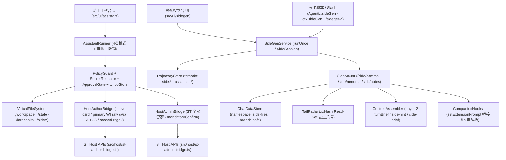
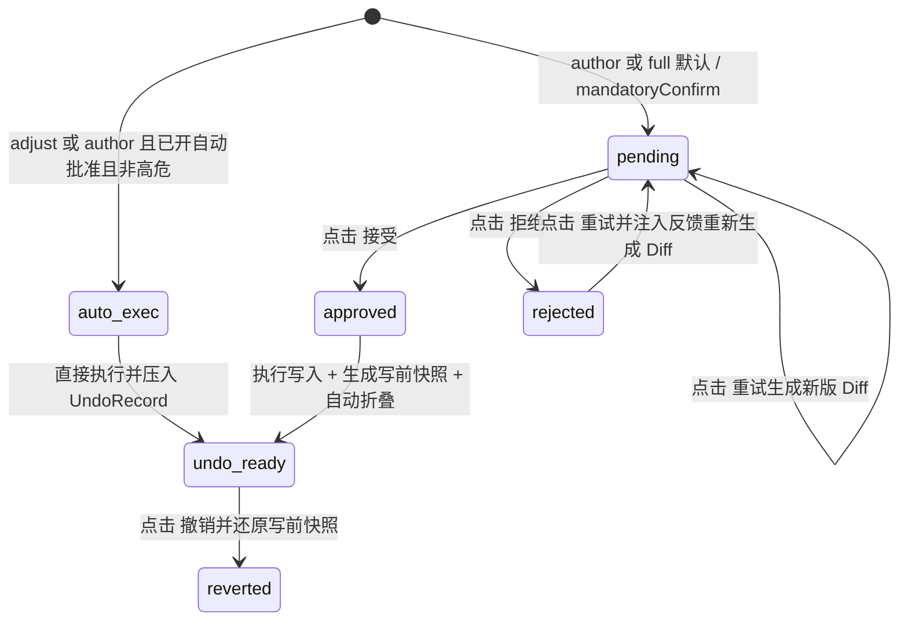
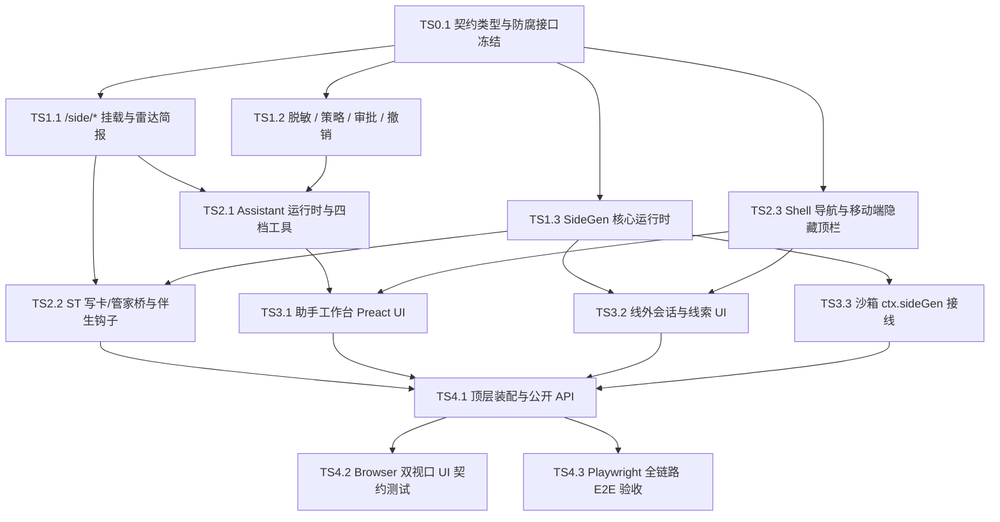

# ST-Agentic 线外生成体系架构与并行实施计划（Assistant + SideGen）

> 本文档为 `ST-Agentic` **不占用主线上下文的线外生成体系**的权威架构规格与多 Agent 并行实施任务书，严格继承 [ARCHITECTURE.md](./ARCHITECTURE.md) 的四大架构红线与 [TASKS.md](./TASKS.md) 的并行契约机制，并与交互原型 [assistant-ui-prototype.html](./assistant-ui-prototype.html) 保持 1:1 契约一致。

---

## §1 背景、设计目标与架构红线

### 1.1 核心痛点与设计目标

`ST-Agentic` 当前的触发管线（`before_turn` / `main_turn` / `after_turn` / `maintenance`）面向**主线回合自动执行**。但在真实跑团与写卡创作中，存在两类无法也不应塞进主线 Prompt 的高频需求：

1. **线外助手（Assistant）**：由**用户主动触发**的独立侧边工作台，按风险分级切换四种能力模式：
   - **交流模式（`chat`）**：纯聊天答疑、剧情/设定的诊断复盘，严格只读不写；
   - **调整模式（`adjust`）**：修正当前 Chat 消息、分支变量、工作区与分支 WI 覆写；
   - **写卡模式（`author`）**：面向角色卡创作者，具备调整能力并可永久修改当前角色卡、绑定主世界书（直接书写原始 `@@` 装饰器与 `<% ... %>` EJS 代码）及角色绑定正则；
   - **完全控制（`full`）**：默认读写全局全部**已开启**世界书；开启独立开关 **`🛡️ ST 全权管家`** 后，可接管全局世界书/角色卡/人设/ST 设置/预设/斜杠命令与 URL 资源导入。
2. **线外剧情生成（SideGen）**：由**写卡脚本 / Slash / SDK 触发**的一次性小插曲、不在场 NPC 动态、流言蜚语/传闻演化，或类似“加密手机通讯”的独立多轮线外对话：
   - 对主线上下文 Token 与主线 Prefix KV Cache 占用为 **0**（除非按规则桥接进入 `/side/*` 潜伏线索池）；
   - 不干扰主线正文流，不在原生 `#chat` 插入楼层记录，按作者选定策略在后续回合“按需浮现”产生蝴蝶效应。

### 1.2 严格遵循的四大架构红线

| 红线 | 对线外生成体系的具体约束 |
| :--- | :--- |
| **1. 严格宿主边界（Host Boundary）** | `src/core/**`（包含 `/side/*` VFS、`SideGenService`、`AssistantRunner`、`UndoStore`、`Redact`）**严禁**导入 `@st/*`、`window`、`document`、`$` 或 `jQuery`。写卡与 ST 全局管理全部通过 `src/core/bridge/` 新增的 `HostAuthorBridge` 与 `HostAdminBridge` 执行，宿主实现仅存在于 `src/host/**`。 |
| **2. 只增不改 KV Cache 不变性（Append-Only Prefix）** | ① 线外产物不直接修改主线 Layer 0 静态前缀与历史 Layer 1；② 持久化线外会话（`SideSession`）与助手会话均复用 `TrajectoryStore`（线程键 `side:<id>` / `assistant:<id>`）＋ `canonicalStringify` 规范排序 ＋ 高低水位压缩，保持线外多轮自身的高缓存命中率；③ `adjust` 模式编辑历史楼层默认 `syncTrajectory: 'none'`，0 击穿主线缓存。 |
| **3. 零原生替代与 Shadow DOM 隔离 UI** | 不替换 `#chat .mes`。作者向小剧场/手机通讯 UI 由写卡作者自行在卡内脚本经 SDK 构建；`ST-Agentic` 仅在现有 `<dialog id="agentic-app">`（`Shadow DOM` + `dark`/`light`/`auto`）中新增 `offmain`（线外协作）分组（`assistant` 助手工作台 + `sidegen` 线外会话与线索），移动端 `< 768px` 对话态隐藏顶部控制台标题与导航栏、触控区 `>= 40×40px`、输入控件 `>= 16px`、禁用 Monaco。 |
| **4. 因果分支安全（Causal Branch Safety）** | `/side/*` 文件、`branch` 作用域 `SideSession` 与当前聊天写入绑定 `(messageId, swipeId)`；切换 Swipe/重抽/切卡立即触发 `AbortSignal` 并回滚 `SideSession` 分支检查点；写卡/全权管家写入全部留存写前快照支持一键撤销。 |

### 1.3 总体架构拓扑



---

## §2 线外信息入主线机制：`/side/*` VFS 挂载与四档按需投递

线外生成结果（与某位 NPC 的短信记录、暗线流言、助手整理的暗桩档案）禁止硬塞入主线系统提示词或默认世界书；系统通过分支安全挂载 **`/side/*`** 与四档按需投递机制，将其变为“主线可在合适时机按需消费的伏笔”。

### 2.1 存储与 `/side/*` VFS 挂载

- **分支数据命名空间**：在 `DataNamespace`（`src/core/types/vfs.ts`）新增 `'side-files'`，在 `NAMESPACE_POLICY`（`src/core/store/chat-data-store.ts`）注册 `{ layered: true }`。
  - 所有写入遵循 `(messageId, swipeId)` 因果链前向传播与冷层压平归档；用户划回旧 Swipe 或重抽时，该时间线之后产生的线外线索自动隐去。
- **VFS 挂载实现**：新增 `SideMount`（`src/core/vfs/fs-side.ts`），挂载到 `VirtualFileSystem` 路径前缀 **`/side`**，约定子目录：
  - `/side/comms/<npc>.md`：远程加密通讯 / 手机聊天桥接档案；
  - `/side/rumors/<topic>.md`：市井流言 / 势力暗流演化线索；
  - `/side/notes/<slug>.md`：线外事件备忘 / 伏笔便签。
- **Frontmatter 元数据编解码**：由 `src/core/utils/side-clue-codec.ts` 解析与序列化，标准格式：

```markdown
---
id: clue_linwan_comms
title: 林晚的加密通讯线索
delivery: radar_hint
status: dormant
keywords:
  - 老码头
  - 灯塔
  - 林晚
  - 门禁卡
secondaryKeys: []
scanDepth: 2
order: 100
summary: 林晚已在老码头旧仓库灯塔下接应，并确认东区巡逻 21:30 换防。
sourceSessionId: phone:linwan
anchor: 12#0
createdAt: 1732320000000
updatedAt: 1732326600000
---
- [18:10 User]: 今晚十点老码头见，带上门禁卡。
- [18:11 林晚]: 收到，东区巡逻九点半换防，我提前二十分钟在旧仓库灯塔下等你。
```

### 2.2 四档主线投递策略矩阵

| 投递策略（`SideClueDelivery`） | 默认 | 雷达触发 | 主 Agent 可读取 | 主线上下文行为与 KV Cache 影响 |
| :--- | :---: | :---: | :---: | :--- |
| **`none`**（完全隔离） | - | 否 | 仅显式路径或线外台 | 彻底隔离，主线完全不可见。适用于纯娱乐性线外小插曲。 |
| **`vfs_only`**（仅 VFS 可查） | - | 否 | 是 | 不主动注入任何提示；仅当主 Agent 自主调用 `read_file` / `search_files` / `grep_search` 查阅 `/side/*` 时才消费。 |
| **`radar_hint`**（尾部雷达按需触发） | **是** | **是** | 是 | 由 `TailRadar` 复用 `parseLoreRegex` + `Read-Set`（`xxHash`）在 **Layer 2 尾部**扫描关键词。命中且未读或内容哈希已更新时，输出 `<side-hint>` 精炼标题+路径提醒；**主线 Read-Set 哈希未变化时 100% 静默**，不重复占用 Token。 |
| **`next_turn_brief`**（下轮一次性简报） | - | 忽略 | 是 | 在下一主线回合的 Layer 2 `turnBrief` 中注入一次 `<side-brief>`，回合完成后自动将状态标为 `surfaced` 并降级消费标记，避免污染后续回合前缀。 |

### 2.3 接管模式 vs 伴生模式接入与手工导出世界书

- **完全接管模式（`takeover`）**：
  - `TailRadar.scanSideClues(...)` 在 `ContextAssembler` 构建 Layer 2 动态段时同步扫描 `/side/*`，将命中但未读/已更新线索追加为 `<side-hint>`，将未消费的 `next_turn_brief` 写入 `turnBrief` 的 `<side-brief>`；Layer 0/1 保持只增不改。
- **伴生模式（`companion`）**：
  - 在 `src/host/companion-hooks.ts` 新增轻量桥接 `setExtensionPrompt('agentic_side_bridge', ..., extension_prompt_types.IN_CHAT, 0)`，将当前最近对话命中的 `radar_hint`（`summary` + `/side/*` 路径）与待消费的 `next_turn_brief` 注入酒馆原生生成队列；当 `runMode === 'off'` 时必须调用 `setExtensionPrompt('agentic_side_bridge', '', ...)` 彻底清空。
  - 同时复用 `resolveVfsFileSync('/side/...', target)`，使 `{{file::/side/comms/linwan.md}}` 等原生宏在伴生模式下同步解析成功。
- **手动升级导出至真实世界书**：
  - 在 SideGen 控制台（`线索 (/side/*)` 详情页）或 SDK `clues.exportToWorldInfo()`，支持用户一键将成熟伏笔转换为真实 SillyTavern World Info 条目（绑定关键词、插入深度与内容，经 `HostAuthorBridge` 确认写入并生成撤销快照）。

---

## §3 助手子系统（Assistant Runtime）：四档分级权限与安全红线

助手拥有独立对话轨（`TrajectoryStore` 线程键 `assistant:<sessionId>`）与独立模型选择器（`connectionId: 'inherit' | string`），**0 占用主线上下文**。用户输入指令后，由助手自主调用只读/写入工具完成探索与修改。

### 3.1 四档权限矩阵与能力边界

| 能力维度 | 💬 交流模式 (`chat`) | 🔧 调整模式 (`adjust`) | ✍️ 写卡模式 (`author`) | ⚡ 完全控制 (`full` · 默认) | 🛡️ 完全控制 + ST 全权管家 (`stAdminEnabled: true`) |
| :--- | :---: | :---: | :---: | :---: | :---: |
| 读取 VFS / Chat / 变量 / 日志 / 状态 | ✅ | ✅ | ✅ | ✅ | ✅（Key/Token 自动脱敏 `***REDACTED***`） |
| 修改当前 Chat（楼层正文 / 隐藏状态 / 展示覆写） | ❌ | ✅ | ✅（含调整能力） | ✅ | ✅ |
| 修改分支变量 / 工作区 / `/side/*` / 分支 WI 覆写 | ❌ | ✅ | ✅（分支 WI 默认 `escapeAt`） | ✅ | ✅ |
| 永久修改当前角色卡、绑定主世界书（允许原始 `@@` 与 EJS） | ❌ | ❌ | ✅ | ✅ | ✅ |
| 永久修改当前角色绑定正则（`SCOPED`）与嵌卡数据 | ❌ | ❌ | ✅ | ✅ | ✅ |
| 读写全局**全部已开启**世界书 | ❌ | ❌ | ❌ | ✅ | ✅ |
| 读写全库世界书 / 全角色卡 / 人设 / 全局正则 | ❌ | ❌ | ❌ | ❌ | ✅ |
| 读写 ST 全局设置 / 切换预设 / Slash / URL 导入 | ❌ | ❌ | ❌ | ❌ | ✅ |
| 写入审批策略 | 只读无写入 | 直接执行 + 自动写前快照 | 默认**气泡 Diff 审批**（可勾选本会话自动批准） | 已开启 WI 同写卡策略 | **删除/设置/预设/全局正则/Slash/导入/跨卡批处理 永远强制确认** |

### 3.2 各档工具清单（Tool Contracts）

1. **`chat` 只读底座工具**（全部后续模式继承）：
   - 复用现有：`list_dir`、`glob_files`、`grep_search`、`search_files`、`read_file`、`read_variables`、`search_history`、`read_history`；
   - 新增只读工具：`agentic_read_status`（运行模式/活跃预设/主线水位/缓存命中率/当前分支坐标）、`agentic_read_traces`（检索近期生成与工具日志，自动脱敏）、`card_read_active`（当前角色卡字段与扩展字段只读快照）、`wi_read_enabled`（已开启世界书目录与条目）。
2. **`adjust` 调整工具**（作用于当前聊天，全部自动留存 `UndoRecord`）：
   - 复用 VFS/变量写工具：`patch_variables`、`write_file`、`append_file`、`edit_file`（作用域仅允许 `/workspace/**`、`/state/**`、`/lorebooks/**`、`/side/**`）；
   - `chat_edit_message({ target, oldText?, newText, syncTrajectory: 'none' | 'rewrite' | 'fork' })`：调用 `HostBridge.writeChatMessage(target, nextContent, { emitEvent: true })`。默认 `syncTrajectory: 'none'`（原位改写楼层且不破坏主线 `TrajectoryStore` 前缀缓存）；
   - `chat_toggle_hide_message({ messageId, hidden })`：切换酒馆 `is_system` 状态并刷新楼层；
   - `message_override_display({ target, content })`：写入 `DATA_NAMESPACES.MESSAGE` 仅影响展示不改模型上下文。
3. **`author` 写卡工具**（包含 `adjust`，永久写操作受 `ApprovalGate` 管控）：
   - `card_read_full` / `card_patch_active({ fields })`：通过 `HostAuthorBridge` 调用 ST `/api/characters/merge-attributes` 持久化并三处同步（`characters[chid]`、`characters[chid].data`、`chat_metadata`/界面）；
   - `wi_read_raw_book` / `wi_upsert_primary_entry` / `wi_delete_primary_entry`：通过 `loadWorldInfo` / `saveWorldInfo` 持久化当前角色绑定主世界书；**显式绕过 `escapeAt`**，允许直接写入原始 `@@system` / `@@trigger` 装饰器及 `<% ... %>` EJS 逻辑，并执行基础语法体检（对明显未闭合 `<%` 或未知 `@@` 给出非阻断告警）；
   - `regex_list_scoped` / `regex_upsert_scoped` / `regex_delete_scoped`：读写当前角色 `data.extensions.regex_scripts` 并调用 `saveScriptsByType(..., SCRIPT_TYPES.SCOPED)`；
   - `card_embed_agentic`：复用 `src/host/embed-card.ts` 将当前预设/文件打包嵌入角色卡扩展字段。
4. **`full`（已开启 WI）与 `ST 全权管家` 工具**：
   - `full` 默认解锁：`wi_list_enabled_books`、`wi_upsert_enabled_entry`、`wi_delete_enabled_entry`；
   - 开启 `stAdminEnabled` 后额外解锁 `tools-admin.ts`：
     - `wi_admin_list_all` / `wi_admin_create_book` / `wi_admin_bind_book` / `wi_admin_upsert_entry` / `wi_admin_delete_entry`；
     - `card_admin_list_all` / `card_admin_read` / `card_admin_create` / `card_admin_patch` / `card_admin_delete` / `card_admin_select`；
     - `persona_admin_list` / `persona_admin_upsert` / `persona_admin_select`；
     - `st_settings_read` / `st_settings_patch`（`power_user` 与指定扩展设置键）；
     - `st_preset_list` / `st_preset_select` / `st_preset_patch`；
     - `regex_admin_global_upsert` / `regex_admin_global_delete`（`SCRIPT_TYPES.GLOBAL`）；
     - `st_slash_exec`（复用 `executeStSlashCommand`）；
     - `st_import_url`（通过 ST `/api/content/importURL` 导入远程角色卡/世界书/预设资源）。

### 3.3 三道不可绕过的安全红线与气泡审批状态机

1. **高危强制审批不可跳过**：所有 `*_delete_*`、`st_settings_patch`、`st_preset_*`、`regex_admin_global_*`、`st_slash_exec`、`st_import_url` 与跨卡批处理操作，即使勾选“本会话自动批准写卡（`autoApproveAuthor`）”，仍强制置 `mandatoryConfirm: true`，必须人工在气泡内点击 `✓ 接受`。
2. **秘密信息递归脱敏（`src/core/assistant/redact.ts`）**：对任何键名命中 `/api[_-]?key|token|secret|password|authorization|cookie|bearer|private[_-]?key/i` 或 Bearer 前缀凭证的值递归替换为 `'***REDACTED***'`，作用于读工具返回值、日志轨迹（`AgentRunTrace`）及 UI 预览。
3. **写前快照与一键撤销（`src/core/assistant/undo-store.ts`）**：所有 `adjust` / `author` / `full` 写入执行前，自动序列化写前状态为 `UndoRecord` 写入撤销栈，并在 AI 气泡顶部活动条及全局「↩ 写前快照撤销历史」抽屉中提供一键还原。



---

## §4 线外生成运行时（SideGen Runtime & Author SDK）

作者向业务 UI（如微信手机聊天界面、酒馆论坛八卦墙、NPC 每日信件弹窗）**完全由写卡作者在卡内 HTML/CSS/JS 脚本中自定义构建**；`ST-Agentic` 负责提供**高性能 KV Cache 友好的后台生成、分支生命周期管理、`/side/*` 线索自动桥接与控制台管理视图**。

### 4.1 `Agentic.sideGen` / `ctx.sideGen` 完整 SDK 契约

- **`runOnce(opts: SideGenOnceOptions): Promise<SideGenResult>`**
  - **一次性无残留生成**：不建立 `TrajectoryStore` 持久线程，不写主线聊天，默认 0 状态残留。
  - 可选 `mainChatDepth`（仅以只读尾片方式拼接最近 N 条主线消息）、`includeVars`、独立 `connectionId`（默认跟随主连接）、`abortSignal`。
  - 可选 `bridge: { path, delivery, title?, keywords?, summary? }`：若显式指定，则将本次小插曲结果同步沉淀到 `/side/*` 供主线消费。
- **`createSession(opts: CreateSideSessionOptions): Promise<SideSessionInfo>`**
  - 创建持久化线外会话（如 `phone:linwan`）。配置 `scope: 'branch' | 'chat'`、`systemPrompt`、`connectionId`、高低水位 `watermark: { high, low }`，以及可选 `autoBridge: { path, delivery, keywords, title, mode: 'append' | 'replace', summaryPrefix? }`。
- **`send(sessionId: string, prompt: string, opts?: SideGenSendOptions): Promise<SideGenResult>`**
  - 复用 `TrajectoryStore` 线程键 `side:<sessionId>`：冻结系统提示词静态前缀（Layer 0），仅追加本轮对话（Layer 1/2），命中商业模型显式缓存断点以获得 >90% 缓存命中；超过 `watermark.high` 自动触发线外独立压缩；
  - 若开启 `autoBridge`，每次生成完毕自动同步更新对应 `/side/*` 文档并刷新 `xxHash`，下一次主线 `TailRadar` 扫描检测到关键词或哈希变更即可触发 `[已更新]`。
- **管理与线索方法集**：
  - 会话管理：`getSession(sessionId)`、`listSessions(filter?)`、`getTranscript(sessionId)`、`compactSession(sessionId)`、`deleteSession(sessionId)`；
  - 线索操作 `clues.*`：`write(input)`、`read(path, target?)`、`list(target?)`、`updateDelivery(path, delivery)`、`updateStatus(path, status)`、`delete(path, target?)`、`exportToWorldInfo(path, options)`。

### 4.2 因果分支安全与斜杠命令入口

- **因果锚点隔离**：
  - `scope === 'branch'` 的 `SideSession` 每次 `send()` 均记录与主线当前坐标 `(messageId, swipeId)` 绑定的 `BranchCheckpoint`；当主线切换 Swipe 或重抽退回历史楼层时，自动回滚 `side:<sessionId>` 至该祖先分支最新检查点；
  - 正在进行中的 SideGen HTTP 流监听主线重抽/切卡/取消 `AbortSignal`，保证后台残留请求零污染。
- **斜杠命令入口（`src/host/sidegen-slash.ts`）**：
  - `/sidegen-once`：`--system`、`--depth`、`--connection`、`--path`、`--delivery`、`--keywords`、`--title`；
  - `/sidegen-send`：`--session`、`--scope`、`--system`、`--path`、`--delivery`、`--keywords`；
  - `/sidegen-clue`：`--action list|read|write|delivery|status|export`、`--path`、`--delivery`、`--keywords`、`--title`。

---

## §5 核心契约与防腐层接口设计（Wave S0 冻结规格）

在 **Wave S0 (`TS0.1`)** 中，所有跨层共享类型与宿主边界接口先行冻结于 `src/core/types/` 与 `src/core/bridge/`，现有测试桩通过可选属性实现**100% 向后兼容**。

### 5.1 核心领域类型（`src/core/types/off-mainline.ts`）

```typescript
export type AssistantMode = 'chat' | 'adjust' | 'author' | 'full';

export type ApprovalStatus = 'pending' | 'approved' | 'rejected';

export interface DiffLine {
    type: 'ctx' | 'del' | 'add';
    text: string;
}

export interface PendingApproval {
    id: string;
    sessionId: string;
    messageId: string;
    toolCallId: string;
    toolName: string;
    riskLevel: 'medium' | 'high';
    mandatoryConfirm: boolean;
    revision: number;
    title: string;
    summary: string;
    targetLabel: string;
    status: ApprovalStatus;
    rawContent: string;
    diffLines: DiffLine[];
    args: Record<string, unknown>;
    undoId?: string;
    rejectionFeedback?: string;
    reverted?: boolean;
    createdAt: number;
}

export interface UndoRecord {
    id: string;
    sessionId: string;
    toolCallId: string;
    toolName: string;
    kind: 'chat_message' | 'variables' | 'vfs_file' | 'character' | 'worldinfo' | 'regex' | 'st_setting';
    label: string;
    scope: string;
    beforeSummary: string;
    afterSummary: string;
    snapshot: Record<string, unknown>;
    target?: { messageId: number; swipeId: number };
    timestamp: number;
    reverted: boolean;
}

export interface AssistantMessage {
    id: string;
    role: 'user' | 'assistant';
    content: string;
    think?: string;
    toolCalls?: Array<{
        id: string;
        name: string;
        scopeLabel: string;
        status: 'ok' | 'error';
        durationMs: number;
        argsSummary: string;
        resultSummary: string;
        hasSecretRedaction?: boolean;
        undoId?: string;
    }>;
    approvalIds?: string[];
    fileRefs?: string[];
    usage?: { inputTokens: number; cachedTokens: number; outputTokens: number; cacheRate: string };
    interrupted?: boolean;
    timestamp: number;
}

export interface AssistantSession {
    id: string;
    title: string;
    mode: AssistantMode;
    stAdminEnabled: boolean;
    autoApproveAuthor: boolean;
    connectionId: string; // 'inherit' | connection.id
    updatedAt: number;
    messages: AssistantMessage[];
}

export type SideClueDelivery = 'none' | 'vfs_only' | 'radar_hint' | 'next_turn_brief';
export type SideClueStatus = 'dormant' | 'surfaced' | 'resolved';

export interface SideClueMeta {
    id: string;
    title: string;
    delivery: SideClueDelivery;
    status: SideClueStatus;
    keywords: string[];
    secondaryKeys?: string[];
    scanDepth?: number;
    order?: number;
    summary: string;
    sourceSessionId?: string;
    anchor: string;
    createdAt: number;
    updatedAt: number;
    consumedByTurn?: number;
}

export interface SideClueDoc {
    path: string;
    meta: SideClueMeta;
    body: string;
    contentHash: string;
}

export type SideSessionScope = 'branch' | 'chat';

export interface SideSessionAutoBridge {
    path: string;
    delivery: SideClueDelivery;
    keywords: string[];
    title: string;
    mode: 'append' | 'replace';
    summaryPrefix?: string;
}

export interface SideSessionConfig {
    id: string;
    title: string;
    scope: SideSessionScope;
    systemPrompt: string;
    connectionId: string;
    watermark: { high: number; low: number };
    autoBridge?: SideSessionAutoBridge;
    anchor: { messageId: number; swipeId: number };
    turns: number;
    estimatedTokens: number;
    lastCacheHitRate?: string;
    createdAt: number;
    updatedAt: number;
}

export interface SideGenOnceOptions {
    prompt: string;
    systemPrompt?: string;
    connectionId?: string;
    mainChatDepth?: number;
    includeVars?: boolean;
    bridge?: {
        path: string;
        delivery: SideClueDelivery;
        title?: string;
        keywords?: string[];
        summary?: string;
    };
    signal?: AbortSignal;
}

export interface SideGenSendOptions {
    connectionId?: string;
    mainChatDepth?: number;
    includeVars?: boolean;
    signal?: AbortSignal;
}

export interface SideGenResult {
    text: string;
    sessionId?: string;
    bridgedPath?: string;
    usage?: { inputTokens: number; cachedTokens: number; outputTokens: number };
    durationMs: number;
}
```

### 5.2 防腐层扩展（`src/core/bridge/host-admin-bridge.ts` & `host-bridge.ts` & `tool-context.ts`）

- **`HostBridge` 可选扩展**（在 `src/core/bridge/host-bridge.ts` 追加）：
  - `author?: HostAuthorBridge;`
  - `admin?: HostAdminBridge;`
- **`HostAuthorBridge` 核心方法**：
  - `getActiveCharacterFull()` / `patchActiveCharacter(fields, undoMeta?)`
  - `toggleChatMessageHidden(messageId, hidden)`
  - `getPrimaryWorldName()` / `readWorldInfoBook(bookName)` / `upsertWorldInfoEntry(bookName, entry, opts)` / `deleteWorldInfoEntry(bookName, uid)`（`upsertWorldInfoEntry` 直写 ST 原生世界书对象，不经过 `escapeAt`）
  - `listScopedRegex()` / `saveScopedRegex(scripts)`
  - `embedAgenticPayload(options)`
- **`HostAdminBridge` 核心方法**（仅供 `full` 且 `stAdminEnabled === true` 调用）：
  - 全库世界书：`listAllWorldNames()`、`createWorldBook(name)`、`bindWorldBook(name, enabled)`；
  - 全库角色卡：`listAllCharacters()`、`readCharacterById(chid)`、`createCharacter(payload)`、`patchCharacterById(chid, fields)`、`deleteCharacterById(chid)`、`selectCharacterById(chid)`；
  - 人设与预设：`listPersonas()`、`upsertPersona(key, desc, title?)`、`selectPersona(key)`、`listPresets(apiType?)`、`selectPreset(name, apiType?)`、`patchPreset(name, patch)`；
  - 全局设置 / 全局正则 / URL 导入：`readHostSettings(scope)`、`patchHostSettings(scope, patch)`、`listGlobalRegex()`、`saveGlobalRegex(scripts)`、`importFromUrl(url)`。
- **`ToolExecutionContext` 扩展**（`src/core/bridge/tool-context.ts`）：新增 `readonly sideGen?: ToolSideGenApi;`，供 JS 沙箱脚本内通过 `ctx.sideGen.runOnce(...)`、`ctx.sideGen.send(...)`、`ctx.sideGen.clues.*` 无缝调用。

---

## §6 交互与 UI 规范（同步 [assistant-ui-prototype.html](./assistant-ui-prototype.html)）

完整视觉与交互基准已在可运行 HTML 原型 [assistant-ui-prototype.html](./assistant-ui-prototype.html) 中验证定稿，生产组件（`TS2.3` / `TS3.1` / `TS3.2`）必须严格遵从以下交互契约：

1. **控制台导航分组扩展（`src/ui/store/view-registry.ts`）**
   - `ConsoleTabId` 追加 `'assistant' | 'sidegen'`；
   - `ConsoleTabGroup` 在最顶部新增 `'offmain'`（标签：`线外协作`）：
     - `assistant`（`助手工作台` · 短标签 `助手`）：4 档模式、冒泡 Diff 审批、写前快照撤销；
     - `sidegen`（`线外会话与线索` · 短标签 `线外线索`）：`/side/*` 线索库管理、持久线外会话监控、Author SDK 试跑台。
   - 在 `src/ui/capsule/HostEntryWidgets.tsx`（`#extensionsMenu` 魔棒菜单）新增直达深链接：「🤖 打开 Agentic 助手」与「📡 线外会话与线索」。

2. **助手工作台交互契约（`src/ui/assistant/`）**
   - **极致空间利用（砍掉冗余外设）**：
     - 取消“快捷指令条”与“手动附带上下文芯片”；用户输入自然语言后，由助手自主调用只读工具获取现场；
     - 桌面端会话列表收敛为左上角滑出抽屉按钮 `☰ 会话 (N)`，保持对话主视口最大化；
     - **桌面端 / 移动端单行超薄顶栏**（`min-h-[46px]`）：仅保留会话切换（桌面 `☰ 会话` / 移动 `←`）、当前会话标题、`＋` 新建、`↩ N` 撤销栈入口；
     - **统一底部输入组**：权限模式切换按钮（点击弹出浮层选择 4 档模式、勾选「本会话自动批准写卡」或经二次确认模态框开启 `🛡️ ST 全权管家`）与模型连接按钮（`跟随主连接` 或指定 `ApiConnection`）全部**合入输入组左下角**；右下角采用紧凑 **`40×40px`** 方钮：待发送态为 **`▶`**，流式输出态为 **`■`**。
   - **移动端（`< 768px`，390×844）专有堆叠规则**：
     - 进入助手具体会话对话态（`activeTab === 'assistant' && mobileViewStack === 'detail'`）时，**`AgenticAppShell` 必须自动隐藏顶部 `⚡ ST-Agentic` 标题栏与顶部导航标签栏（`NAV_ITEMS`）**，将全部垂直空间让渡给对话消息流与输入组；
     - 点击对话左上角 `←` 返回会话列表（或从其他 Tab 切入 `assistant` 落入 `list` 视图）时，顶部控制台标题栏与导航标签栏立即恢复显示；
     - 全部输入文本域保持 `font-size >= 16px` 防止 iOS 自动缩放，触控按钮 `>= 40×40px`。
   - **AI 输出气泡内联审批**：
     - `author` / `full` 产生的变更审批不再弹窗阻塞，也不单独占底栏警告条，而是**直接附着在对应 AI 输出气泡底部**（支持 `Diff` / `原文` 切换、高危项显示 `🔒 强制确认`）；
     - 提供 `↻ 重试`、`✕ 拒绝`、`✓ 接受` 三钮操作；已接受或已拒绝后**自动折叠为单行紧凑状态条**（显示 `✓ 已接受：...` / `✕ 已拒绝：...`，保留 `详情`、`↻ 重试` 或 `↩ 撤销`），若用户先点击 `↻ 重试` 重新展开并再次点击 `✓ 接受`，亦必须重置展开状态并折叠为单行状态条。

3. **SideGen 管理台交互契约（`src/ui/sidegen/`）**
   - 顶部 3 子页签：`线索 (/side/*)`、`线外会话`、`SDK 试跑`；
   - `线索 (/side/*)`：桌面左右分栏 Master-Detail、移动端 `list ↔ detail` 推入栈；支持切换投递策略（4 档）、线索状态、编辑摘要与正文、以及点击「📤 导出到世界书」弹窗落地真实 WI；
   - `线外会话`：展示每个 `SideSession` 的 `scope`（`branch` / `chat`）、锚点坐标、桥接 `/side/*` 路径、Token 水位与缓存命中率，支持查看只读记录、手动压缩与删除；
   - `SDK 试跑`：提供 `send()` / `runOnce()` 可视化参数表单、模拟/实跑输出展示及一键复制可直接黏贴进角色卡脚本的 `Agentic.sideGen.*` JS 代码。

---

## §7 多 Agent 并行实施排期与任务看板（Wave S0 → Wave S4）

沿用 [TASKS.md](./TASKS.md) 的严格协作协议：**先契约后扇出 + 同波次目录绝对互斥 + 单写者跟踪 + 门禁合并（`npm run typecheck` + `npm run lint` + 定向 Vitest）**。共拆分 **13 个原子任务包**，分 **5 个波次**（`Wave S0` → `Wave S4b`）推进。

### 7.1 任务总览矩阵

**状态图例**：`[ ]` 待开始 · `[~]` 进行中 · `[x]` 已完成 · `[!]` 阻塞待协调

| 任务 ID | 任务名称 | 波次 | 轨道 | 前置依赖 | 独占写路径（Owned Paths）摘要 | 状态 |
| :--- | :--- | :---: | :---: | :--- | :--- | :---: |
| **TS0.1** | 线外领域契约、防腐接口、Frontmatter 编解码与测试桩 | Wave S0 | Serial | 无 | `src/core/types/off-mainline.ts`, `src/core/types/{index,vfs,trace,settings}.ts`, `src/core/bridge/{host-admin-bridge,host-bridge,tool-context,index}.ts`, `src/core/utils/{side-clue-codec,index}.ts`, `tests/mocks/**`, `tests/fixtures/off-mainline-fixtures.ts` | `[ ]` |
| **TS1.1** | `/side/*` VFS 挂载、`side-files` 存储与尾部雷达/简报桥接 | Wave S1 | Track A | TS0.1 | `src/core/store/chat-data-store.ts`, `src/core/vfs/{fs-side,filesystem,index}.ts`, `src/core/lore/tail-radar.ts`, `src/core/context/context-assembler.ts`, `tests/unit/vfs/fs-side.test.ts`, `tests/unit/lore/side-radar.test.ts` | `[ ]` |
| **TS1.2** | 秘密脱敏器、四档策略守卫、审批闸门与写前快照撤销引擎 | Wave S1 | Track B | TS0.1 | `src/core/assistant/{redact,policy,approval,undo-store}.ts`, `tests/unit/assistant/policy-and-undo.test.ts` | `[ ]` |
| **TS1.3** | SideGen 核心运行时（`runOnce`、`SideSession`、压缩与自动桥接） | Wave S1 | Track C | TS0.1 | `src/core/sidegen/**`, `tests/unit/sidegen/**` | `[ ]` |
| **TS2.1** | Assistant 运行时、四档工具集与气泡审批重试闭环 | Wave S2 | Track A | TS1.1, TS1.2 | `src/core/assistant/{tools-chat,tools-adjust,tools-author,tools-admin,session-store,assistant-runner,index}.ts`, `tests/unit/assistant/{assistant-runner,assistant-tools}.test.ts` | `[ ]` |
| **TS2.2** | ST 写卡/全权管家宿主桥、伴生 `/side/*` 钩子与斜杠命令 | Wave S2 | Track B | TS1.1, TS1.3 | `src/host/{st-author-bridge,st-admin-bridge,sidegen-slash,st-bridge,companion-hooks}.ts`, `tests/unit/host/st-author-admin-bridge.test.ts` | `[ ]` |
| **TS2.3** | Shadow DOM 控制台导航扩展、移动端对话隐藏顶栏与魔棒深链 | Wave S2 | Track C | TS0.1 | `src/ui/store/{view-registry,app-store}.ts`, `src/ui/shell/{AgenticAppShell.tsx,styles.ts}`, `src/ui/capsule/HostEntryWidgets.tsx` | `[ ]` |
| **TS3.1** | 助手工作台 Preact 视图（极简输入组 + 气泡审批 + 撤销抽屉） | Wave S3 | Track A | TS2.1, TS2.3 | `src/ui/assistant/**` | `[ ]` |
| **TS3.2** | SideGen 线外会话与 `/side/*` 线索控制台 Preact 视图 | Wave S3 | Track B | TS1.3, TS2.3 | `src/ui/sidegen/**` | `[ ]` |
| **TS3.3** | JS 沙箱 `ctx.sideGen` 暴露与 `ToolExecutionContext` 接线 | Wave S3 | Track C | TS1.3 | `src/sandbox/js-sandbox.ts`, `src/core/tools/builtin.ts`, `tests/browser/sandbox/sidegen-sandbox.test.ts` | `[ ]` |
| **TS4.1** | 顶层装配入口、`Agentic.sideGen` / `Agentic.assistant` API 与多语言 | Wave S4a | Serial | TS2.2, TS3.1, TS3.2, TS3.3 | `src/index.ts`, `src/globals.d.ts`, `locales/**` | `[ ]` |
| **TS4.2** | Browser 双视口 UI 契约与移动端对话隐藏顶栏测试 | Wave S4b | Track A | TS4.1 | `tests/browser/ui/{assistant-ui,sidegen-ui}.test.tsx` | `[ ]` |
| **TS4.3** | 真酒馆 + Mock SSE 线外全链路 E2E 黄金路径验收 | Wave S4b | Track B | TS4.1 | `tests/e2e/off-mainline.spec.ts` | `[ ]` |

### 7.2 依赖拓扑图（DAG）



---

### 7.3 分波次原子任务卡明细（可直接作为并行 Worker Brief 派发）

#### Wave S0：公共契约与测试桩冻结（串行先导）

##### TS0.1 — 线外领域契约、防腐接口、Frontmatter 编解码与测试桩
- **关联章节**：[§2](#2-线外信息入主线机制side-vfs-挂载与四档按需投递)、[§5](#5-核心契约与防腐层接口设计wave-s0-冻结规格)
- **前置依赖**：无
- **独占写路径**：
  - `src/core/types/off-mainline.ts`
  - `src/core/types/index.ts`, `src/core/types/vfs.ts`, `src/core/types/trace.ts`, `src/core/types/settings.ts`
  - `src/core/bridge/host-admin-bridge.ts`, `src/core/bridge/host-bridge.ts`, `src/core/bridge/tool-context.ts`, `src/core/bridge/index.ts`
  - `src/core/utils/side-clue-codec.ts`, `src/core/utils/index.ts`
  - `tests/mocks/**`, `tests/fixtures/off-mainline-fixtures.ts`
- **实施细目**：
  1. 新建 `src/core/types/off-mainline.ts`，冻结 §5.1 定义的全部领域接口并从 `src/core/types/index.ts` 统一 re-export。
  2. 扩展 `DataNamespace`（加入 `'side-files'`）与 `ConsoleTabId`（加入 `'assistant' | 'sidegen'`）；按需在 `Settings` 增补可选 `offMainline?: { defaultAssistantConnectionId?: string; defaultDelivery?: SideClueDelivery }` 兼容字段。
  3. 新增 `src/core/bridge/host-admin-bridge.ts`（定义 `HostAuthorBridge`、`HostAdminBridge`、`ToolSideGenApi`），并在 `HostBridge` 与 `ToolExecutionContext` 上作为可选属性挂载。
  4. 编写 `src/core/utils/side-clue-codec.ts`（纯函数解析与规范序输出 `/side/*` YAML Frontmatter + Markdown 正文，不依赖 DOM/Host）。
  5. 在 `tests/mocks/` 扩展 `MemoryHostBridge` 的 `author` / `admin` 内存桩（含 API Key 样本以验证脱敏），并新增 `tests/fixtures/off-mainline-fixtures.ts`。
- **验收门禁**：`npm run typecheck`、`npm run lint`、`npx vitest run tests/unit/utils` 全绿。

---

#### Wave S1：三大核心引擎并行扇出

##### TS1.1 — `/side/*` VFS 挂载、`side-files` 存储与尾部雷达/简报桥接
- **关联章节**：[§2](#2-线外信息入主线机制side-vfs-挂载与四档按需投递)
- **前置依赖**：`TS0.1`
- **独占写路径**：
  - `src/core/store/chat-data-store.ts`
  - `src/core/vfs/fs-side.ts`, `src/core/vfs/filesystem.ts`, `src/core/vfs/index.ts`
  - `src/core/lore/tail-radar.ts`
  - `src/core/context/context-assembler.ts`
  - `tests/unit/vfs/fs-side.test.ts`, `tests/unit/lore/side-radar.test.ts`
- **实施细目**：
  1. 在 `src/core/store/chat-data-store.ts` 注册 `DATA_NAMESPACES.SIDE_FILES = 'side-files'` 及 `NAMESPACE_POLICY['side-files'] = { layered: true }`。
  2. 实现 `SideMount`（`src/core/vfs/fs-side.ts`）并在 `VirtualFileSystem` 中注册 `/side` 挂载；支持列举、搜索、读写与删除 `/side/comms/*`、`/side/rumors/*`、`/side/notes/*`。
  3. 扩展 `TailRadar` 新增 `scanSideClues(clues, input)`：复刻 `parseLoreRegex` 与 `Read-Set` `xxHash` 脏检查，`delivery === 'radar_hint'` 命中且未读或内容更新时生成紧凑 `<side-hint>`，已读且哈希未变时零输出；`none` 与 `vfs_only` 严格不触发。
  4. 扩展 `ContextAssembler` 在 Layer 2 动态段接入 `<side-hint>` 与一次性 `<side-brief>`（消费 `delivery === 'next_turn_brief'` 后返回已消费路径列表，严禁触碰 Layer 0 与历史 Layer 1）。
- **验收门禁**：`npm run typecheck`、`npm run lint`、`npx vitest run tests/unit/vfs/fs-side.test.ts tests/unit/lore/side-radar.test.ts` 全绿。

##### TS1.2 — 秘密脱敏器、四档策略守卫、审批闸门与写前快照撤销引擎
- **关联章节**：[§3.1](#31-四档权限矩阵与能力边界)、[§3.3](#33-三道不可绕过的安全红线与气泡审批状态机)
- **前置依赖**：`TS0.1`
- **独占写路径**：
  - `src/core/assistant/redact.ts`, `src/core/assistant/policy.ts`, `src/core/assistant/approval.ts`, `src/core/assistant/undo-store.ts`
  - `tests/unit/assistant/policy-and-undo.test.ts`
- **实施细目**：
  1. `redact.ts`：实现深度嵌套对象/数组/JSON 字符串与错误消息的递归脱敏，匹配敏感键名及 Bearer token 一律替换为 `'***REDACTED***'`。
  2. `policy.ts`：精确编码 4 档模式权限表与 tool allowlist；校验 `author` 严格包含 `adjust`，`full` 默认仅允许已开启世界书，`stAdminEnabled === true` 才放行全局管家工具，并给出每个工具的 `mandatoryConfirm` 标记。
  3. `approval.ts`：管理 `PendingApproval` 状态流转（`pending` → `approved` / `rejected`，`retry` 递增 `revision` 并附带 `rejectionFeedback`），实现行级 Diff 生成与强确认拦截逻辑。
  4. `undo-store.ts`：管理 `UndoRecord` 栈（持久化/内存适配），支持 7 类写入前置快照保存与按 `undoId` 幂等回滚。
- **验收门禁**：`npm run typecheck`、`npm run lint`、`npx vitest run tests/unit/assistant/policy-and-undo.test.ts` 全绿。

##### TS1.3 — SideGen 核心运行时（`runOnce`、`SideSession`、压缩与自动桥接）
- **关联章节**：[§4](#4-线外生成运行时sidegen-runtime--author-sdk)
- **前置依赖**：`TS0.1`
- **独占写路径**：
  - `src/core/sidegen/**`
  - `tests/unit/sidegen/**`
- **实施细目**：
  1. 定义 `SideSessionStore`：在 `chat_metadata.agentic_side_sessions`（按 `chat` 与因果分支 `(messageId, swipeId)` 隔离）维护 `SideSessionConfig`，复用 `TrajectoryStore` 线程键 `side:<sessionId>`。
  2. 实现 `SideGenService`：
     - `runOnce(opts)`：独立组装轻量 `LLMRequest`（可选只读 `mainChatDepth` 尾段上下文与 `vars`），调用指定 `LLMTransport` 产出结果，默认零残留，若传入 `bridge` 则通过注入的 `VirtualFileSystem` 写入 `/side/*`；
     - `createSession(opts)` / `send(sessionId, prompt, opts)`：冻住会话系统提示词 Prefix（显式缓存断点）、增量追加多轮并触发水位压缩；若配置 `autoBridge`，自动规范化更新 `/side/*` Frontmatter & 正文并重算 `xxHash`；
     - 实现 Swipe/重抽退回时的 `branch` 检查点自动回滚及全量 `AbortSignal` 取消传播。
  3. 实现 `clues` 操作门面（含调用 `HostAuthorBridge` 导出至真实世界书）。
- **验收门禁**：`npm run typecheck`、`npm run lint`、`npx vitest run tests/unit/sidegen` 全绿。

---

#### Wave S2：核心集成与宿主/外壳层并行开发

##### TS2.1 — Assistant 运行时、四档工具集与气泡审批重试闭环
- **关联章节**：[§3](#3-助手子系统assistant-runtime四档分级权限与安全红线)
- **前置依赖**：`TS1.1`, `TS1.2`
- **独占写路径**：
  - `src/core/assistant/tools-chat.ts`, `src/core/assistant/tools-adjust.ts`, `src/core/assistant/tools-author.ts`, `src/core/assistant/tools-admin.ts`
  - `src/core/assistant/session-store.ts`, `src/core/assistant/assistant-runner.ts`, `src/core/assistant/index.ts`
  - `tests/unit/assistant/assistant-runner.test.ts`, `tests/unit/assistant/assistant-tools.test.ts`
- **实施细目**：
  1. 按 §3.2 分别封装 `tools-chat`、`tools-adjust`、`tools-author`、`tools-admin`；所有只读返回均经过 `redact.ts`，所有可变写入在执行前通过 `undo-store.ts` 留存快照。
  2. 实现 `chat_edit_message`（`syncTrajectory: 'none' | 'rewrite' | 'fork'`，默认 `'none'`），验证修改历史消息时主线 KV Cache 0 击穿。
  3. 验证 `wi_upsert_primary_entry` / `wi_upsert_enabled_entry` 直传原始 `@@` 装饰器与 `<% ... %>` EJS 代码到 `HostAuthorBridge` 而不被 `escapeAt` 转义，仅 BRANCH VFS `/lorebooks/*` 保持 `escapeAt`。
  4. 实现 `AssistantRunner` 流式多轮执行器：挂起可审批写操作为气泡内 `PendingApproval`，暴露 `decideApproval(id, 'approve' | 'reject')` 与 `retryApproval(id, feedback?)` 自动续写新版 Diff，`abort()` 全链路可控中断。
- **验收门禁**：`npm run typecheck`、`npm run lint`、`npx vitest run tests/unit/assistant` 全绿。

##### TS2.2 — ST 写卡/全权管家宿主桥、伴生 `/side/*` 钩子与斜杠命令
- **关联章节**：[§2.3](#23-接管模式-vs-伴生模式接入与手工导出世界书)、[§3.2](#32-各档工具清单tool-contracts)、[§4.2](#42-因果分支安全与斜杠命令入口)
- **前置依赖**：`TS1.1`, `TS1.3`
- **独占写路径**：
  - `src/host/st-author-bridge.ts`, `src/host/st-admin-bridge.ts`, `src/host/sidegen-slash.ts`
  - `src/host/st-bridge.ts`, `src/host/companion-hooks.ts`
  - `tests/unit/host/st-author-admin-bridge.test.ts`
- **实施细目**：
  1. `st-author-bridge.ts`：对接 ST `/api/characters/merge-attributes` 与 `characters[chid]`/`characters[chid].data` 三处镜像同步、`loadWorldInfo`/`saveWorldInfo` 原生世界书原始读写、`saveScriptsByType(SCOPED)` 与 `embed-card.ts`。
  2. `st-admin-bridge.ts`：对接全库 WI（`world_names`）、全角色卡 CRUD、人设管理、`power_user`/`extension_settings` 读写、预设管理器（`getPresetManager()`）、全局正则（`SCRIPT_TYPES.GLOBAL`）、`executeStSlashCommand` 及 `/api/content/importURL`。
  3. 扩展 `STHostBridge` 暴露 `.author` 与 `.admin`；扩展 `companion-hooks.ts` 注册 `agentic_side_bridge` `setExtensionPrompt` 及 `off` 模式清理钩子。
  4. `sidegen-slash.ts`：注册 `/sidegen-once`、`/sidegen-send`、`/sidegen-clue` 原生斜杠命令解析与执行。
- **验收门禁**：`npm run typecheck`、`npm run lint`、`npx vitest run tests/unit/host` 全绿。

##### TS2.3 — Shadow DOM 控制台导航扩展、移动端对话隐藏顶栏与魔棒深链
- **关联章节**：[§6](#6-交互与-ui-规范同步-assistant-ui-prototypehtml)
- **前置依赖**：`TS0.1`
- **独占写路径**：
  - `src/ui/store/view-registry.ts`, `src/ui/store/app-store.ts`
  - `src/ui/shell/AgenticAppShell.tsx`, `src/ui/shell/styles.ts`
  - `src/ui/capsule/HostEntryWidgets.tsx`
- **实施细目**：
  1. 在 `view-registry.ts` 新增最顶部导航分组 `offmain`（`线外协作`）与 `assistant`、`sidegen` 两个 Tab 元数据。
  2. 在 `app-store.ts` 增加 `assistant` / `sidegen` UI 状态切片（`mobileAssistantStack: 'list' | 'detail'`、`selectedAssistantSessionId`、`assistantRuntimeBridge` 动作绑定等）。
  3. 升级 `AgenticAppShell.tsx`：**当 `isMobile && activeTab === 'assistant' && mobileAssistantStack === 'detail'` 时隐藏顶部控制台标题栏（`ag-header`）与顶部 Tab 导航栏（`ag-mobile-tabs`）**，仅在 `list` 视图或其他 Tab 时恢复显示；确保切换 Tab 到 `assistant` 在移动端落入 `list` 视图。
  4. 在 `styles.ts` 补充气泡内 Diff 高亮、极简输入组、`40×40px` 紧凑发送按钮等 Shadow DOM 独立样式变量（兼容 Dark/Light/Auto）；在 `HostEntryWidgets.tsx` 新增魔棒菜单直达按钮。
- **验收门禁**：`npm run typecheck`、`npm run lint`（`tests/browser/ui` 回归无退化）。

---

#### Wave S3：业务视图与沙箱接线并行实现

##### TS3.1 — 助手工作台 Preact 视图（极简输入组 + 气泡审批 + 撤销抽屉）
- **关联章节**：[§6.2](#6-交互与-ui-规范同步-assistant-ui-prototypehtml)
- **前置依赖**：`TS2.1`, `TS2.3`
- **独占写路径**：`src/ui/assistant/**`
- **实施细目**：
  1. 严格复刻 [assistant-ui-prototype.html](./assistant-ui-prototype.html) 实现 `AssistantView.tsx`、`SessionListPanel.tsx`、`ModeModelPopover.tsx`、`MessageBubble.tsx`、`AttachedApprovalCard.tsx`、`UndoHistoryModal.tsx` 并注册至 `'assistant'`。
  2. 实现桌面 `☰ 会话` 抽屉、移动端 `list ↔ detail` 推入栈（左上 `←` 返回列表并恢复壳层顶栏/导航）、移除快捷指令与附带上下文、合并模式与模型切换至左下输入组、`▶` / `■` 紧凑 `40×40px` 按钮。
  3. 实现 AI 气泡内折叠思考/工具条、脱敏徽标、`Diff`/`原文` 切换、`↻ 重试`/`✕ 拒绝`/`✓ 接受` 操作及受理后自动折叠为单行紧凑条。
- **验收门禁**：`npm run typecheck`、`npm run lint`。

##### TS3.2 — SideGen 线外会话与 `/side/*` 线索控制台 Preact 视图
- **关联章节**：[§6.3](#6-交互与-ui-规范同步-assistant-ui-prototypehtml)
- **前置依赖**：`TS1.3`, `TS2.3`
- **独占写路径**：`src/ui/sidegen/**`
- **实施细目**：
  1. 实现 `SideGenView.tsx`、`CluesManagerPane.tsx`、`SideSessionsPane.tsx`、`SdkPlaygroundPane.tsx`、`ExportWorldInfoModal.tsx` 并注册至 `'sidegen'`。
  2. 支持 `/side/*` 线索增删改查、4 档投递策略即时切换、只读 `SideSession` 历史与压缩/删除、一键导出真实世界书，以及 Author SDK 试跑与代码复制。
- **验收门禁**：`npm run typecheck`、`npm run lint`。

##### TS3.3 — JS 沙箱 `ctx.sideGen` 暴露与 `ToolExecutionContext` 接线
- **关联章节**：[§4.1](#41-agenticsidegen--ctxsidegen-完整-sdk-契约)、[§5.2](#52-防腐层扩展srccorebridgehost-admin-bridgets--host-bridgets--tool-contextts)
- **前置依赖**：`TS1.3`
- **独占写路径**：
  - `src/sandbox/js-sandbox.ts`
  - `src/core/tools/builtin.ts`
  - `tests/browser/sandbox/sidegen-sandbox.test.ts`
- **实施细目**：
  1. 在 `createToolExecutionContext`（`src/core/tools/builtin.ts`）接入可选 `sideGen?: ToolSideGenApi`。
  2. 在 `src/sandbox/js-sandbox.ts` 安全代理暴露 `ctx.sideGen`（`runOnce`、`createSession`、`send`、`getSession`、`listSessions`、`compactSession`、`deleteSession`、`clues.*`），严格继承 `signal` 中断传播且不穿透全局网络屏蔽。
  3. 编写浏览器沙箱单测验证脚本可调用 `ctx.sideGen.send()` 写入 `/side/comms/*` 并受 `AbortSignal` 管控。
- **验收门禁**：`npm run typecheck`、`npm run lint`、`npx vitest run tests/browser/sandbox/sidegen-sandbox.test.ts`。

---

#### Wave S4：顶层装配、浏览器契约与 E2E 黄金路径验收

##### TS4.1 — 顶层装配入口、`Agentic.sideGen` / `Agentic.assistant` API 与多语言（Wave S4a 串行）
- **关联章节**：[§4.1](#41-agenticsidegen--ctxsidegen-完整-sdk-契约)
- **前置依赖**：`TS2.2`, `TS3.1`, `TS3.2`, `TS3.3`
- **独占写路径**：`src/index.ts`, `src/globals.d.ts`, `locales/**`
- **实施细目**：
  1. 在 `src/index.ts` 组装 `SideGenService`、`UndoStore`、`AssistantRunner`、注册 `assistant` / `sidegen` UI 视图、挂载 `/sidegen-*` 斜杠命令、同步移动端与主线切卡/Swipe `AbortController` 到线外实例。
  2. 更新 `src/globals.d.ts` 将 `sideGen` 与 `assistant` 只读/控制句柄暴露到 `AgenticPublicApi`（`globalThis.Agentic`）。
  3. 补充 `locales/**` 中文/英文文案键，运行 `npm run build` 验证生产包产出零告警。
- **验收门禁**：`npm run typecheck`、`npm run lint`、`npm run build`。

##### TS4.2 — Browser 双视口 UI 契约与移动端对话隐藏顶栏测试（Wave S4b 并行）
- **关联章节**：[§6](#6-交互与-ui-规范同步-assistant-ui-prototypehtml)
- **前置依赖**：`TS4.1`
- **独占写路径**：`tests/browser/ui/assistant-ui.test.tsx`, `tests/browser/ui/sidegen-ui.test.tsx`
- **实施细目**：
  1. 在 Shadow DOM + 双视口（桌面 & `390×844`）挂载真实 `AgenticAppShell` + `AssistantView` + `SideGenView`。
  2. 断言桌面/移动端输入组包含模式/模型选择器与 `▶` 发送按钮、无快捷指令/附带上下文；断言移动端进入 `assistant` 对话态时顶部标题与导航栏完全隐藏，点 `←` 回 `list` 视图立即恢复显示，且触控区 `>= 40×40px`、文本框 `>= 16px`。
  3. 断言气泡审批「拒绝 → 重试 → 接受 → 撤销」DOM 与状态严格闭合。
- **验收门禁**：`npm run test:browser`。

##### TS4.3 — 真酒馆 + Mock SSE 线外全链路 E2E 黄金路径验收（Wave S4b 并行）
- **关联章节**：[§8](#8-测试矩阵与关键工程风险缓解)
- **前置依赖**：`TS4.1`
- **独占写路径**：`tests/e2e/off-mainline.spec.ts`
- **实施细目**：
  1. **GP-1（SideGen → `/side/*` → 雷达按需触发）**：脚本调 `Agentic.sideGen.send('phone:linwan', ...)` 产生 `/side/comms/linwan.md`，验证未提及时主线零注入、提到关键词后 Layer 2 `<side-hint>` 激活、主线 `Read-Set` 已读后次轮静默。
  2. **GP-2（因果分支隔离）**：主线 Swipe B 下修改 `/side/*` 与 `branch` SideSession，切回 Swipe A 后线外会话与线索自动回溯，不串线。
  3. **GP-3（写卡原始 `@@`/EJS ＋ 气泡审批 ＋ 撤销）**：助手 `author` 模式修改当前绑定主世界书写入原始 `@@system` 与 `<% ... %>`，经气泡 `✓ 接受` 落盘真实 WI，再点击 `↩ 撤销` 原位还原。
  4. **GP-4（ST 全权管家红线）**：开启 `🛡️ ST 全权管家` 读配置验证 API Key 脱敏为 `***REDACTED***`，即使勾选自动批准修改设置/删除条目仍强制人工确认。
  5. **GP-5（伴生模式桥接与清理）**：`runMode = 'companion'` 验证 `setExtensionPrompt` 注入命中摘要，`runMode = 'off'` 验证彻底清空无残留。
- **验收门禁**：`npm run test:e2e`。

---

## §8 测试矩阵与关键工程风险缓解

### 8.1 分层测试验收矩阵

| 层次 | 命令 | 覆盖焦点 |
| :--- | :--- | :--- |
| 静态类型与架构边界 | `npm run typecheck && npm run lint` | `src/core/**` 零宿主泄漏、新契约类型完备 |
| 核心单测（Node Vitest） | `npm test` | `/side/*` VFS、雷达 `xxHash` 去重、`SideGenService` 水位与分支回滚、密钥脱敏、4 档策略、审批/撤销 |
| 浏览器契约（Browser Vitest） | `npm run test:browser` | Shadow DOM 隔离、`390×844` 对话态隐藏顶栏/导航、`▶` 输入组、气泡审批、沙箱 `ctx.sideGen` |
| 端到端集成（Playwright E2E） | `npm run test:e2e` | 真实 SillyTavern DOM + Mock SSE 全套 5 条黄金路径与构建产物 `dist/index.js` |

### 8.2 关键工程风险与缓解对策

| 风险点 | 潜在后果 | 架构缓解措施 |
| :--- | :--- | :--- |
| **写卡时 SillyTavern 三处内存镜像不同步** | `merge-attributes` 落盘后原生 UI 或当轮读取仍见到旧卡内容 | `st-author-bridge.ts` 在持久化成功后同步刷新 `characters[chid]`、`characters[chid].data` 与界面展示字段 |
| **原始 `@@` 与 `<% %>` 绕过转义误用于普通 VFS** | 主线普通模型借助支路覆写提权注入 `@system` / `@trigger` | 仅 `HostAuthorBridge` / `HostAdminBridge` 经人工审批的永久世界书工具允许直写；`VirtualFileSystem` `/lorebooks/*` 分支覆写继续严格强制 `escapeAt` |
| **敏感 Key 经由工具结果或堆栈报错泄露** | 日志、Assistant 对话上下文或 UI 意外回显明文 API Key | `redact.ts` 包装一切读取类工具、日志落盘前切片与 UI Diff 原文展示，未命中任何豁免路径 |
| **Swipe / 重抽期间线外请求竞态回写** | 旧 Swipe 慢响应写进新 Swipe 的 `branch` 会话或 `/side/*` | 每个异步 `SideGen` / `Assistant` 请求绑定当前 `(messageId, swipeId)` 与 `AbortController`；宿主切卡/Swipe 事件立即 abort 并在入库前二次校验目标坐标 |
| **伴生模式提示词残留** | 切换 `runMode = 'off'` 后酒馆仍携带旧 `/side/*` 提示词 | `companion-hooks.ts` 每次 `runMode` 变更与卸载均显式调用 `setExtensionPrompt('agentic_side_bridge', '', ...)` 清空 |
| **移动端虚拟键盘弹起导致气泡与输入组遮挡** | `390×844` 小屏下无法看清最近回复与气泡审批按钮 | 对话态隐藏控制台顶栏与导航条，使用 `100dvh` 弹性 Flex 容器与内部 `min-h-0` 滚动容器 |
