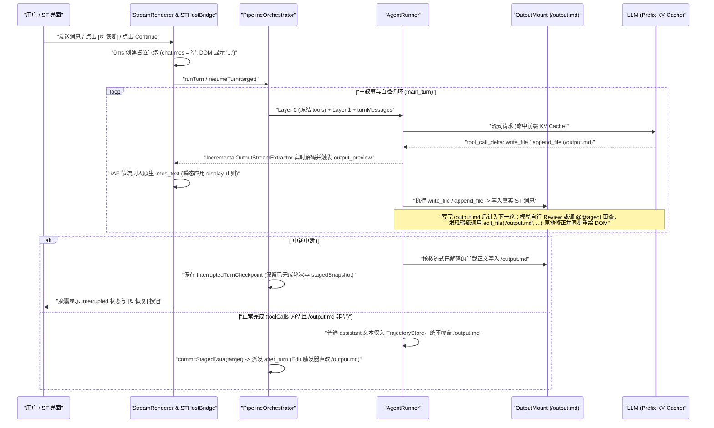

# `/output.md` 输出文件化、轮内自检、断点恢复与 Edit 触发器架构计划

本文档定义 `ST-Agentic` 将模型最终输出视为虚拟文件 `/output.md` 的完整架构方案、核心契约、生命周期状态机、实施波次与验收门禁。所有设计均严格遵守 `AGENTS.md` 与 [ARCHITECTURE.md](./ARCHITECTURE.md) 规定的四大系统不变量。

---

## 1. 背景、已确认设计决策与架构红线对齐

### 1.1 现状痛点与差距

对当前代码基线核查确认，现有实现存在四处结构性缺口：

1. **VFS 尚未挂载当前消息输出文件**：`VirtualFileSystem`（[filesystem.ts](../src/core/vfs/filesystem.ts#L220-L233)）挂载了 `/` 工作区、`/state/variables.json`、`/character/*`、`/persona/*`、`/lorebooks/*`、`/skills/*`、`/preset/*`、`/global/*` 与 `/history/*`，没有绑定到目标楼层 `(messageId, swipeId)` 的 `/output.md`。
2. **主回复无法实现轮内写后自检（Review & Fix）**：`AgentRunner`（[agent-runner.ts](../src/core/agents/agent-runner.ts#L631-L698)）在 `turnOutput.toolCalls.length === 0` 时即把纯文本作为最终回复并结束运行，无法形成「生成写入文件 → 自检或委托校验 → `edit_file` 原地修错 → 确认结束」的闭环。
3. **中途中断直接丢失已完成工具轮与半截正文**：网络抖动、用户点击 `#mes_stop` 或触及 `max_tokens` 截断时，[pipeline-orchestrator.ts](../src/core/triggers/pipeline-orchestrator.ts#L498-L501) 会执行 `store.rollbackStagedData(target)` 丢弃暂存写入，且无法在保留已完成工具轮次前缀的前提下从半截输出恢复。
4. **Edit 类后置触发器仅写影子展示层**：[message-tools.ts](../src/core/tools/message-tools.ts#L47-L96) 与 [st-bridge.ts](../src/host/st-bridge.ts#L563-L633) 仅写 `DATA_NAMESPACES.MESSAGE` 非分层覆写并恢复 `msg.mes`，未真正修改 `chat[messageId].mes` / `swipes[swipeId]`，导致外部扩展、楼层编辑铅笔按钮与后续文件工具无法以单一真相源操作 ST 原生消息。

### 1.2 四项已确认核心决策

1. **强制 `/output.md` 文件模式**：主叙事 Agent（`phase === 'main_turn'`）**必须**通过文件工具（`write_file` / `append_file` / `edit_file`）将面向用户的最终回复/结构化内容写入 `/output.md`；普通 `assistant.content` 仅作为内部规划、思考或自检总结记录进 `TrajectoryStore` 与日志，**绝不上屏覆盖聊天消息**。
2. **彻底取代 `DATA_NAMESPACES.MESSAGE` 影子展示层**：所有消息读写（`/output.md`、Edit 类后置触发器、兼容保留的 `append_reply_view` / `replace_reply_view`、以及控制台「文件与内容覆盖」视图）一律直接读写目标 `(messageId, swipeId)` 的真实 SillyTavern `chat[messageId].swipes[swipeId]` 与 `mes`（`display` 阶段正则仅在渲染 `.mes_text` HTML 时瞬态计算）。由于持久 Agent 的对话上下文独立维护在 `TrajectoryStore` 中，直改 ST `chat` 消息 **0 破坏 Prefix KV Cache**。
3. **全场景断点抢救 + 手动恢复（100% 命中前序 KV Cache）**：统一覆盖 `#mes_stop` 手动停止、SSE/网络异常、以及 `finish_reason === 'length'`（单次输出 `max_tokens` 截断）。中断瞬间从工具流式入参实时解包并抢救已生成半截内容落盘 `/output.md`，将已完成工具轮与暂存区快照持久化至 `InterruptedTurnCheckpoint`；用户点击胶囊 **`[↻ 恢复]`** 或使用 ST 原生「继续（Continue）」即可 100% 复用前序缓存无缝补全 `/output.md` 并继续自检。
4. **先契约后扇出的波次实施规范**：严格沿用 [TASKS.md](./TASKS.md) 的目录独占锁、防腐层边界检查与单测门禁顺序推进。

### 1.3 与 `AGENTS.md` 四大红线对齐核验

| 红线原则 | 本方案落实机制 |
| :--- | :--- |
| **1. 严格宿主防腐边界** | `src/core/**` 仅通过新增的 `HostBridge.readChatMessage` 与 `HostBridge.writeChatMessage` 访问宿主 `chat[messageId]`，严禁出现 `@st/*`、`window`、`document` 或 `$`。 |
| **2. Append-Only KV Cache 不变性** | 持久主 Agent 的工具列表（含 `write_file`/`append_file`/`edit_file`）与写 `/output.md` 权限在会话初始化时即固定写入 Layer 0；恢复时原样复用 `completedTurnMessages` 并在尾部追加单条 `user` 恢复指令，Layer 0 与已完成历史轮次字节级不变；`/output.md` 不进入 `Read-Set`。 |
| **3. 零原生聊天替代与隔离 UI** | 不替换 `#chat .mes` DOM；流式工具参数解码仍通过 `StreamRenderer` 经 `rAF` 节流刷新 `.mes_text`；恢复按钮 `[↻ 恢复]` 内置在 Shadow DOM 自定义元素 `<agentic-capsule>` 内，满足 `>= 40×40px` 触控热区与 `< 768px` 单行省略规范。 |
| **4. Causal Branch 因果分支安全** | `OutputMount` 严格按 `{ messageId, swipeId }` 读写，绝不跨楼继承；`InterruptedTurnCheckpoint` 绑定到 `BranchKey`（`${messageId}#${swipeId}`），Swipe / Regenerate / Delete 时精准清理对应分支断点；同楼 Edit 触发器锁键带楼层坐标防串楼与互锁。 |

---

## 2. 核心接口与数据结构契约（Contracts & Types）

### 2.1 `HostBridge` 扩展（`src/core/bridge/host-bridge.ts`）

```typescript
export interface WriteChatMessageOptions {
    /**
     * 是否向宿主广播 `MESSAGE_UPDATED` / `CHARACTER_MESSAGE_RENDERED` 等原生事件。
     * 流式阶段或内部落盘设为 false；后置触发器或独立编辑完结时可设为 true。
     */
    emitEvent?: boolean;
}

export interface HostBridge {
    // ... 既有接口保持不变

    /**
     * 读取指定 `(messageId, swipeId)` 的真实聊天消息原文（干净 Markdown，不含 display 正则渲染结果）。
     * 若目标楼层或对应 swipe 尚未在宿主创建（如伴生模式 `before_turn` 阶段），返回 `null`。
     */
    readChatMessage(target: MessageTarget): string | null;

    /**
     * 直接写入指定 `(messageId, swipeId)` 的真实宿主消息：
     * 1. 更新 `chat[messageId].swipes[swipeId]`；
     * 2. 若 `swipeId === chat[messageId].swipe_id`，同步更新 `chat[messageId].mes` 并局部重绘 `.mes_text`（瞬态应用 `display` 正则）；
     * 3. 触发 `saveChatDebounced()` 持久化。
     */
    writeChatMessage(
        target: MessageTarget,
        content: string,
        options?: WriteChatMessageOptions,
    ): Promise<void>;
}
```

### 2.2 VFS 与工具文件接口扩展

1. **`VfsMount`（[fs-base.ts](../src/core/vfs/fs-base.ts#L72-L88)）**：新增可选追加原语：
   ```typescript
   export interface VfsMount {
       // ... 既有成员
       appendFile?(relPath: string, content: string, opts?: VfsWriteOptions): Promise<void>;
   }
   ```
2. **`ToolFsApi`（[tool-context.ts](../src/core/bridge/tool-context.ts#L16-L23)）**：新增追加接口供内置 `append_file` 工具及 JS 自定义工具 `ctx.fs.append()` 调用：
   ```typescript
   export interface ToolFsApi {
       read(path: string): Promise<string>;
       write(path: string, content: string): Promise<void>;
       append(path: string, content: string): Promise<void>;
       edit(path: string, oldText: string, newText: string): Promise<ToolEditResult>;
       list(dirPath?: string): Promise<VfsEntryStat[]>;
       search(query: string, opts?: { pathPrefix?: string; limit?: number }): Promise<VfsSearchHit[]>;
       glob(pattern: string): Promise<string[]>;
   }
   ```

### 2.3 运行态与实时事件类型扩展（`src/core/types/trace.ts`）

```typescript
export type InterruptedReason = 'user_stop' | 'length' | 'error' | 'empty_output';

export type AgentRunStatus = 'running' | 'completed' | 'interrupted' | 'aborted' | 'error';

export interface AgentRunTrace {
    // ... 既有字段
    interruptedReason?: InterruptedReason;
}

export type GenerationEventKind =
    | 'turn_started'
    | 'phase_started'
    | 'phase_completed'
    | 'tool_started'
    | 'tool_completed'
    | 'text_delta'
    | 'reasoning_delta'
    | 'output_preview'
    | 'turn_interrupted'
    | 'turn_resumed'
    | 'background_task_updated'
    | 'trace_recorded'
    | 'turn_completed'
    | 'turn_aborted'
    | 'turn_error';

export interface GenerationEventPayload {
    // ... 既有字段
    outputPreview?: string;
    interruptedReason?: InterruptedReason;
}
```

### 2.4 `ChatDataStore` 暂存快照原语（`src/core/store/chat-data-store.ts`）

为支持断点检查点跨越刷新/异步边界保留 `before_turn` 与已完成工具轮的暂存写入，`ChatDataStore` 新增两项原语：

- `snapshotStagedData(target: MessageTarget): NamespaceDataMap`：深拷贝导出 `UNBOUND_STAGED_KEY` 与 `toBranchKey(target)` 合并后的未提交暂存数据。
- `restoreStagedData(target: MessageTarget, snapshot: NamespaceDataMap): void`：将检查点中的 `stagedSnapshot` 精确回填到 `toBranchKey(target)` 暂存桶，供恢复运行继续叠加并最终 `commitStagedData(target)`。

### 2.5 `TrajectoryStore` 断点检查点契约（`src/core/context/trajectory-store.ts`）

在 `metadata.agentic_trajectories` 中新增 `interrupted` 映射，**随聊天 `.jsonl` 一同持久化**，保证刷新页面或重开酒馆后依然可以一键恢复：

```typescript
export interface InterruptedTurnCheckpoint {
    agentId: string;
    target: MessageTarget;
    reason: InterruptedReason;
    errorMessage?: string;
    /** 本轮初始 Layer 2 user 输入 + 已完整闭环的 assistant(tool_calls)->tool 轮次 */
    completedTurnMessages: CanonicalMessage[];
    /** 中断前最新已读集合快照（避免恢复后重新触发世界书提示） */
    readSetSnapshot: Record<string, string>;
    /** 本轮已完成工具步与 before_turn 的暂存区快照 */
    stagedSnapshot: NamespaceDataMap;
    createdAt: number;
}

export interface SerializedTrajectoryStore {
    version: 1;
    threads: Record<string, SerializedAgentTrajectory>;
    interrupted?: Record<BranchKey, InterruptedTurnCheckpoint>;
}
```

`TrajectoryStore` 新增与联动方法：
- `saveInterruptedCheckpoint(checkpoint: InterruptedTurnCheckpoint): void`
- `getInterruptedCheckpoint(target: MessageTarget): InterruptedTurnCheckpoint | undefined`
- `clearInterruptedCheckpoint(target: MessageTarget): boolean`
- `pruneFromMessage(messageId)` / `pruneSwipe(target)` / `clearThread()`：同步清除对应楼层/分支的 `interrupted` 检查点，严防残余断点跨分支污染。

---

## 3. VFS `/output.md` 虚拟挂载与内置工具升级

### 3.1 `OutputMount`（`src/core/vfs/fs-mounts.ts`）与路径路由

在 `VirtualFileSystem` 中新增 `OutputMount`（常量 `OUTPUT_FILE_PATH = '/output.md'`，`OUTPUT_FILE_NAME = 'output.md'`）：

1. **高优先级精确路由**：[VirtualFileSystem.route()](../src/core/vfs/filesystem.ts#L544-L587) 在判断 `/state/variables.json` 之后、回落 `WorkspaceMount` 之前，精确拦截 `normalized === '/output.md'`（同时兼容用户传入 `output.md` 经 `normalizeVfsPath` 归一化为 `/output.md`）并路由至 `this.outputMount`。
2. **严格单楼层非继承语义（Non-Layered）**：
   - `readFile('', opts)` / `writeFile('', content, opts)` / `editFile(...)` / `appendFile(...)` 始终以 `opts.target` 为唯一坐标读取/修改对应楼层消息，**绝不向上继承第 `messageId - 1` 楼的内容**。
   - `listDir('/')` 合并展示当前目标楼层的 `output.md` 元信息（`writable: true, mount: 'output'`）。
   - `deleteFile` 清空目标楼层文本（写回 `""`）而非破坏聊天数组结构。
3. **跨轮 `Read-Set` 隔离**：[fs-tools.ts](../src/core/tools/fs-tools.ts#L369-L373) 中 `read_file` 记录 `ctx.readSet` 时，若 `normalizedPath === '/output.md'` 则跳过写入 `Read-Set`，避免 `/output.md` 作为普通档案污染持久线程的尾部雷达哈希表。
4. **伴生模式 `before_turn` 预缓冲机制**：
   - `takeover` 模式下，目标 `.mes` 在 0ms 占位即已创建，`bridge.readChatMessage(target) !== null`，读写直接透传宿主。
   - `companion` 模式下，若 `before_turn` 阶段目标 AI 消息尚未由酒馆创建（`readChatMessage(target) === null`），`OutputMount` 将写入暂存于按 `BranchKey` 隔离的内存 `preCreateBuffers` 映射中；待酒馆生成完回复触发 `CHARACTER_MESSAGE_RENDERED` 时，由 `companion-hooks.ts` 冲刷合并（如追加前置脚本输出）并清空预缓冲。

### 3.2 新增内置工具 `append_file` 与 `VirtualFileSystem.appendFile`

在 [fs-tools.ts](../src/core/tools/fs-tools.ts) 与 `BUILTIN_TOOL_NAMES`（[builtin.ts](../src/core/tools/builtin.ts#L17-L34)）新增第 15 个内置工具 `append_file`：

```typescript
const APPEND_FILE_SCHEMA = z.object({
    content: z.string().describe('Content to append to the end of the target file.'),
    path: z
        .string()
        .min(1)
        .describe('Writable VFS file path (e.g. "/output.md" or "/memory/notes.md").'),
});
```

- **逐字节缓存保护**：工具注册与 `canonicalStringify` 严格保持键名字典序（`content`, `path`）。
- **Mount 适配**：`VirtualFileSystem.appendFile(path, content, opts)` 优先调用 `mount.appendFile`（由 `OutputMount`、`WorkspaceMount` 等实现原生拼接；未实现的挂载默认读取现有文本后原子 `writeFile`；只读挂载返回 `VfsReadOnlyError`）。
- **核心价值**：
  - 支持主 Agent 对长回复分段调用 `append_file('/output.md', ...)`，减小单次 JSON 参数体积；
  - 中断恢复后无需重写前文、无需依赖易失的尾行锚点，直接 `append_file('/output.md', ...)` 从断口处无缝续写。

### 3.3 废弃 `DATA_NAMESPACES.MESSAGE` 影子展示层

- **工具层改造（[message-tools.ts](../src/core/tools/message-tools.ts)）**：
  - `ChatMessageViewAdapter` 构造参数接入 `VirtualFileSystem`（或 `OutputMount`）；
  - `appendView(text)` 与 `replaceView(text)`（包括兼容旧工具名 `append_reply_view` / `replace_reply_view` 及 `ctx.message.*` JS 沙箱 API）全部改为直接读写当前 `target` 对应的 `/output.md`（即真实 ST `chat` 消息），不再写入 `DATA_NAMESPACES.MESSAGE`。
- **历史兼容边界**：
  - `DATA_NAMESPACES.MESSAGE` 常量仅在 `ChatDataStore` 与 `data-compaction.ts` 中保留类型兼容以防旧聊天存档反序列化报错；
  - 新逻辑不再向 `DATA_NAMESPACES.MESSAGE` 写入任何条目；`st-bridge.ts` 与 `stream-renderer.ts` 移除对 `MESSAGE_OVERRIDE_KEY` 的拦截覆盖。

### 3.4 主叙事 Agent 默认配置升级（`defaults.ts` & `normalize.ts`）

1. **`DEFAULT_MAIN_AGENT_TOOLS`（[defaults.ts](../src/core/config/defaults.ts#L23-L37)）**：默认新增 `'write_file'`、`'append_file'`、`'edit_file'`。
2. **`DEFAULT_MAIN_AGENT_PERMISSIONS.write`**：升级为 `['/output.md', '/memory/**', '/scratch/**']`。
3. **已有预设兼容迁移（[normalize.ts](../src/core/config/normalize.ts)）**：对未显式禁用文件输出工具的历史预设（或旧版迁入预设），在 `normalizeAgentProfile` 中为主 Agent 补齐 `'/output.md'` 写权限及 `write_file`/`append_file`/`edit_file`（除非在 `builtinToolSettings[tool].enabled === false` 显式关闭）。
4. **`DEFAULT_SYSTEM_BASE_PROMPT` 更新**：明确告知主 Agent：
   - 普通对话输出文本仅作为内部思考/工具规划/自检结论，不会渲染到用户聊天界面；
   - 必须使用 `write_file`（或分块 `append_file`）将最终呈现给用户的剧情/结构化结果写入 `/output.md`；
   - 写完 `/output.md` 后应在轮内自行检查内容是否违反设定、格式标签是否闭合、角色口吻与状态是否一致，若有问题调用 `edit_file('/output.md', ...)` 原地修正后再结束回合。

---

## 4. 强制文件输出、参数流实时上屏与轮内 Review 闭环

### 4.1 端到端主回复、自检与断点恢复时序



### 4.2 流式工具参数实时解包器（`src/core/agents/output-stream-extractor.ts`）

由于强制主 Agent 通过 `write_file({ path: "/output.md", content: "..." })` 或 `append_file` 输出正文，如果等到整个 JSON tool call 闭合后才刷新页面，长文生成期间聊天窗口会卡在 `'...'` 假死状态，且中断时拿不到工具里的半截正文。因此设计专用增量状态机 `IncrementalOutputStreamExtractor`：

- **输入**：监听 `AgentRunner.invokeLLM()` 收到的每个 `tool_call_delta`（按 `toolCallIndex` 独立跟踪）。
- **状态机阶段**：
  1. **工具名识别**：当 `toolName` 为 `'write_file'` 或 `'append_file'` 时激活参数扫描；否则跳过零开销。
  2. **双顺序 JSON 字段容错**：模型可能先吐 `"path"` 后吐 `"content"`，也可能先吐 `"content"` 后吐 `"path"`（OpenAI/Anthropic/DeepSeek 均可能出现键序变化）。因此状态机同时解析顶层字符串字段 `"path"` 与 `"content"`：
     - 仅当确定 `"path"` 归一化后等于 `'/output.md'` 时才立即向外发送预览；
     - 若 `"content"` 先于 `"path"` 出现，先在内部缓冲解码后的 `"content"`，一旦确认 `"path === '/output.md'"` 立即补发完整前缀并切换为逐字流式发射（若确认不是 `/output.md` 则丢弃缓冲）。
  3. **精确 JSON 字符串逐字符解码**：正确处理 `\"`、`\\`、`\/`、`\b`、`\f`、`\n`、`\r`、`\t`、以及 `\uXXXX`（含高/低 UTF-16 代理对 `\uD83D\uDE00`）；当 chunk 恰好切断在反斜杠 `\` 或不完整的 `\u12` 处时挂起状态机游标，等待下一 chunk 到达后再解码，确保对外暴露的预览字符串永远完整无乱码。
  4. **预览合成与抢救读取**：
     - 对 `write_file('/output.md')`：预览内容为 `decodedContent`；
     - 对 `append_file('/output.md')`：提取器记录本次调用启动前 `/output.md` 的基线快照 `baseContent`，对外合成完整预览 `baseContent + decodedContent`。
     - 新增公开方法 `getSalvageableOutput()`：在任意中断时刻返回尚未落盘但已解码完成的最新 `/output.md` 文本。

### 4.3 `AgentRunner` 主轮次行为与空输出自愈护栏

1. **普通文本隔离**：在 `phase === 'main_turn'` 时，[AgentRunner](../src/core/agents/agent-runner.ts#L626-L698) 不再将 `turnOutput.content` 推送给 `onTextDelta` 上屏（`onReasoningDelta` 思考块照常流式展示），也不以 `turnOutput.content` 覆盖 `AgentRunResult.content`；`main_turn` 最终返回值 `result.content` 固定从目标楼层 `/output.md` 读取，普通 `turnOutput.content` 照常归档入 `TrajectoryStore` 与日志的 `outputPreview`。
2. **工具集恒定保证 Layer 0 不变性**：在 `phase === 'main_turn'` 下，无论预设原始权限如何，`AgentRunner` 均确保运行时工具集包含 `read_file`、`write_file`、`append_file`、`edit_file` 且权限包含 `/output.md` 的读写权，该判定仅依赖静态 `phase === 'main_turn'` 与 `agentProfile`，不随对话轮次变化，Layer 0 `tools` 序列化 100% 稳定。
3. **空 `/output.md` 自动自愈护栏**：当 `phase === 'main_turn'` 出现 `turnOutput.toolCalls.length === 0`（模型企图结束回合）时：
   - `AgentRunner` 读取当前 `target` 下的 `/output.md`；
   - 若内容非空（`trim().length > 0`）：正常执行 `finalizeTurn` 并返回；
   - 若内容仍为空：
     - 若未触发过空输出纠偏且 `toolRoundsExecuted < maxToolRounds`：拦截本次结束，将本轮 `assistant` 消息推入 `turnMessages` 后追加一条纠偏 `user` 消息：
       `[System Check] /output.md is still empty. Plain assistant text is NOT displayed to the user. Write the final response to /output.md via write_file and review it before finishing.`
       然后继续下一轮 LLM 调用原地自愈；
     - 若重试后仍为空或已耗尽 `maxToolRounds`：不再强行把普通文本塞进聊天，而是进入可恢复的 `interrupted` 态（`reason: 'empty_output'`），提示用户检查或点击恢复。
4. **Review 后静默确认或摘要**：模型在完成 `write_file('/output.md', ...)` 并进行轮内自检（或调用 `edit_file('/output.md', ...)` 修复错误，或调用 `@@agent` 子专家审核并由主 Agent 修订）后，只需输出简短自检小结（例如 `"Review passed. No errors found."`）且不再调用工具即可干净结束，**不会把这句内部总结写进用户可见的聊天内容**。

---

## 5. 全场景断点抢救与 100% KV Cache 恢复协议

### 5.1 三类中断的统一拦截

在 `AgentRunner` 执行循环内统一识别三类可恢复中断：

| 中断场景 | 触发来源 | `InterruptedReason` | 关键拦截点 |
| :--- | :--- | :--- | :--- |
| **用户主动停止** | `#mes_stop` 触发 `AbortSignal` | `'user_stop'` | `invokeLLM` 流式拉取循环或工具等待期间抛出 `AbortError` |
| **模型长度截断** | `turnOutput.finishReason === 'length'` | `'length'` | **`invokeLLM` 返回后、进入 `toolCalls` JSON 解析执行前立即拦截** |
| **网络/接口异常** | `LLMTransportError` / SSE 断流超时 | `'error'` | `invokeLLM` `catch` 捕获异常 |

> **关键设计**：当 `turnOutput.finishReason === 'length'` 且模型正在生成 `write_file` / `append_file` 时，工具调用参数 JSON 往往未闭合（缺少末尾 `"}`）。如果直接进入工具循环，Zod 参数解析必定报错。通过在进入工具执行前优先检测 `turnOutput.finishReason === 'length'`，系统直接转入抢救分支，将提取器已解包的全部半截内容安全落盘 `/output.md`，避免无意义的 JSON 报错重试。

### 5.2 半截正文抢救与检查点留存边界

`AgentRunner` 在中断捕获区执行标准化抢救 `salvageInterruptedState()`：

1. **抢救未落盘文本**：读取 `outputStreamExtractor.getSalvageableOutput()`；若非空，立即调用 `vfs.writeFile('/output.md', salvagedText, { target, staged: true, source: 'salvage' })` 将半截正文写回目标 ST 消息并刷新 `.mes_text`（同时若此前有非空正文且本次 `append_file` 刚追加一部分，已由提取器按 `baseContent + decodedContent` 完整合并）。
2. **判定是否保留可恢复检查点**：
   - 读取抢救后当前 `target` 的 `/output.md` 内容与已完成完整工具轮次计数（`completedTurnMessages` 中是否存在已完成的 `assistant(tool_calls) -> tool` 闭环，或已有非空 `stagedSnapshot`）；
   - **情况 A（有有效产出：`/output.md` 非空或至少完成了 1 个工具调用）**：
     - 保留 `target` 暂存区**不调用 `rollbackStagedData`**；
     - 构造 `InterruptedTurnCheckpoint`（记录 `completedTurnMessages`、当前 `readSet`、通过 `store.snapshotStagedData(target)` 导出的 `stagedSnapshot`）并存入 `trajectoryStore.saveInterruptedCheckpoint(checkpoint)` 后持久化至 `metadata`；
     - `PipelineOrchestrator` 返回（或抛出携带可恢复标记的 `TurnInterruptedError`）通知 `StreamRenderer` 保留半截正文并将胶囊置为 `'interrupted'`。
   - **情况 B（彻底 0 产出：`/output.md` 为空且无已完成工具轮）**：
     - 与既有中止语义一致，干净 `rollbackStagedData(target)` 并清除空占位气泡（或回退无效 swipe）。

### 5.3 100% 命中 Prefix KV Cache 的恢复协议（`resumeTurn`）

在 `PipelineOrchestrator` 新增方法 `resumeTurn(input: ResumeTurnInput)`，同时在 `runTurn` 接收 `action === 'continue'` 时自动探测断点并分流：

```typescript
export interface ResumeTurnInput {
    target: MessageTarget;
    signal?: AbortSignal;
    stream?: boolean;
    onTextDelta?: (delta: string) => void;
    onOutputPreview?: (previewText: string) => void;
    onReasoningDelta?: (delta: string) => void;
    onToolStart?: (step: ToolStepLog) => void;
    onToolComplete?: (step: ToolStepLog) => void;
}
```

**恢复执行流程（Byte-for-Byte 前缀保护）**：

1. **检查点加载与轨迹对齐**：
   - 从 `trajectoryStore.getInterruptedCheckpoint(target)` 读出断点；
   - 恢复 `trajectoryStore.restoreBeforeMessage(target.messageId, agentId)`（保证 Layer 1 停在上一轮完结锚点，绝不重复追加）；
   - 恢复 `effectiveReadSet = new Map(Object.entries(cp.readSetSnapshot))`；
   - 恢复 `store.restoreStagedData(target, cp.stagedSnapshot)`。
2. **严禁伪造未闭合的半截 `tool_calls`**：
   - 半截 `write_file` / `append_file` 若送入下一轮历史，缺失 Gemini `thoughtSignature` 或 Anthropic thinking block 签名会触发上游 `400 Bad Request`；
   - 因此 `turnMessages` **只原样复用 `cp.completedTurnMessages`**（第 $0 \dots K-1$ 轮全部逐字节冻结不变，100% 命中云端前缀 KV Cache）。
3. **尾部追加紧凑恢复引导（`role: 'user'`）**：
   - 在 `turnMessages` 末尾追加单条 `user` 消息（OpenAI 原生支持 `tool -> user` 衔接；Anthropic `payload-compiler.ts` 自动合并至上一条 `tool_result` 的同 `user` 块末尾，前序 0 改动）：
     ```text
     [System Recovery] Previous generation was interrupted (reason: <reason>).
     Current /output.md already has <N> chars saved (ending with: "<last 200 chars>").
     Inspect /output.md if needed, seamlessly continue writing the remaining content using append_file or edit_file on /output.md WITHOUT repeating already-written text, and review /output.md for completeness and errors before finishing.
     ```
   - 若连续遭遇第二次截断（例如超长章节跨越多个 `max_tokens` 窗口），新一轮已完成的工具轮自动并入下一版 `InterruptedTurnCheckpoint.completedTurnMessages`，支持**无限次接力恢复**直至完整写完并 Review 通过。
4. **恢复完结**：
   - 当恢复运行正常完成时，调用 `trajectoryStore.clearInterruptedCheckpoint(target)`，通过 `finalizeTurn` 将整轮完整轨迹一次性冻结并入 Layer 1，执行 `store.commitStagedData(target)`，随后正常派发 `after_turn` 与 `maintenance`。
5. **ST 原生「继续（Continue）」统一分流**：
   - 当用户点击 ST 原生 Continue 时，`PipelineOrchestrator.runTurn({ action: 'continue', target })` 先检查是否存在 `getInterruptedCheckpoint(target)`：
     - **存在断点** → 自动委托 `resumeTurn(target)` 完成断点续传与 Review，并补跑此前未触发的 `after_turn`；
     - **无断点（已完结消息的常规续写）** → 走常规 `continue` 分支，但指令调整为引导模型通过 `read_file('/output.md')` + `append_file('/output.md', ...)` / `edit_file('/output.md', ...)` 续写并自检，更新后的 `/output.md` 同步回 ST 消息。

---

## 6. Edit 类触发器直改 ST 消息与同楼串行锁

### 6.1 `DecoratorCompiler` 授权升级（`src/core/triggers/decorator-compiler.ts`）

对涉及修改回复正文的触发器统一接入 `/output.md` 文件模型：

| 装饰器 / 触发器写法 | 绑定 `targetPath` | 授予工具集（`enabledTools`） | VFS 权限（`ScopedPermissions`） | 说明 |
| :--- | :--- | :--- | :--- | :--- |
| `@@replace_output` / `*_before` | `'/output.md'` | `['read_file', 'edit_file', 'write_file', 'append_file', 'read_variables']` | `read: ['/**']`, `write: ['/output.md']` | 直接基于锚点局部 `edit_file` 或 `write_file` 修改真实 ST 消息 |
| `@@append_output` / `*_before` | `'/output.md'` | `['read_file', 'append_file', 'edit_file', 'read_variables']` | `read: ['/**']`, `write: ['/output.md']` | 直接向真实 ST 消息末尾追加（或经 `edit_file` 插槽插入） |
| `@@trigger target=/output.md`（或预设规则 `targetPath === '/output.md'`） | `'/output.md'` | `['read_file', 'edit_file', 'append_file', 'write_file', 'read_variables']` | `read: ['/**', '/state/variables.json']`, `write: ['/output.md']` | 自定义审校/润色/状态栏插入触发器直接修改真实 ST 消息 |
| `@@append_output_ejs*` / `@@replace_output_ejs*` | `'/output.md'` | N/A（0 Token 脚本） | `read: ['/**']`, `write: ['/output.md']` | 通过更新后的 `ctx.message` 适配器直改 `/output.md` |

- **锚点失败原地自愈**：与传统盲吐 Search/Replace 块不同，触发器 Agent 调用 `edit_file('/output.md', search, replace)` 若锚点未命中，工具当场返回 `{ ok: false, error: '... Re-read "/output.md" and copy the exact anchor text.' }`，Agent 在当前触发轮内调用 `read_file('/output.md')` 后原地重试修正。

### 6.2 `BarrierCoordinator` 楼层维度路径锁（`src/core/triggers/barrier-coordinator.ts`）

现有 [buildSelfQueueKeys](../src/core/triggers/barrier-coordinator.ts#L468-L475) 对任何 `targetPath` 生成全局键 `path:${trimmedPath}`。如果两个不同楼层（`#10` 与 `#12`）的后置 Edit 触发器先后在后台运行，使用全局 `path:/output.md` 会导致第 `#12` 楼无谓阻塞等待第 `#10` 楼完成。

修改策略：
```typescript
private buildSelfQueueKeys(
    agentProfileId: string,
    targetPath?: string,
    target?: MessageTarget,
): string[] {
    const keys = [`agent:${agentProfileId}`];
    const trimmedPath = targetPath?.trim();
    if (trimmedPath) {
        if (trimmedPath === '/output.md' && target) {
            keys.push(`path:/output.md@${target.messageId}#${target.swipeId}`);
        } else {
            keys.push(`path:${trimmedPath}`);
        }
    }
    return keys;
}
```
- **同一楼层同一页**的多个 `barrier: 'self'` Edit 触发器严格 FIFO 串行，后者必定读到前者已写回 ST 消息的最新 `/output.md`；
- **不同楼层**之间的后台 `/output.md` Edit 任务完全并发隔离，互不抢锁。

---

## 7. 宿主桥、流式渲染器与 Shadow DOM UI 升级

### 7.1 `STHostBridge`（`src/host/st-bridge.ts`）

1. **`readChatMessage(target)`**：校对 `chat[target.messageId]` 存在性与 `swipes[target.swipeId]`（当 `swipeId === 0` 且未初始化 `swipes` 时回退读取 `msg.mes`）；不存在返回 `null`。
2. **`writeChatMessage(target, content, options)`**：
   - 更新 `msg.swipes[target.swipeId] = content`（必要时扩充 `swipes` 槽位）；
   - 当 `activeSwipeId === target.swipeId` 时同步更新 `msg.mes = content`，调用私有渲染管线瞬态计算 `display` 阶段正则并更新 `#chat .mes[mesid="N"] .mes_text` 与 `updateReasoningUI` / `addCopyToCodeBlocks`（**绝不把正则替换结果写回 `msg.mes` 或 `msg.swipes`**）；
   - 调用 `saveChatDebounced()`；若 `options?.emitEvent` 为 `true`，补发 `MESSAGE_UPDATED`。
3. **`refreshMessageView(target)`**：移除 `DATA_NAMESPACES.MESSAGE` 读取逻辑，直接以 `msg.swipes[target.swipeId] ?? msg.mes` 为唯一源码应用 `display` 正则刷新 DOM。

### 7.2 `StreamRenderer`（`src/host/stream-renderer.ts`）

1. **消除 `'...'` 占位污染**：在 `beginPlaceholder` 创建新消息与新 Swipe 时，将 `chat[messageId].mes` 与 `swipes[targetSwipeId]` 初始化为空字符串 `""`；仅在 `renderToDom` 检测到无内容时在 DOM 层视觉呈现 `'...'`。这确保了 `read_file('/output.md')` 在首轮输出前读到干净空串而非 `'...'`。
2. **支持 `output_preview` 与 `interrupted` 生命周期**：
   - 新增 `setOutputPreview(fullPreviewText: string)` 方法：接收来自 `AgentRunner` 的流式解包工具参数预览，走现有 `rAF` 节流刷新 `.mes_text`（不再依赖普通 `appendTextDelta` 刷新正文）。
   - 新增 `markInterrupted(info: { reason: InterruptedReason; errorMessage?: string; currentOutput: string })` 方法：
     - 将已抢救的 `currentOutput` 稳态写入 `msg.mes` 与 `swipes[target.swipeId]` 并执行 `saveChatConditional()`；
     - 保持发送按钮可用，解锁用户输入；
     - 更新 `<agentic-capsule>` 状态为 `status: 'interrupted'`，展示具体中断原因与 `[↻ 恢复]` 按钮。

### 7.3 `<agentic-capsule>` 与控制台视图升级

1. **`AgenticCapsuleElement`（[AgenticCapsuleElement.ts](../src/ui/capsule/AgenticCapsuleElement.ts)）**：
   - `CapsuleStatus` 扩展 `'interrupted'`（使用琥珀色 `--cap-warning` 警示边框与图标）；
   - 新增字段 `canResume?: boolean`、`interruptedReason?: InterruptedReason`、`onResume?: () => void | Promise<void>`；
   - 当 `status === 'interrupted'` 时，在胶囊右侧渲染 **`[↻ 恢复]`** 独立按钮（`min-width: 40px; min-height: 40px`，移动端单行不撑爆气泡，点击后调用 `services.resumeTurn(target)`）。
2. **`AgenticUIServices`（[app-store.ts](../src/ui/store/app-store.ts)）与 [index.ts](../src/index.ts)**：
   - 新增可选方法 `resumeTurn?(target: MessageTarget): Promise<void>`，接线至 `interceptor` / `orchestrator.resumeTurn(target)`（复用 `StreamRenderer` 对目标楼层进行原地流式更新直至完结）。
   - `listFilesAndOverrides` / `saveFileOrOverride` / `deleteFileOrOverride` 将原 `category: 'message'` 升级为读取和直接保存当前楼层的 `/output.md`（真实 `chat` 消息）。
3. **`FilesOverridesView.tsx`（[FilesOverridesView.tsx](../src/ui/session/FilesOverridesView.tsx)）**：
   - 筛选标签「展示层」更名为「输出 (`/output.md`)」，支持按楼层直接查看与修改真实 ST 消息并支持 `diff` 模式对照。

### 7.4 `CompanionHooks`（`src/host/companion-hooks.ts`）

- 支持在 `CHARACTER_MESSAGE_RENDERED` 时检测并冲刷 `before_turn` 期间写入 `OutputMount` 预缓冲的内容；
- `resolveVfsFileSync('/output.md', target)`（支持 `{{file::/output.md}}` 宏）直接同步读取当前目标楼层的 `chat[id].swipes[swipeId] ?? mes`。

---

## 8. 分波次并行实施任务卡与验收门禁（Execution Waves & Merge Gates）

沿用 [TASKS.md](./TASKS.md) 的多 Agent 并行协议：**先契约（Wave O0）→ 基础层并行（Wave O1）→ 运行时与 UI 并行（Wave O2）→ 宿主集成与 E2E 验收（Wave O3）**。各同波次 Worker 严格拥有互不重叠的 `Owned Paths`。

| 任务 ID | 任务名称 | 波次 | 轨道 | 前置依赖 | 独占写路径（Owned Paths） |
| :--- | :--- | :---: | :---: | :--- | :--- |
| **TO0.1** | 核心契约、Bridge 接口与内存测试桩扩展 | Wave O0 | Serial | 无 | `src/core/types/**`, `src/core/bridge/**`, `tests/mocks/**` |
| **TO1.1** | `OutputMount`、`append_file`、直写消息适配器与默认配置 | Wave O1 | Track A | TO0.1 | `src/core/store/**`, `src/core/vfs/**`, `src/core/tools/**`, `src/core/config/**`, `tests/unit/store/**`, `tests/unit/vfs/**`, `tests/unit/tools/**` |
| **TO1.2** | 工具参数流式解包器与断点检查点持久化 | Wave O1 | Track B | TO0.1 | `src/core/agents/output-stream-extractor.ts`, `src/core/context/**`, `tests/unit/context/**` |
| **TO2.1** | 强制 `/output.md` 执行循环、中断抢救、恢复与 Edit 触发器锁 | Wave O2 | Track A | TO1.1, TO1.2 | `src/core/agents/**` (不含 `output-stream-extractor.ts`), `src/core/triggers/**`, `tests/unit/agents/**`, `tests/unit/triggers/**` |
| **TO2.2** | `<agentic-capsule>` `[↻ 恢复]` 态与 `/output.md` 控制台视图 | Wave O2 | Track B | TO0.1, TO1.1 | `src/ui/capsule/**`, `src/ui/session/**`, `src/ui/store/**` |
| **TO3.1** | 宿主桥、流式渲染器、拦截器顶层接线与文档同步 | Wave O3 | Track A | TO2.1, TO2.2 | `src/host/**`, `src/index.ts`, `docs/ARCHITECTURE.md` |
| **TO3.2** | Browser 双视口触控与 Playwright 断点恢复 E2E 验收 | Wave O3 | Track B | TO3.1 | `tests/browser/**`, `tests/e2e/**` |

### Wave O0：公共契约与测试桩冻结（串行先导）

#### TO0.1 — 核心契约、Bridge 接口与内存测试桩扩展
- **前置依赖**：无
- **独占写路径**：`src/core/types/**`、`src/core/bridge/**`、`tests/mocks/**`
- **实施细目**：
  1. 在 `src/core/bridge/host-bridge.ts` 增加 `WriteChatMessageOptions`、`HostBridge.readChatMessage(target)` 与 `HostBridge.writeChatMessage(target, content, options?)`。
  2. 在 `src/core/bridge/tool-context.ts` 的 `ToolFsApi` 增加 `append(path, content)`。
  3. 在 `src/core/types/trace.ts` 扩展 `InterruptedReason`、`AgentRunStatus`（`'interrupted'`）、`GenerationEventKind`（`'output_preview' | 'turn_interrupted' | 'turn_resumed'`）与 `GenerationEventPayload`。
  4. 在 `tests/mocks/memory-host-bridge.ts` 实现真实的内存级 `readChatMessage` / `writeChatMessage`（自动扩展 `swipes` 槽位并在 `activeSwipeId === target.swipeId` 时同步 `mes`，记录 `writtenMessages` 便于单测断言）。
- **验收门禁**：
  - `npm.cmd run typecheck && npm.cmd run lint && npm.cmd test` 全绿。

---

### Wave O1：存储、VFS 工具与流式解码/断点基座（2 轨并行）

#### TO1.1 [Track A] — `OutputMount`、`append_file`、直写消息适配器与默认配置
- **前置依赖**：`TO0.1`
- **独占写路径**：`src/core/store/**`、`src/core/vfs/**`、`src/core/tools/**`、`src/core/config/**`、`tests/unit/store/**`、`tests/unit/vfs/**`、`tests/unit/tools/**`
- **实施细目**：
  1. 在 `src/core/store/chat-data-store.ts` 新增 `snapshotStagedData(target)` 与 `restoreStagedData(target, snapshot)`。
  2. 在 `src/core/vfs/fs-base.ts`、`fs-mounts.ts`、`fs-scopes.ts`、`filesystem.ts` 实现 `OutputMount`（绑定 `target` 读写 `HostBridge` 真实消息 + `before_turn` 预缓冲 + 非继承隔离）、`VfsMount.appendFile` 与 `ScopedToolGuard.append`。
  3. 在 `src/core/tools/fs-tools.ts` 与 `builtin.ts` 新增第 15 个内置工具 `append_file`，并在 `read_file` 中跳过对 `/output.md` 的 `ctx.readSet` 记录。
  4. 改造 `src/core/tools/message-tools.ts`（`ChatMessageViewAdapter`）：`appendView` / `replaceView` 改为直调 `VirtualFileSystem` 读写 `/output.md`，彻底移除 `DATA_NAMESPACES.MESSAGE` 新写入。
  5. 更新 `src/core/config/defaults.ts` 与 `normalize.ts`：`DEFAULT_MAIN_AGENT_TOOLS` 纳入 `write_file` / `append_file` / `edit_file`；`DEFAULT_MAIN_AGENT_PERMISSIONS.write` 纳入 `/output.md`；升级 `DEFAULT_SYSTEM_BASE_PROMPT`。
- **验收门禁**：
  - `npm.cmd run typecheck && npm.cmd run lint`；
  - `npx.cmd vitest run tests/unit/store/ tests/unit/vfs/ tests/unit/tools/` 全绿（覆盖 `/output.md` 跨楼非继承隔离、`append_file` 正常拼接、`/output.md` 不进 `Read-Set`、`replace_reply_view` 直改 `chat` 消息、`snapshotStagedData`/`restoreStagedData`）。

#### TO1.2 [Track B] — 工具参数流式解包器与断点检查点持久化
- **前置依赖**：`TO0.1`
- **独占写路径**：`src/core/agents/output-stream-extractor.ts`、`src/core/context/**`、`tests/unit/context/**`
- **实施细目**：
  1. 新建 `src/core/agents/output-stream-extractor.ts`：实现 `IncrementalOutputStreamExtractor`，流式解析 `write_file` / `append_file` 的 JSON 参数，支持 `"path"`/`"content"` 任意键序、完整处理转义符与 UTF-16 代理对、边界半截转义挂起等待、`append_file` 自动拼接 `baseContent`、提供 `getSalvageableOutput()`。
  2. 在 `src/core/context/trajectory-store.ts` 新增 `InterruptedTurnCheckpoint` 类型及 `saveInterruptedCheckpoint` / `getInterruptedCheckpoint` / `clearInterruptedCheckpoint` 方法，升级 `serialize` / `deserialize` 至 `metadata.agentic_trajectories`，并联动 `pruneFromMessage` / `pruneSwipe` / `clearThread` 自动清理。
- **验收门禁**：
  - `npm.cmd run typecheck && npm.cmd run lint`；
  - `npx.cmd vitest run tests/unit/context/` 全绿（覆盖半截 JSON 流分片在 `\u`、`\n`、代理对及键序反转边界的精确解码，以及 `InterruptedTurnCheckpoint` 序列化往返与 Swipe 剪枝清理）。

---

### Wave O2：Agent 核心执行引擎与控制台 UI（2 轨并行）

#### TO2.1 [Track A] — 强制 `/output.md` 执行循环、中断抢救、恢复与 Edit 触发器锁
- **前置依赖**：`TO1.1`、`TO1.2`
- **独占写路径**：`src/core/agents/**`（`output-stream-extractor.ts` 除外）、`src/core/triggers/**`、`tests/unit/agents/**`、`tests/unit/triggers/**`
- **实施细目**：
  1. 升级 `src/core/agents/agent-runner.ts`（及 `index.ts` 导出）：
     - `main_turn` 恒定授权 `/output.md` 工具与写权限，普通 `turnOutput.content` 不触发 `onTextDelta` 上屏；
     - 挂载 `IncrementalOutputStreamExtractor` 实时发射 `output_preview` 事件及调用 `onOutputPreview` 回调；
     - 实现空 `/output.md` 轮内自愈纠偏护栏；
     - 在 `invokeLLM` 返回 `finishReason === 'length'` 或抛出 `AbortError` / `LLMTransportError` 时抢救半截 `/output.md` 并保存可恢复断点。
  2. 升级 `src/core/triggers/pipeline-orchestrator.ts`：
     - 实现 `resumeTurn(input)` 与 `runTurn` 中 `action === 'continue'` 的断点自动识别；
     - 恢复时原样保留 `completedTurnMessages`、恢复 `Read-Set` 与 `stagedSnapshot`、尾部追加 `[System Recovery]` `user` 指令；支持连续多次截断接力；
     - Swipe / Regenerate 时联动清除对应分支断点。
  3. 升级 `src/core/triggers/decorator-compiler.ts` 与 `barrier-coordinator.ts`：
     - `@@replace_output*`、`@@append_output*`、`@@trigger target=/output.md` 授权标准 `/output.md` 文件读写编辑工具；
     - `BarrierCoordinator.buildSelfQueueKeys` 对 `/output.md` 附加 `@${messageId}#${swipeId}` 楼层坐标锁。
- **验收门禁**：
  - `npm.cmd run typecheck && npm.cmd run lint`；
  - `npx.cmd vitest run tests/unit/agents/ tests/unit/triggers/` 全绿（**必含**：① 写 `/output.md` → 轮内 Review → `edit_file` 修错 → 内部总结不上屏；② 漏写 `/output.md` 自愈纠偏；③ 网络错误 / 手动中止 / `finish_reason=length` 截断半截抢救；④ `resumeTurn` 恢复时通过 `assertAppendOnlyPrefix` 验证 100% 前缀不变性；⑤ 后置 `@@replace_output` 直改 ST 消息且跨楼层并发不互锁）。

#### TO2.2 [Track B] — `<agentic-capsule>` `[↻ 恢复]` 态与 `/output.md` 控制台视图
- **前置依赖**：`TO0.1`、`TO1.1`
- **独占写路径**：`src/ui/capsule/**`、`src/ui/session/**`、`src/ui/store/**`
- **实施细目**：
  1. 在 `src/ui/store/app-store.ts`（及 `mock-services.ts`）为 `AgenticUIServices` 新增可选 `resumeTurn?(target: MessageTarget): Promise<void>` 与处理 `output_preview` / `turn_interrupted` / `turn_resumed` 事件状态。
  2. 在 `src/ui/capsule/AgenticCapsuleElement.ts` 新增 `status: 'interrupted'` 琥珀色警示样式与独立 `[↻ 恢复]` 按钮（`>= 40×40px` 热区，点击直接触发 `onResume`）。
  3. 更新 `src/ui/session/FilesOverridesView.tsx`：将「展示层」筛选升级为「输出 (`/output.md`)」，支持查看、编辑与 Diff 对比真实消息内容。
- **验收门禁**：
  - `npm.cmd run typecheck && npm.cmd run lint && npm.cmd run build` 全绿；`dev:ui` 预览可正常触发恢复按钮交互与文件编辑视图。

---

### Wave O3：宿主接线、文档更新与浏览器/E2E 全量验收

#### TO3.1 — 宿主桥、流式渲染器、拦截器顶层接线与文档同步
- **前置依赖**：`TO2.1`、`TO2.2`
- **独占写路径**：`src/host/**`、`src/index.ts`、`docs/ARCHITECTURE.md`
- **实施细目**：
  1. 在 `src/host/st-bridge.ts` 实现 `readChatMessage` 与 `writeChatMessage`，清理 `refreshMessageView` 中对 `DATA_NAMESPACES.MESSAGE` 的劫持。
  2. 在 `src/host/stream-renderer.ts` 将新占位 `mes`/`swipes` 初始置 `""`（仅 DOM 视觉渲染 `'...'`），接入 `setOutputPreview` 与 `markInterrupted`（触发胶囊 `interrupted` 态并持久化半截正文）。
  3. 在 `src/host/interceptor.ts` 与 `src/index.ts` 打通断点中断的胶囊 `[↻ 恢复]`（`services.resumeTurn`）以及 ST 原生 Continue 按键无缝恢复；删除 `src/index.ts` 中 `DATA_NAMESPACES.MESSAGE` 的写入残留。
  4. 在 `src/host/companion-hooks.ts` 接入 `OutputMount` 预缓冲冲刷与 `{{file::/output.md}}` 同步直读。
  5. 同步更新 `docs/ARCHITECTURE.md`（§2.2, §4.1, §5.3, §8.2, §8.3），使其与 `/output.md` 架构契约保持一致。
- **验收门禁**：
  - `npm.cmd run typecheck && npm.cmd run lint && npm.cmd test && npm.cmd run build` 全部通过（确认 `src/core/**` 零宿主泄漏）。

#### TO3.2 — Browser 双视口触控与 Playwright 断点恢复 E2E 验收
- **前置依赖**：`TO3.1`
- **独占写路径**：`tests/browser/**`、`tests/e2e/**`
- **实施细目**：
  1. 在 `tests/browser/` 增补 `<agentic-capsule>` 在 `interrupted` 态下桌面端（`1280×800`）与移动端（`390×844`）的无横向溢出及 `[↻ 恢复]` 按钮 `>= 40×40px` 触控尺寸断言。
  2. 在 `tests/e2e/` 扩充 Mock SSE Server 与端到端黄金路径：
     - 路径 A：工具流式写 `/output.md` 实时上屏 → 轮内 Review 调用 `edit_file` 修错 → 内部小结不上屏；
     - 路径 B：流式写入一半断流/被 `#mes_stop` 停止 → 页面保留半截文本且胶囊显示 `[↻ 恢复]` → 点击恢复无缝补全且后置 `@@replace_output` 直接改写真实 ST 消息。
- **验收门禁**：
  - `npm.cmd run test:browser` 与 `npm.cmd run test:e2e` 全绿。

---

## 9. 关键陷阱清单（Known Pitfalls Checklist）

1. **占位符 `'...'` 污染陷阱**：绝对不能在 `chat[messageId].mes` 或 `swipes[swipeId]` 中存入 `'...'` 占位文本，否则模型调用 `read_file('/output.md')` 会把 `'...'` 当作已有正文；必须让存储层保持 `""` 而仅在 `.mes_text` DOM 空态渲染 `'...'`。
2. **`display` 正则倒灌源码陷阱**：`writeChatMessage` / `renderToDom` 时只能在传给 `messageFormatting()` 的临时变量中执行 `display` 阶段正则；写回 `chat.mes`、`swipes` 与返给 `read_file('/output.md')` 的永远是干净的原始 Markdown。
3. **`Read-Set` 跨轮误缓存陷阱**：`/output.md` 是每楼独立的输出槽位，若被 `read_file` 写入跨轮 `Read-Set` 会在后续楼层产生无意义的尾部雷达状态误判，必须在 `fs-tools.ts` 中显式豁免 `/output.md`。
4. **`finish_reason === 'length'` 残缺 JSON 死循环陷阱**：模型输出超 `max_tokens` 时流式 `tool_calls.arguments` 极大概率不合法，必须在进入 `executeToolCall` 前拦截 `finishReason === 'length'` 直接执行抢救与检查点留存，禁止把残缺 JSON 送去 Zod 校验触发无限重试。
5. **跨厂商签名缺失 400 报错陷阱**：中断时的半截 `toolCalls` 缺少 Gemini `thoughtSignature` 或 Anthropic thinking signature，恢复时绝不能把半截 `assistant(tool_calls)` 写入 `completedTurnMessages`；必须仅复用已完整闭环的历史轮次并追加 `user` 恢复提示。
6. **`/output.md` 全局路径锁误阻塞陷阱**：若 `BarrierCoordinator` 对 `/output.md` 使用全局 `path:/output.md` 锁，第 `#12` 楼的后台润色将被 `#10` 楼阻塞。路径锁键必须附带 `@${messageId}#${swipeId}` 坐标，确保同楼严格串行、跨楼充分并行。
