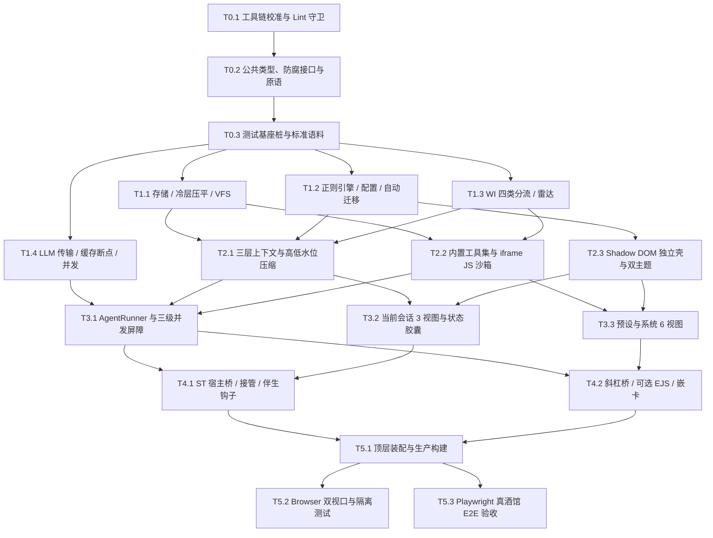

# ST-Agentic 多 Agent 并行实施任务进度文档

本文档为 [ARCHITECTURE.md](./ARCHITECTURE.md) 的工程落地排期与多 Agent 协作调度板。每个任务卡均设计为**可直接拷贝作为并行 Worker 派发 Brief** 的独立工作单元，严格遵循“先契约后扇出 + 目录独占锁 + 门禁合并”机制。

---

## 1. 多 Agent 并行协作协议（Parallel Orchestration Protocol）

1. **先契约后扇出（Contract-First Fan-Out）**
   - **Wave 0** 必须先由单先导 Agent（或协调者本人）串行完成并合入主分支，冻结全部公共类型（`src/core/types/`）、防腐层接口（`src/core/bridge/`）、ESLint 隔离规则以及测试桩（`tests/mocks/`）。
   - Wave 0 门禁通过后，再按波次 **Wave 1 → Wave 2 → Wave 3 → Wave 4 → Wave 5** 扇出并行。

2. **目录独占锁（Strict Path Ownership）**
   - 同一波次（Wave）内并行的所有 Worker 拥有**完全不相交的独占写目录（Owned Paths）**。
   - Worker **严禁修改**归属任务卡 `Owned Paths` 之外的任何文件——尤其是全局配置文件（`package.json`、`tsconfig.json`、`webpack.config.js`、`manifest.json`）以及已冻结的契约目录（`src/core/types/**`、`src/core/bridge/**`）。
   - 若在实施过程中发现公共类型或接口确实需要补充字段，Worker 应停止猜测并向 **Coordinator（协调者）** 提交结构化变更说明，由 Coordinator 统一更新契约或顺延处理。

3. **防进度表合并冲突规则（Single-Writer Tracking）**
   - 并行 Worker **不得**在各自工作树中修改本进度文档 `docs/TASKS.md`。
   - 仅由 **Coordinator** 在每个任务通过门禁验收并合入后，统一将本表对应行从 `[ ]` / `[~]` 更新为 `[x]`，并记录完成备注。

4. **统一合入门禁（Merge Gate）**
   - 任何任务提交验收前，必须在其独占工作区跑通以下命令且零错误：
     - `npm run typecheck`
     - `npm run lint`
     - 对应任务的隔离单测命令（如 `npx vitest run tests/unit/<module>`）
   - 代码审查同时核验四大架构红线：
     1. `src/core/**` 严禁出现 `@st/*`、`window`、`document` 或 jQuery 依赖；
     2. 持久上下文组装严禁出现破坏 Prefix KV Cache 的历史中间修改；
     3. UI 层严禁替代原生 `#chat .mes` DOM，控制台必须封装在 `<dialog>` Shadow DOM 内且默认 Dark 主题并符合移动端 `< 768px` 规范；
     4. 状态写入与异步任务必须绑定 `(messageId, swipeId)` 因果分支坐标。

---

## 2. 全局进度总览看板与依赖拓扑

**状态图例**：`[ ]` 待开始 · `[~]` 进行中 · `[x]` 已完成（已合并通过门禁） · `[!]` 阻塞待协调

### 2.1 任务总览矩阵（共 18 个原子任务包）

| 任务 ID | 任务名称 | 波次 | 轨道 | 前置依赖 | 独占写路径（Owned Paths）摘要 | 状态 |
| :--- | :--- | :---: | :---: | :--- | :--- | :---: |
| **T0.1** | 工具链校准与防腐层 Lint 守卫 | Wave 0 | Serial | 无 | `package.json`, `tsconfig.json`, `vitest.config.ts`, `.eslintrc.cjs`, `manifest.json` | `[x]` |
| **T0.2** | 核心领域类型、防腐接口与基础原语 | Wave 0 | Serial | T0.1 | `src/core/types/**`, `src/core/bridge/**`, `src/core/utils/**`, `tests/unit/utils/**` | `[x]` |
| **T0.3** | 测试基座桩模块与标准测试语料 | Wave 0 | Serial | T0.2 | `tests/mocks/**`, `tests/fixtures/**` | `[x]` |
| **T1.1** | 分层数据存储、冷层压平与 VFS 引擎 | Wave 1 | Track A | T0.3 | `src/core/store/**`, `src/core/vfs/**`, `tests/unit/store/**`, `tests/unit/vfs/**` | `[x]` |
| **T1.2** | 自研正则引擎、配置状态与自动迁移 | Wave 1 | Track B | T0.3 | `src/core/regex/**`, `src/core/migration/**`, `src/core/config/**`, `tests/unit/regex/**`, `tests/unit/migration/**` | `[x]` |
| **T1.3** | WI 装饰器解析、四类分流与尾部雷达 | Wave 1 | Track C | T0.3 | `src/core/lore/**`, `tests/unit/lore/**` | `[x]` |
| **T1.4** | LLM 传输、SSE 解析、缓存断点与限流 | Wave 1 | Track D | T0.3 | `src/core/llm/**`, `tests/unit/llm/**` | `[x]` |
| **T2.1** | 三层上下文组装、持久轨与高低水位压缩 | Wave 2 | Track A | T1.1, T1.2, T1.3 | `src/core/context/**`, `tests/unit/context/**` | `[ ]` |
| **T2.2** | 内置工具集、斜杠包装模型与 JS 沙箱 | Wave 2 | Track B | T1.1, T1.3 | `src/core/tools/**`, `src/sandbox/**`, `tests/unit/tools/**`, `tests/browser/sandbox/**` | `[ ]` |
| **T2.3** | Shadow DOM 独立 `<dialog>` 壳与双主题 | Wave 2 | Track C | T1.2 | `src/ui/shell/**`, `src/ui/components/**`, `src/ui/store/**`, `src/ui/dev-preview.tsx` | `[ ]` |
| **T3.1** | AgentRunner、四阶段管线与三级屏障 | Wave 3 | Track A | T1.4, T2.1, T2.2 | `src/core/agents/**`, `src/core/triggers/**`, `src/core/logger/**`, `tests/unit/agents/**`, `tests/unit/triggers/**` | `[ ]` |
| **T3.2** | 「当前会话」3 视图与 `<agentic-capsule>` | Wave 3 | Track B | T2.1, T2.3 | `src/ui/session/**`, `src/ui/capsule/**` | `[ ]` |
| **T3.3** | 「预设与系统」6 视图与迁移/嵌卡弹窗 | Wave 3 | Track C | T2.2, T2.3 | `src/ui/studio/**` | `[ ]` |
| **T4.1** | ST 宿主桥、三档模式、接管与流式上屏 | Wave 4 | Track A | T3.1, T3.2 | `src/host/st-bridge.ts`, `src/host/interceptor.ts`, `src/host/companion-hooks.ts`, `src/host/stream-renderer.ts` | `[ ]` |
| **T4.2** | 斜杠桥、可选 EJS、嵌卡与多语言 | Wave 4 | Track B | T3.1, T3.3 | `src/host/slash-bridge.ts`, `src/host/ejs-adapter.ts`, `src/host/embed-card.ts`, `locales/**` | `[ ]` |
| **T5.1** | 顶层装配入口、公开 API 与生产构建 | Wave 5a | Track A | T4.1, T4.2 | `src/index.ts`, `src/globals.d.ts`, `style.css` | `[ ]` |
| **T5.2** | 浏览器沙箱隔离与双视口 UI 契约测试 | Wave 5b | Track B | T3.2, T3.3, T5.1 | `tests/browser/ui/**` | `[ ]` |
| **T5.3** | 真酒馆 + Mock SSE 端到端黄金路径验收 | Wave 5b | Track C | T5.1 | `tests/e2e/**` | `[ ]` |

### 2.2 依赖拓扑图（DAG）

---

## 3. 分波次原子任务卡明细

---

### Wave 0：工程校准与公共契约冻结（串行先导）

#### T0.1 — 工具链校准与防腐层 Lint 守卫
- **关联架构**：[ARCHITECTURE.md §2.1](./ARCHITECTURE.md#L43-L88)
- **前置依赖**：无
- **独占写路径**：`manifest.json`、`package.json`、`tsconfig.json`、`vitest.config.ts`、`.eslintrc.cjs`
- **实施细目**：
  1. 核对 `manifest.json`（确认 `display_name: "Agentic"`、`generate_interceptor: "Agentic_interceptor"` 与入口资源声明完整）。
  2. 校准 `vitest.config.ts`：`include` 扩展为 `['tests/**/*.test.{ts,tsx}']`，确保支持 Preact TSX 组件测试与 `@` 别名。
  3. 校准 `tsconfig.json`：`include` 纳入 `tests/**/*.ts` 与 `tests/**/*.tsx`（或配合独立 `tsconfig.test.json`）并配置 `vitest/globals` 类型支持；保持 strict 模式不放宽。
  4. 完善 `package.json` 脚本：补充 `dev:ui`、`test:unit`、`test:browser`、`test:e2e` 脚本入口（按需检查浏览器/E2E 依赖准备策略）。
  5. 强化 `.eslintrc.cjs`：针对 `src/core/**/*` 添加 `overrides` 与 `no-restricted-imports` / `no-restricted-globals` 规则，**在静态检查期即阻断任何 `@st/*`、`window`、`document`、`$` 或 `jQuery` 的意外引入**。
- **验收门禁**：
  - `npm run typecheck && npm run lint && npm run build` 零错误通过。

#### T0.2 — 核心领域类型、防腐接口与基础原语冻结
- **关联架构**：[ARCHITECTURE.md §2.2, §4.2, §5.1, §7, §8.1](./ARCHITECTURE.md#L90-L159)
- **前置依赖**：`T0.1`
- **独占写路径**：`src/core/types/**`、`src/core/bridge/**`、`src/core/utils/**`、`tests/unit/utils/**`
- **只读参考**：`../ST-CustomGeneration/src/utils/defines.ts`（字段兼容参照）
- **实施细目**：
  1. 定义并导出全系统冻结类型（`src/core/types/`）：
     - 基础与消息：`MessageTarget`、`ChatMessageSnapshot`、`MediaAttachment`、`CanonicalMessage`、`CanonicalToolSchema`、`RawLoreEntry`。
     - 设置与预设：`RunMode` (`'off' | 'companion' | 'takeover'`)、`ThemeMode` (`'dark' | 'light' | 'auto'`)、`CapsulePosition` (`'top' | 'bottom'`)、`ApiConnection`、`CachePolicy`、`PromptBlock`、`AgentProfile`、`TriggerRule`、`RegexRule`、`CustomToolConfig`、`Preset`、`StorageSettings`、`Settings`。
     - 日志与执行态：`AgentRunTrace`、`ToolStepLog`、`GenerationEventPayload`。
  2. 冻结防腐抽象接口（`src/core/bridge/`）：`HostBridge`、`LLMTransport`、`LLMRequest`、`LLMResponse`、`LLMStreamChunk`、`ToolExecutionContext`。
  3. 实现零宿主依赖基础原语（`src/core/utils/`）：
     - `canonicalStringify(obj)`：按键名递归字典序稳定序列化 JSON（保证 Tool Schema 与对象前缀逐字节一致）；
     - `xxhash.ts`：封装 `xxhash-wasm` 异步初始化与同步哈希计算接口；
     - `glob.ts`：纯 TS 轻量路径匹配与规范化工具（供 VFS 与 `ScopedToolGuard` 共享）。
- **验收门禁**：
  - `npm run typecheck && npm run lint` 通过；
  - `npx vitest run tests/unit/utils/` 验证 `canonicalStringify` 键序无关稳定性与 `xxhash` 一致性通过。

#### T0.3 — 测试基座桩模块与标准测试语料
- **关联架构**：[ARCHITECTURE.md §10.1](./ARCHITECTURE.md#L632-L640)
- **前置依赖**：`T0.2`
- **独占写路径**：`tests/mocks/**`、`tests/fixtures/**`
- **只读依赖**：`src/core/types/**`、`src/core/bridge/**`
- **实施细目**：
  1. 实现 `tests/mocks/memory-host-bridge.ts`：全内存 `HostBridge`（内置内存聊天数组、metadata、角色/人设、WI 列表、宏替换模拟、可选 EJS 桩及真实 `xxhash-wasm` 哈希）。
  2. 实现 `tests/mocks/scripted-llm.ts`：可按轮次剧本回放流式分片、Tool Calls、`cached_tokens` 统计与可控异常报错的 `ScriptedLLMTransport`。
  3. 实现 `tests/mocks/assertions.ts`：包含 **`assertAppendOnlyPrefix(prevReq, nextReq)`** 看门狗（逐字节比较 `tools` 与 `messages[0..prevLen-1]`）和可控异步闸门 **`DeferredGate`**（用于并发屏障竞态测试）。
  4. 构建 `tests/fixtures/` 标准脱敏测试语料：空壳中文大卡 WI 集合、含变量动态分支的 EJS 条目、旧版 `ST-CustomGeneration` 导出配置 JSON、传统 ST 预设 JSON（含内置槽位与 `@D4`/`@D0` 注入）。
- **验收门禁**：
  - `npm run typecheck && npm run lint && npm test` 通过（包含桩模块自检用例）。

---

### Wave 1：底层纯逻辑基础模块（4 轨完全并行）

> **并行前提**：Wave 0 已合入；Track A / B / C / D 的写路径**零重叠**，可同时派发 4 个 Worker。

#### T1.1 [Track A] — 分层数据存储、冷层压平与 VFS 虚拟文件系统
- **关联架构**：[ARCHITECTURE.md §4.1, §9.2③](./ARCHITECTURE.md#L231-L246)
- **前置依赖**：`T0.3`
- **独占写路径**：`src/core/store/**`、`src/core/vfs/**`、`tests/unit/store/**`、`tests/unit/vfs/**`
- **只读依赖**：`src/core/types/**`、`src/core/bridge/**`、`src/core/utils/**`、`tests/mocks/**`
- **只读参考**：`../ST-CustomGeneration/src/functions/chat-data-store.ts`、`data-compaction.ts`、`filesystem.ts`、`fs-mounts.ts`、`fs-scopes.ts`、`fs-worldinfo.ts`
- **实施细目**：
  1. 迁移并纯化 `ChatDataStore`（面向 `HostBridge` 脱离 `@st/*`）：支持 `(messageId, swipeId)` 精确层写入、`pending` 暂存与原子 `commitStagedData` / `rollbackStagedData`、删除墓碑 `deleted`、以及对旧版 `cg_data` / `wi_overrides` / `mes_override` 的只读兼容解析。
  2. 实现存档冷层物理压平器 `data-compaction.ts`：支持 `dryRun` 估算释放字节数与层数、安全保留热窗口 `keepDepth`、压平冷分支释放 `.jsonl` 体积。
  3. 实现全拓扑 VFS 与权限守卫：挂载 `/`、`global`、`persona`、`character`、`lorebooks`（支持读取钩子注入）、`skills`、`preset`、`state/variables.json`、`history`；集成 `minisearch` 排序检索与 `ScopedToolGuard`（对 `read` / `write` Glob 白名单强制拦截）。
- **验收门禁**：
  - `npm run typecheck && npm run lint`；
  - `npx vitest run tests/unit/store/ tests/unit/vfs/` 全绿（覆盖 Swipe 分支隔离、冷层压平无损性与 Glob 权限越权拦截）。

#### T1.2 [Track B] — 自研正则引擎、配置状态归一化与自动迁移器
- **关联架构**：[ARCHITECTURE.md §7.1, §7.2, §7.3, §7.5](./ARCHITECTURE.md#L466-L533)
- **前置依赖**：`T0.3`
- **独占写路径**：`src/core/regex/**`、`src/core/migration/**`、`src/core/config/**`、`tests/unit/regex/**`、`tests/unit/migration/**`
- **只读依赖**：`src/core/types/**`、`src/core/bridge/**`、`tests/mocks/**`、`tests/fixtures/**`
- **只读参考**：`../ST-CustomGeneration/src/ui/state.ts`、`src/utils/compatibility.ts`
- **实施细目**：
  1. 实现自研独立正则管线 `src/core/regex/`：支持 `/pattern/flags` 与纯文本解析、捕获组替换、按阶段（`display` / `ingest` / `lore_read`）与发送方过滤执行（零依赖 ST 宿主正则模块）。
  2. 实现 `src/core/config/`：默认 `Settings` 与默认 `Preset`（含默认主叙事 Agent 与常用连接占位）、结构归一化（`normalizeSettings` / `normalizePreset`）及导出脱敏（强制剥离 `apiKey`）。
  3. 实现 `src/core/migration/`：
     - 旧版 `ST-CustomGeneration` 自动单向无损迁移（`ApiSettings`、`Preset.prompts`、`Template` 拆解为 `AgentProfile + TriggerRule`、`RegEx` 阶段映射、`interceptGenerate -> runMode`）；
     - 传统 ST OpenAI 预设部分兼容导入器（保留相对位置与 `@D0` 积木，**忽略内置槽位与 `@D >= 1` 深度注入**并输出结构化跳过报告）。
- **验收门禁**：
  - `npm run typecheck && npm run lint`；
  - `npx vitest run tests/unit/regex/ tests/unit/migration/` 全绿（验证传统 ST 预设深度忽略报告与旧版配置无损映射）。

#### T1.3 [Track C] — WI 装饰器解析、中文卡四类分流与脏检查尾部雷达
- **关联架构**：[ARCHITECTURE.md §4.2, §4.3, §4.4, §5.3](./ARCHITECTURE.md#L249-L291)
- **前置依赖**：`T0.3`
- **独占写路径**：`src/core/lore/**`、`tests/unit/lore/**`
- **只读依赖**：`src/core/types/**`、`src/core/bridge/**`、`src/core/utils/**`、`tests/mocks/**`、`tests/fixtures/**`
- **只读参考**：`../ST-CustomGeneration/src/functions/worldinfo.ts`
- **实施细目**：
  1. 实现 `DecoratorParser`：支持原版全部 `@@` 装饰器及新增 `@@trigger`（含键值参数）、`@@tool`、`@@script`、`@@group`、`@@system`。
  2. 实现 **WI 四类语义分流器（`WIClassifier`）**：识别 `system_rule`、`core_manifest`、`on_demand_archive`、`dynamic_or_trigger`，支持检测空壳角色卡自动生成补偿提示，并支持叠加预设级 `wiRouterOverrides` 手动纠偏。
  3. 实现 **读取时沙箱渲染与 `Read-Set` 脏检查雷达**：
     - 读取条目时按序叠加 `worldinfo` 覆写 → `HostBridge.substituteMacros` → 可选 `evaluateOptionalEjs` → `lore_read` 正则回调；
     - 雷达按关键词/正则扫描最新输入，比对 `Read-Set: Map<path, xxHash>`：未读则进候选列表，已读且哈希一致则静默，已读但哈希变化则标记 `[已更新]`；实施 Top-K 限流（默认 `K=5`）与防诱导 `<lore-hint>` 组装。
- **验收门禁**：
  - `npm run typecheck && npm run lint`；
  - `npx vitest run tests/unit/lore/` 全绿（覆盖空壳卡四类分流、EJS 条件分支改变触发 `xxHash` 脏检查重读）。

#### T1.4 [Track D] — LLM 传输层、流式解析、跨厂商缓存断点与并发池
- **关联架构**：[ARCHITECTURE.md §3.3](./ARCHITECTURE.md#L223-L226)
- **前置依赖**：`T0.3`
- **独占写路径**：`src/core/llm/**`、`tests/unit/llm/**`
- **只读依赖**：`src/core/types/**`、`src/core/bridge/**`、`src/core/utils/**`
- **只读参考**：`../ST-CustomGeneration/src/functions/generate.ts`、`src/utils/retries.ts`、`src/utils/concurrency-limiter.ts`
- **实施细目**：
  1. 实现 `FetchLLMTransport`（`LLMTransport` 真实 HTTP/SSE 实现）：支持自定义 Request Headers/Body、Exclude Keys、OpenAI 与 Anthropic 格式适配。
  2. 实现 SSE 增量流式解析器：正确拼装分片文本、`reasoning_content` / `<think>` 块、多工具增量 `tool_calls`、Gemini `thoughtSignature` 与响应 `usage.cached_tokens`。
  3. 实现 `CachePolicy` Payload 编译器：`auto_prefix` 模式保障严格稳定键序；`anthropic_explicit` 模式在 `Layer 0` 末尾及 `cacheBreakpoints` 处自动放置 `cache_control: { type: "ephemeral" }`（不超过厂商断点上限）。
  4. 实现 `ConcurrencyLimiter` 与支持 `AbortSignal` 的指数退避重试包装器。
- **验收门禁**：
  - `npm run typecheck && npm run lint`；
  - `npx vitest run tests/unit/llm/` 全绿（验证流式工具碎片拼装、断点上限控制与 `AbortSignal` 立即中止重试）。

---

### Wave 2：上下文压缩、工具沙箱与独立 UI 壳层（3 轨完全并行）

#### T2.1 [Track A] — 三层上下文组装器、持久分支轨迹与高低水位压缩
- **关联架构**：[ARCHITECTURE.md §3.1, §3.2, §10.1](./ARCHITECTURE.md#L166-L221)
- **前置依赖**：`T1.1`、`T1.2`、`T1.3`
- **独占写路径**：`src/core/context/**`、`tests/unit/context/**`
- **只读依赖**：`src/core/store/**`、`src/core/vfs/**`、`src/core/lore/**`、`src/core/regex/**`、`tests/mocks/**`
- **实施细目**：
  1. 实现 `TrajectoryStore`：为每个 `persistent` 线程维护不可变消息流及 `Map<"messageId#swipeId", BranchCheckpoint>`（同时快照对应的 `Read-Set`），支持 Swipe 切页回拨分支指针且前序前缀零变动。
  2. 实现 `ContextAssembler`：
     - **Layer 0**：字典序稳定 `tools` + 去耦合单人扮演底座 + 第 ① 类 `system_rule` + `Core Manifest`（含空壳卡提示）+ `prefix` 积木；
     - **Layer 1**：冻结轨迹，新消息入轨前执行 `ingest` 阶段正则清洗并永久固化；
     - **Layer 2**：当轮用户输入 + `<turn-brief>` + 动态短提醒 + `<lore-hint>` + `tail` 积木。
  3. 实现 `WatermarkCompactor`：跨高水位 `H` 时在单一原子批次内将最早完整回合切出归档为 `/history/chunk-NNN.md`、折叠保留区较早轮次的大体积只读 `tool_result`、从 `Read-Set` 剔除对应路径并降至低水位 `L`；实现「自建摘要衔接模式」与「兜底摘要提示」分支。
- **验收门禁**：
  - `npm run typecheck && npm run lint`；
  - `npx vitest run tests/unit/context/` 全绿——**必须包含使用 `assertAppendOnlyPrefix` 连续跑通 15 轮带工具调用、变量变动、雷达提示、显示覆写与压缩恢复后的逐字节前缀不变性看门狗测试**。

#### T2.2 [Track B] — 内置工具集、斜杠包装模型与分级 `iframe` JS 沙箱
- **关联架构**：[ARCHITECTURE.md §6](./ARCHITECTURE.md#L412-L462)
- **前置依赖**：`T1.1`、`T1.3`
- **独占写路径**：`src/core/tools/**`、`src/sandbox/**`、`tests/unit/tools/**`、`tests/browser/sandbox/**`
- **只读依赖**：`src/core/vfs/**`、`src/core/store/**`、`src/core/lore/**`、`src/core/bridge/**`、`tests/mocks/**`
- **只读参考**：`../ST-CustomGeneration/src/features/tools/**`、`src/utils/vm-browserify.ts`
- **实施细目**：
  1. 实现内置工具集与 `ToolRegistry`（全部以 Zod v4 定义严格参数并在调用前校验，失败返回结构化自愈错误文本）：
     - 文件与档案：`list_dir`、`glob_files`、`grep_search`、`search_files`、`read_file`、`write_file`、`edit_file`（走 `ScopedToolGuard`）；
     - 状态变量：`read_variables`、`patch_variables`（内嵌 `@@json_schema`/`@@zod_schema` 动态校验并在报错时明确指出出错字段路径）；
     - 归档与展示：`search_history`、`read_history`、`append_reply_view`、`replace_reply_view`、`attach_media`（严格锚定 `target: { messageId, swipeId }`）；
     - 零代码斜杠包装器：将 `CustomToolConfig (kind: 'slash_bridge')` 编译为带模板插值与参数校验的标准工具，调用 `HostBridge.executeSlashCommand`。
  2. 实现 `src/sandbox/`：
     - `js-sandbox.ts`：构建分级 `iframe` 沙箱（禁网 Schema 解析模式屏蔽 `fetch`/`XHR`/`parent`/`top`；自定义工具模式支持 `defineTool` 单工具与工具包数组导出，注入 `ctx.fs/vars/message/st/target/signal` 与 `z`/`_`，透传 `AbortSignal` 中断请求）；
     - `lifecycle.ts`：`SandboxLifecycleManager` 代理记账沙箱内定时器与事件监听，销毁/热重载时彻底清理防止泄漏。
- **验收门禁**：
  - `npm run typecheck && npm run lint`；
  - `npx vitest run tests/unit/tools/` 通过；`tests/browser/sandbox/` 在浏览器环境验证沙箱拦截与销毁回收（无头测试可用时纳入 Browser 套件跑通）。

#### T2.3 [Track C] — Shadow DOM 独立 `<dialog>` 应用壳、双主题与 `dev:ui` 预览
- **关联架构**：[ARCHITECTURE.md §9.1, §9.3](./ARCHITECTURE.md#L585-L630)
- **前置依赖**：`T1.2`
- **独占写路径**：`src/ui/shell/**`、`src/ui/components/**`、`src/ui/store/**`、`src/ui/dev-preview.tsx`
- **只读依赖**：`src/core/types/**`、`src/core/config/**`
- **设计参考**：[ui-prototype.html](../../../.gemini/antigravity/brain/7d87f203-d097-4b05-85e3-c47b37f557c2/ui-prototype.html)（以项目内 UI 规范与 [ARCHITECTURE.md §9](./ARCHITECTURE.md#L585-L630) 为准）
- **实施细目**：
  1. 实现 UI 状态管理与 Bridge 绑定 Store（`src/ui/store/`）：管理当前控制台开关状态、深链接定位参数（如从气泡跳转到某楼日志/文件 Diff）、三档 `runMode`、三档 `themeMode`（`'dark' | 'light' | 'auto'`，默认 `'dark'`）。
  2. 实现 `src/ui/shell/AgenticAppShell.tsx`：
     - 创建原生 `<dialog id="agentic-app">`（Top Layer）+ `attachShadow({ mode: 'open' })` + `:host { all: initial }`；
     - 编写自包含作用域样式表，定义 `:host([data-theme="dark"])` 与 `:host([data-theme="light"])` 两套语义变量（`'auto'` 下读取宿主 `--SmartThemeBlurTintColor` 感知亮度切换）；
     - 在 `<dialog>` 边界拦截 `keydown` / `keyup` 冒泡（`stopPropagation`），防方向键穿透至宿主触发 Swipe；
     - 顶栏集成模式快切、主连接/预设切换、深浅色切换与导入/嵌卡菜单入口。
  3. 实现 `src/ui/components/` 响应式基础组件库：内嵌矢量 SVG 图标集、`MasterDetailLayout`（桌面双栏 ↔ 移动端 `< 768px` 下的 `100vw × 100dvh` + `visualViewport` + `safe-area-inset` 单栏页面推入栈 + `history` 返回键拦截）、触控热区 `>= 40×40px` 按钮、表单 `>= 16px` 输入控件与移动端中文 IME 安全增强代码编辑区。
  4. 实现 `src/ui/dev-preview.tsx` 与独立预览 HTML（`dev:ui` 脱离酒馆直接用 Mock 数据启动控制台）。
- **验收门禁**：
  - `npm run typecheck && npm run lint && npm run build` 通过；确认 `dev:ui` 可独立构建挂载无报错。

---

### Wave 3：多 Agent 触发管线 & 控制台九大业务视图（3 轨完全并行）

#### T3.1 [Track A] — 多步 AgentRunner、装饰器编译、四阶段管线与三级并发屏障
- **关联架构**：[ARCHITECTURE.md §5](./ARCHITECTURE.md#L296-L408)
- **前置依赖**：`T1.4`、`T2.1`、`T2.2`
- **独占写路径**：`src/core/agents/**`、`src/core/triggers/**`、`src/core/logger/**`、`tests/unit/agents/**`、`tests/unit/triggers/**`
- **只读依赖**：`src/core/llm/**`、`src/core/context/**`、`src/core/tools/**`、`src/core/store/**`、`src/sandbox/**`、`tests/mocks/**`
- **实施细目**：
  1. 实现 `TraceLogger`（`src/core/logger/`）：环形缓存最近 100 次运行的完整轨迹（轮次/楼层、阶段、工具步骤、耗时、`input/cached/output` Tokens 与实时事件订阅推送）。
  2. 实现 `AgentRunner`（`src/core/agents/`）：执行多轮 `LLMTransport` ↔ `ToolRegistry` 循环（支持流式文字/思考回调、`@@agent` 子智能体工具委托、工具报错轮内原地自愈与 `maxToolRounds` 护栏）。
  3. 实现原版 `@@` 装饰器编译器与四阶段管线调度器（`src/core/triggers/`）：
     - 将旧 `@@replace*` / `@@variables*` / `@@append_output*` / `@@replace_output*` / `@@evaluate_ejs*` 无损编译为受限赋权 `TriggerRule` 或 0 Token 脚本任务；支持新 `@@trigger` / `@@script` / `@@group`；
     - 落实默认 `1 Trigger = 1 独立 Run` 与显式 `@@group` 合并机制；
     - 实现 **三级并发屏障调度器（`BarrierCoordinator`）**：`'turn'`（下轮发送前自动 `await`）、`'self'`（同 Agent/写入目标 FIFO 串行，不挡主聊）、`'none'`（独立楼层 `AbortController` 彻底脱离）；严格冻结 `target: { messageId, swipeId }` 防串楼，精确响应针对特定楼层/页的 Swipe 与中止取消信号。
- **验收门禁**：
  - `npm run typecheck && npm run lint`；
  - `npx vitest run tests/unit/agents/ tests/unit/triggers/` 全绿（使用 `DeferredGate` 跑通 `turn` / `self` / `none` 时序竞态、旧工具错误自愈、以及 Swipe/Stop 分支回滚测试）。

#### T3.2 [Track B] — 控制台「当前会话」3 视图与宿主无侵入微组件 `<agentic-capsule>`
- **关联架构**：[ARCHITECTURE.md §8.3, §9.2①②③](./ARCHITECTURE.md#L568-L618)
- **前置依赖**：`T2.1`、`T2.3`
- **独占写路径**：`src/ui/session/**`、`src/ui/capsule/**`
- **只读依赖**：`src/ui/shell/**`、`src/ui/components/**`、`src/ui/store/**`、`src/core/store/**`、`src/core/vfs/**`、`src/core/context/**`
- **实施细目**：
  1. 实现 `src/ui/session/` 三个一级视图：
     - **① 文件与内容覆盖 (`FilesOverridesView`)**：过滤工作区 / 变量 / `worldinfo` / `message`，原位编辑、`diff` 库高亮对比原书与当前层、保存覆写与删除恢复；
     - **② 生成与工具日志 (`LogsView`)**：支持按楼层过滤、步骤树、Token/缓存命中率卡片、复制原始 `messages`/`tool_calls` JSON；
     - **③ 缓存水位与存档压平 (`CacheStorageView`)**：上下文高低水位条与 `[立即分块归档]` + `ChatDataStore` 冷层体积估算、`[预览压平]` 与 `[立即压平]` 操作。
  2. 实现 `src/ui/capsule/` 宿主无侵入轻入口组件：
     - `<agentic-capsule>` Shadow DOM 自定义元素（绝不改 `.mes_text`，支持正文上方/下方配置与完后保留/自动隐藏配置，单行截断适配移动端，独立 `[×]` 取消在途后台任务，点击本体定位打开控制台对应楼层）；
     - `#extensions_settings` 极简状态卡组件（三档模式切换 + 预设选择 + `[打开控制台]`）；
     - `#extensionsMenu` 魔棒菜单条目工厂（直达①、直达②、`重新运行后置触发`）。
- **验收门禁**：
  - `npm run typecheck && npm run lint` 通过；可在 `dev:ui` 预览中点通 3 个视图与状态胶囊交互。

#### T3.3 [Track C] — 控制台「预设与系统」6 视图与导入/迁移/嵌卡面板
- **关联架构**：[ARCHITECTURE.md §7, §9.2④-⑨](./ARCHITECTURE.md#L466-L622)
- **前置依赖**：`T2.2`、`T2.3`
- **独占写路径**：`src/ui/studio/**`
- **只读依赖**：`src/ui/shell/**`、`src/ui/components/**`、`src/ui/store/**`、`src/core/config/**`、`src/core/migration/**`、`src/core/regex/**`、`src/core/lore/**`、`src/core/tools/**`
- **实施细目**：
  1. 实现 `src/ui/studio/` 六个一级视图：
     - **④ 智能体 (`AgentsView`)**：连接继承/副连接选择、`persistent`/`ephemeral` 切换、`promptBlocks`（`Prefix`/`Tail` 开关、`[↑][↓]` 显式排序、原位编辑）、工具勾选与 VFS 白名单、水位阈值；
     - **⑤ 触发管线 (`PipelineView`)**：四阶段泳道展示预设与扫描到的世界书 `@@` 条目，调整 `order`/`tag`/`barrier`/`@@group`；
     - **⑥ 工具与脚本 (`ToolsView`)**：内置工具、斜杠命令包装表单、`defineTool`/`@@script` 代码编辑区及 **`[▶ 沙箱模拟调用测试]`** 面板；
     - **⑦ 正则清洗 (`RegexView`)**：管理三阶段 `RegexRule`，内建**防失焦局部刷新的实时正则替换对比测试区**；
     - **⑧ 世界书路由 (`WIRouterView`)**：`/preset/*` 文件上传/编辑管理 + 中文卡 WI 四类分流预览与手动下拉纠偏；
     - **⑨ API 连接 (`ConnectionsView`)**：多连接 CRUD、Header/Body YAML、并发上限、`cachePolicy` 策略、`linkedPreset` 与连通性测试。
  2. 实现顶栏预设 CRUD、导入旧版/传统 ST 预设（带跳过项摘要报告）与角色卡 PNG 嵌入触发对话框（在 Shadow DOM 内）。
- **验收门禁**：
  - `npm run typecheck && npm run lint` 通过；可在 `dev:ui` 预览中点通 6 个视图及导入迁移弹窗。

---

### Wave 4：SillyTavern 宿主薄适配层接线（2 轨并行）

#### T4.1 [Track A] — ST 宿主桥、三档运行模式、主生成接管与流式上屏
- **关联架构**：[ARCHITECTURE.md §2.2, §8](./ARCHITECTURE.md#L114-L144)
- **前置依赖**：`T3.1`、`T3.2`
- **独占写路径**：`src/host/st-bridge.ts`、`src/host/interceptor.ts`、`src/host/companion-hooks.ts`、`src/host/stream-renderer.ts`
- **只读依赖**：`src/core/**`、`src/ui/capsule/**`、`src/ui/store/**`
- **只读参考**：`../ST-CustomGeneration/src/features/interceptor.ts`、`global-context.ts`、`trigger-manager.ts`
- **实施细目**：
  1. 实现 `STHostBridge`（`src/host/st-bridge.ts`）：完整实现 `HostBridge`，对接酒馆 `chat`、`chat_metadata`、`characters`、`power_user`、世界书加载、宏引擎、消息附件与刷新。
  2. 实现 `companion-hooks.ts`：实现 `'companion'` 伴生模式的 4 个钩子桥接（`GENERATION_AFTER_COMMANDS` 等候与 `before_turn`、`WORLDINFO_ENTRIES_LOADED` 净化控制装饰器与注入覆写、注册 `{{file::path}}` 宏、`CHARACTER_MESSAGE_RENDERED` 挂载胶囊并派发 `after_turn`）。
  3. 实现 `interceptor.ts` & `stream-renderer.ts`：注册 `Agentic_interceptor` 处理 `'takeover'` 模式下单聊 `normal`/`swipe`/`regenerate`/`continue`（放行 `quiet` 与群聊，短路前置冗余原生 WI 扫描，托管发送/停止按钮消除闪跳）；100% 保留原生 `#chat .mes` DOM 并通过 `rAF` 节流刷新 `.mes_text`（含 `<think>` 折叠与 `display` 正则），落盘时精准提交并局部挂载 `<agentic-capsule>`，支持两段式 `#mes_stop` 中断。
- **验收门禁**：
  - `npm run typecheck && npm run lint`（仅 `src/host/**` 允许引 `@st/*`）。

#### T4.2 [Track B] — 斜杠命令桥、可选 EJS 适配器、角色卡 PNG 嵌入与多语言
- **关联架构**：[ARCHITECTURE.md §6, §7.4, §7.5](./ARCHITECTURE.md#L444-L532)
- **前置依赖**：`T3.1`、`T3.3`
- **独占写路径**：`src/host/slash-bridge.ts`、`src/host/ejs-adapter.ts`、`src/host/embed-card.ts`、`locales/**`
- **只读依赖**：`src/core/**`、`src/ui/store/**`
- **只读参考**：`../ST-CustomGeneration/src/embed-card.ts`、`src/utils/ejs.ts`
- **实施细目**：
  1. 实现 `slash-bridge.ts`：安全桥接酒馆斜杠命令执行，并支持 `AbortSignal` 传入/状态反馈。
  2. 实现 `ejs-adapter.ts`：纯可选探测 `globalThis.EjsTemplate`，存在时接入旧卡 WI 读取求值与 `@@*_ejs` 兼容；未安装时静默返回降级，零报错无强依赖。
  3. 实现 `embed-card.ts`：在 `#char-management-dropdown` 注入关联预设/文件、导入预设/文件四项；写入时同步 live `character`、`character.json_data`、`#form_create [name=json_data]` 三处镜像；新写入 `agentic_embed_*` 并双读兼容 `cg_embed_*` 自动迁移弹窗。
  4. 完善 `locales/zh-cn.json` 与 `locales/zh-tw.json` 多语言文案（覆盖宿主菜单与控制台文案）。
- **验收门禁**：
  - `npm run typecheck && npm run lint`；JSON 多语言文件解析校验合法。

---

### Wave 5：顶层装配、浏览器隔离契约测试与真机 E2E 验收

#### T5.1 — 顶层启动序列装配、公开脚本 API 与生产包构建
- **关联架构**：[ARCHITECTURE.md §2.1](./ARCHITECTURE.md#L45-L88)
- **前置依赖**：`T4.1`、`T4.2`
- **独占写路径**：`src/index.ts`、`src/globals.d.ts`、`style.css`
- **只读依赖**：所有 `src/**` 模块
- **实施细目**：
  1. 在 `src/index.ts` 严格按顺序完成扩展装配：初始化宿主桥与设置（含首次启动自动检测迁移 `extension_settings.CustomGeneration`）→ 注册存储/VFS/日志/工具/沙箱/正则引擎 → 挂载拦截器与伴生钩子 → 挂载角色卡嵌入与宿主快捷入口及 `<dialog id="agentic-app">` → 暴露 `globalThis.Agentic` 公开 API。
  2. 核查 `style.css` 仅保留酒馆宿主页几行无副作用的定位占位样式，主体界面样式全部收口在 Shadow DOM 内；运行 `npm run build` 检查 `dist/index.js` 及 source map。
- **验收门禁**：
  - `npm run typecheck && npm run lint && npm test && npm run build` 全部通过。

#### T5.2 — Layer 2 浏览器沙箱与双视口 / Shadow DOM 隔离验收测试
- **关联架构**：[ARCHITECTURE.md §9.1, §9.3, §10.1](./ARCHITECTURE.md#L588-L640)
- **前置依赖**：`T3.2`、`T3.3`、`T5.1`
- **独占写路径**：`tests/browser/ui/**`
- **实施细目**：
  1. 在无头 Chromium 中挂载 `<dialog id="agentic-app">` 与 `<agentic-capsule>`，注入刻意破坏性的宿主全局样式（如 `input, textarea, button { width: 10px !important; background: red !important; }`），断言 Shadow DOM 内计算样式完全不受污染。
  2. 在控制台输入框内派发左右方向键 `keydown` 事件，断言事件不会冒泡到 `document` 触发酒馆外部监听。
  3. 分别在桌面（`1280×800`）与移动端（`390×844`）遍历全部 9 个视图，断言无横向溢出（`scrollWidth <= clientWidth`）、移动端推入栈 `[← 返回列表]` 正常回退、交互热区 `>= 40×40px` 且输入控件字号 `>= 16px`。
- **验收门禁**：
  - `npm run test:browser` 全绿。

#### T5.3 — Layer 3 真酒馆 + Mock OpenAI SSE 端到端黄金路径验收
- **关联架构**：[ARCHITECTURE.md §10.1](./ARCHITECTURE.md#L632-L640)
- **前置依赖**：`T5.1`
- **独占写路径**：`tests/e2e/**`
- **实施细目**：
  1. 在 `tests/e2e/mock-sse-server.ts` 实现轻量本地 Mock OpenAI SSE Server（支持剧本化流式 `tool_calls`、思考块、正文分片与 `cached_tokens` 统计）。
  2. 基于 Playwright 连接真实 SillyTavern 实例验证 5 条黄金路径：
     - 路径 1：`takeover` 模式下正常发送 → 0ms 原生 `.mes` 上屏 → `<agentic-capsule>` 胶囊进度刷新 → 工具调用后正文流式落盘 → 后台异步写入不锁主输入框；
     - 路径 2：Swipe 切换与 Regenerate 重生成后分支数据、变量 Diff 与 DOM 正确切换；
     - 路径 3：主生成中途点击 `#mes_stop` 干净停止且发送按钮不锁死；
     - 路径 4：`390×844` 手机视口打开魔棒菜单或胶囊进入独立控制台修改配置并持久化生效；
     - 路径 5：`companion` 伴生模式与 `/gen` (`quiet`)、群聊正常放行原生管线运行。
- **验收门禁**：
  - `npm run test:e2e` 5 条黄金路径全绿；至此全部 Milestone 交付完成。
